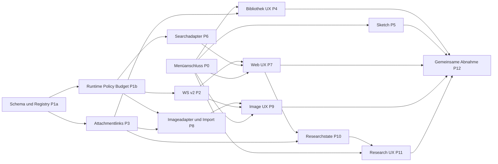

# Plus-Menü: Bestandszuordnung, UX und PR-Roadmap

Status: technische Planung mit begonnener Implementierung von P1a; keine neue Produktfunktion aktiviert. Stand: 2026-10-12. Aktueller Implementierungsstand und lokale Testergebnisse: [Tool-Grundlage P1a](TOOL-FOUNDATION.md). P1b folgt als separater PR erst nach Merge von P1a auf aktualisiertem `main`.

Quellstände: noris `4024c0eea62965bd161c8fccc36bc81141535d47`; Codexreferenz `a9b0815167c27ab13719dd12d13b63e02b70d221`. Die [Tool-Architektur](TOOL-ARCHITECTURE.md) enthält Audit, Komponenten-/Endpoint-/Testkarte, Codexstudie, gemeinsame Verträge, Security und Betriebsgrenzen.

## 1. Dokumente und Phasenabdeckung

| Phase der Aufgabe | Reviewartefakt |
| --- | --- |
| A Bestandsanalyse | [Komponentenkarte und tatsächlich vorhandene Verträge](TOOL-ARCHITECTURE.md#2-konkrete-komponentenkarte-des-bestands) mit Backend-/Frontend-/Testpfaden und DBinvarianten |
| B Codex | [Commitfixierte Architekturstudie](TOOL-ARCHITECTURE.md#3-codex-architekturstudie-verifizierte-konzepte), übertragbare Entscheidungen und begründete Nichtübernahme von Rust |
| C Zielarchitektur | [FastAPI-Module, Ausführung, Persistenz, Berechtigungen, Budget und WS-v2](TOOL-ARCHITECTURE.md#4-fastapi-zielarchitektur) |
| D fünf Funktionskonzepte | [Websuche](WEB-SEARCH-DESIGN.md), [Bibliothek](FILE-LIBRARY-DESIGN.md), [Bilderstellung](IMAGE-GENERATION-DESIGN.md), [Deep Research](DEEP-RESEARCH-DESIGN.md), [Skizzieren](SKETCH-DESIGN.md), jeweils alle zehn geforderten Konzeptpunkte |
| E UX | Gemeinsamer Vertrag in diesem Dokument und die jeweiligen Feature-UXabschnitte |
| F Umsetzung | Getrennte testbare PRs mit Vertrags-/Browser-/Sicherheitsgates unten |
| G Dokumentation/PR | Genau die sieben angeforderten Planungsdateien; Draft gegen main, kein Merge oder Deployment |

Das Arbeitsverzeichnis auf `feat/composer-plus-menu` enthält bereits uncommittete Menüarbeit. Dieser reine Dokumentationsbranch wurde in einem separaten Worktree von main erstellt und übernimmt weder Produktdateien noch vorhandene Screenshots/Tests. P0 ist ein **Integrationsgate für diese Arbeit**, keine konkurrierende Neuentwicklung des Composers.

## 2. Funktionszuordnung zum Bestand

| Funktion | Wiederverwendete UI/State | Wiederverwendeter Backendpfad | Tatsächlich neu |
| --- | --- | --- | --- |
| Websuche | Plusaktion `web`, bestehender Textentwurf/Versand, ChatTimeline/Markdown, Stop/Scroll | GenerationManager → Quellenvorstufe → vorhandene Kontext-/Gatewayadmission → Providertextstream; Repository/Replay | Searchprovider/Fetcher, Sources, ToolRun/Policy/Budget und Moduschip |
| Aus Bibliothek | Plusaktion `library`, Nuxtdialog, `useChatAttachments`, bestehende Attachmentkarten und Ensure/Draftübernahme | AttachmentService/-API, vorhandene Dateien/Parser/PDF/Imageinput; begin_generation | Ownerbibliotheksindex, Mehrfachbindings, Quota-/Retentionanpassung, Picker |
| Bild erstellen | Plusaktion `image`, bestehender Texteingabebereich, Bildvorschau/Download/Assistantkarte | Derselbe GenerationManager-/Repository-/Eventlebenszyklus, AttachmentService/Volume; Gateway nur bei tatsächlichen Textphasen | Geprüfter Imageprovider/katalog, Outputbindung, Costscope und mode-spezifische Admission |
| Deep Research | Plusaktion `research`, vorhandener Composer, Scope-/Quellendialog, Assistantbericht | Manager mit gateway-only Textphasen, DB/Replay/Cancel, dieselben Webtools/PDF/Textreferenzen | Durable Run-/Step-/Evidence-/Checkpointorchestrator und explizites Jobresume |
| Skizzieren | Plusaktion `sketch`, Nuxtdialog/Canvas → `attachments.add(File[])` | Bestehender PNGupload, Parser, private Speicherung, Preview und Visionpfad | Begrenzte lokale Canvascommands, Toolbar/Undo/Export; kein eigenes Remotetool nötig |

Alle Modi erhalten Modellkatalog/Freshness, Upload-/Textreferenz-/PDFgrenzen, Nachrichtenvarianten, Persistenz und Abbruch. Normale Chatv1/SSE/mock-Pfade bleiben vorhanden. Neue persistente Servertools sind zunächst nur im WebSocketmodus aktiviert; Zeichnen/Bibliothek verlangen ein funktionierendes Attachmentbackend. Keine funktionslosen serverlosen Simulationen als aktivierte Produktfunktion ausweisen.

## 3. Gemeinsamer UX-Vertrag

Das vorhandene Plus-/Dropdownpattern, seine Positionierung, Focus-/Esc-/Außenklicklogik, `UChatPrompt`, Autosize und mobile visualViewport-Anpassung bleiben erhalten. Alle Aktionen sind echte bestehende IDs/Handlers; Reihenfolge/Labels des integrierten Menüs werden weiterverwendet. Featureflags und Servercapabilities bestimmen die Verfügbarkeit.

Noch nicht implementierte oder nicht konfigurierte Funktionen sind ausgeblendet. Ein vorübergehend ausgefallener, bereits eingeführter Dienst kann mit zugänglicher Begründung deaktiviert bleiben. Kein Eintrag ohne Funktion darf ein klickbares Erfolgserlebnis vortäuschen. Übergangsweise vorhandene lokale Platzhalter werden bei P0 entsprechend bereinigt; dies ist geplanter Funktionsrollout, keine Änderung im Dokumentations-PR.

| Aktion | Ergebnis der Auswahl | Versand / zurück |
| --- | --- | --- |
| Upload | vorhandener nativer Filedialog | bestehender Uploadstatus und normaler Send/Stop |
| Bibliothek | Auswahl vorhandener Dateien | bestätigte IDs in denselben Attachmentstate; Abbruch erzeugt keinen Chat |
| Websuche | entfernbarer Webchip | nächster Versand verwendet Webvorstufe, danach normaler Modus |
| Bild erstellen | Bildchip und belegte Bildoptionen | nächster Versand erzeugt Bildjob; keine stille Übertragung vorhandener Dateien |
| Deep Research | Scope-/Umfangsdialog, Researchchip | Versand startet konkreten Run; Hintergrundscope ausdrücklich sichtbar |
| Skizzieren | lokale Zeichenfläche im Dialog | bestätigter PNGexport wird normaler Bildanhang |

`chat/web/image/research` sind exklusive Antwortmodi. Upload/Bibliothek/Sketch sind Anhängeaktionen und ersetzen keinen Textentwurf. Neue Modusmetadaten gehören additiv zu bestehendem draft_key; niemals global versehentlich zwischen Chats übernehmen. Beim Wechsel von `__new__` auf erstmals persistierten Chat Text und Mode synchron übertragen. Abgebrochene Dialoge behalten den ursprünglichen Text; Esc in Dialogen beendet nicht nebenbei einen Researchjob.

Desktop: existing Dropdownoverlay/Dialogs, kein Composerlayoutshift; Tool-/Quellenkarte in bestehender Timeline. Mobile: Sheet/Dialog in sichtbarem Viewport, Safe-Area, ≥44 px Touchziele, interne Listen-/Toolbarscrolls, kein horizontaler Overflow. Tastatur: Enter/Shift-Enter/IME unverändert, Focusreturn ohne Scrollsprung, Trap nur im offenen Modal, sichtbarer Fokus, beschriftete Icons und live-region für wesentliche Statusänderungen. Scroll folgt weiterhin der vorhandenen Leserposition, nicht jedem Toolprogress.

Die geprüfte Repositoryreferenz `docs/ui-reference/evidence/sanitized/reference-layout-redacted.png` zeigt den bestehenden Composer mit **geschlossenem** Plus-Menü. Sie wurde visuell geprüft. Ein Screenshot eines geöffneten ChatGPT-Menüs oder dessen fünf Funktionsdialogen liegt in diesem Auftrag nicht vor. Deshalb ist Bediennähe an Menü-/Composerpattern planbar, Pixelgleichheit/Referenzmaße dieser neuen Dialoge aber nicht belegt. Keine unbekannten ChatGPT-Maße erfinden; tatsächliche Designs im Feature-PR anhand synthetischer Desktop-/Mobile-Screenshots reviewen.

## 4. Reihenfolge und Dependencygraph

Die Bibliothek-/Sketchlinie kann nach Menü-/Attachmentgates unabhängig von Search-/Imageproviderkonten umgesetzt werden. Websearch ist vor Research abnehmbar. P1a/P1b sind der gemeinsame P1-Unterbau, auf den die Featuredocs verweisen. PRs enthalten nur ihre jeweilige nächste Ausbaustufe, keine vorgezogene unkontrollierte Aktivierung.

## 5. PR-Roadmap mit prüfbarem Scope

Jeder Implementierungs-PR aktualisiert relevante Plan-/Vertragsdokumente und enthält sinnvolle Unit- **und** Integrationstests für seine Verantwortlichkeit. Eine bestehende Suite kann Regressionabdeckung liefern; funktionsspezifische Fälle ergänzen sie. Relevante Playwrights sind verpflichtend, auch wenn im Backend-PR nur vorhandene Browserszenarien als Regressionsgate laufen. Foundations brauchen keine künstlichen nutzlosen UItests. Alle Provider in CI sind lokale Simulatoren.

### P0 — Bestehendes Plus-Menü integrieren

Zweck: vorhandene Sechs-Aktionen-Menüarbeit abschließen/integrationsfähig machen und funktionale Handleranschlüsse stabilisieren; ein Composer, Upload beibehalten. Wenn bereits integriert, nur Code-/UXstand dokumentieren und Gate abhaken, keine Duplikat-PR.

Unit: Menüdefinition/Handlerpflicht, disabled/capability/focus und Composerdispatch. Integration: vorhandener echter Attachment-/Chatpfad einschließlich neuer Conversation und Textdraft. Playwright: Menü Desktop/Mobile, Tastatur/Esc/Außenklick, upload/filecancel, Screenkeyboard, Theme/Geometrie/kein Layoutshift. API: keine Backendänderung erforderlich. Security: keine PlaceholderonSelects, unveränderte Origin-/Uploadgrenzen. Abnahme: alle verfügbaren Menüaktionen echt; nicht implementierte verborgen. Abhängigkeit: bestehende lokale Menüarbeit und erneuter main-Abgleich.

### P1a — Typisierte Tool-Registry und persistentes Grundschema

Zweck: nur `tools/schemas`, Registry, ToolRun/Result/Approvalmodelle, additive Migration und Repositorytransitions. Keine Providerrequests und keine aktivierten Menüfunktionen. Startupregistrierung fest, Toolnamen eindeutig, Input/Outputschemas strict.

Unit: Schemas, Namenskollisionen, verbotene Invocationkind, Zustandstransitionen. Integration: Migrationupgrade/wiederholtes Upgrade/Backfill/Schema-Drift/FKs, rollback-safe Resultattransaktion und IDOR. Playwright: bestehende persistent-chat-/attachments-/pagination-Regressionssuite nach Migration. API: interne Types zuerst, öffentliche Snapshottypen wenn eingeführt im OpenAPI-/TSexport. Security: keine dynamischen Imports/LLMregistrywrites, keine unbounded JSONfelder. Abnahme: Schema auf Altbestand verlustfrei, normale Chats unberührt. Abhängigkeit: keine neue Produktfunktion.

### P1b — Gemeinsame Runtime, Policy, Timeouts und durable Budgets

Zweck: Dispatcher, Policy/grant-Prüfung, Parent-/Childcancel, Budgetledger und injection hinter bestehender Gatewayadmission. Fakehandler dienen Tests; keine Search-/Imageaktivierung. Approval-/Capability-/Runresource-Routen hier erstmals fertig einführen.

Unit: allow/deny/approval, Digests/Expiry, konservative Kosten, Timeouts, Retrypolicy, safe errors. Integration: konkurrierende Reservation, Tageswechsel/Neustart, Doppelrequest, Providerunknown, cancel vs commit, fremde Approvals, Gatewayphasen/Titel/Fortsetzung ohne Doppelzählung. Playwright: normale Chat-/Stop-/Auto-continuation-/Modelrevocation-Regressionsszenarien; neue sichtbare Fehler falls betroffen. API: neue REST-Schemas/OpenAPI/TS und feste Errorcodes. Security: jede Invocation erneut prüfen; fehlende Preise/Keys fail-closed. Abnahme: Runtime kann Fakeprovider steuern, existing Gatewaylimits bleiben bindend. Abhängigkeit: P1a.

### P2 — Versioniertes Toolstreaming im vorhandenen WebSocket

Zweck: v2 neben v1, zentraler atomic Eventwriter, typed Tool-/Sourcesnapshot, reducer und Capabilityclient. Keine finale Featureaktivierung; bestehender Transport wird erweitert.

Unit: diskriminierte v1/v2-Commands, reducer/sequence/gaps/duplicates/snapshots. Integration: Commit-/Cancelrace, parallele Childprogress, Eventretention, reconnect/slow peer, v1-Resume von Toolgeneration korrekt abweisen, Ticket/Proxy/Origin. Playwright: vorhandene WSsuite plus Simulator-Toolprogress/reload/Stop Desktop/Mobile; Composer-/Scrollregression. API: beide WS-JSON-/TS-Verträge aus Exportscripts, `make check-api`, keine v1-Drift. Security: gleiche Origin/Host/WSS/Ticketgrenzen, keine Bildbytes/Secrets im Event. Abnahme: v1/SSE/mock funktionieren weiter, v2 lückenlos. Abhängigkeit: P1a/P1b.

### P3 — Attachmentmehrfachbindungen und sichere Lebensdauer

Zweck: additive Link-/Pinrelationen, Backfill und zentrale Membership-/Quota-/Cleanupreader; vorhandene Upload-/Referenz-/PDF-/Visionverträge erhalten. Noch kein neuer Picker und keine neue Dateiablage.

Unit: projected AttachmentResponse, Canonicalquota, pending vs input/output, Retention. Integration: echte Bytes einmal speichern, Mehrfachbindung, Ursprungchatdelete/Pin, Cleanup/Attach-/Uploadrace, Textreferenz ohne Datei, immutable PDFsections, Edit-/Regenerate-/Continuation, Altbestand/v1. Playwright: vorhandene Upload/Textreferenz/PDF-Vision-/Reload-/Removefälle im neuen Membershippfad. API: gleiche Legacyresponses, neue Link-/Libraryschemata vorbereiten/erzeugen soweit öffentliche Routen fertig sind. Security: Cross-Owner/Chat-FKs, eindeutige Deletebindung, Lockreihenfolge, kein vorzeitiger unlink. Abnahme: neue Links verlieren keine Dateien/Quoten; Expandrollbackstrategie dokumentiert. Abhängigkeit: P1a.

### P4 — Dateibibliothek-API und Picker

Zweck: ownerbezogene Suche/Pagination, idempotentes library.attach, Pin/Hide und UIhandler `library`; keine Parser-/Uploadneuentwicklung.

Unit: Cursor-/Filter-/Picker-/Selection-/Draftübernahme und Handlercapability. Integration: List/Attach/Remove mit echten Links/Quoten, fremde IDs, Archivziel, duplicate attach, kein Rawfilecopy. Playwright: Bibliothek Desktop/Mobile, multiple/empty/loading/error, neues Gespräch, Textdraft erhalten, Reload, keine POST-Dateibytes nach Auswahl. API: Library-/Linkrouten und OpenAPI/TS. Security: keine Storagepaths/extracted texts im Index, `library.attach` nur Nutzeraktion. Abnahme: vorhandene Datei anderer Unterhaltung ist real nutzbar, eine physische Kopie. Abhängigkeit: P0/P1/P3; WS-v2 nicht für normalen Attachmentversand erforderlich.

### P5 — Canvas-Sketch mit bestehendem Upload

Zweck: Sketchdialog, begrenzte Zeichendaten/Undo/Pointer, PNGexport → existing attachments.add; sonst keine Backendinfrastruktur.

Unit: DPR/Pointercancel/Undo/resize/emptyexport/limits/retry snapshot. Integration: echtes synthetisches PNG via bestehender API speichern, previewn und mit vorhandener Visionfixture nutzen; Quote-/Parserfehler. Playwright: Mouse/Touchzeichnen Desktop/Mobile, Export/Cancel/Uploadretry, Modellunverträglichkeit, Draft/Fokus erhalten. API: unverändert, Driftcheck genügt. Security: kein externer Import, Byte-/Pixelgrenzen und existing Authprüfung. Abnahme: Sketchbild einmal gespeichert und real versendbar. Abhängigkeit: P0 und bestehende Attachments; P1/P2/P3/P8 nicht zwingend.

### P6 — Searchprovider und begrenztes Quellenmodell

Zweck: SearchProvider, SearXNGadapter, normalisierte snippet-Quellenpersistenz und konfigurierter alternativer Braveadapter. Keine freie Seitenfetchroute und noch kein aktivierter Webmenühandler.

Unit: Providerinput-/output, Query-/Enginegrenzen, Dedupe, Publish-/Fetchdatum, safe errors. Integration: lokale Search-HTTPsimulatoren für 403/429/timeout/malformed/empty, DBresultat/quotas/reservation/cancel. Playwright: vorhandene Chat-/Modell-/Menu-Regression bei Searchfeature off; interner Simulatorstatus über P2 ohne Featureclaim. API: Capabilityschema/Searchresultsnapshot, OpenAPI/TS falls verändert. Security: konfigurierter Endpointhost/Secretredaction, kein Datei-/Historyexport oder stiller Fallback. Abnahme: zwei Adapter erfüllen denselben dokumentierten Normalisierungsvertrag. Abhängigkeit: P1; P2 für vollständige Streamintegration.

### P7 — Sicherer Fetcher, Webmodus und Quellen-UX

Zweck: SSRFkontrollierter Plaintextfetch/context und End-to-end `web` im bestehenden Composer/Manager/Gateway. Quellenprovenienz/Citations fertigstellen, Feature nur bei bestandenem Providergate aktivieren.

Unit: SSRF-/DNS-/Redirect-/Kompressionsmatrix, Contentbudget, citation IDs, Moduschip. Integration: Search→Fetch→bestehender Gateway, echte DB-/Replay-/Cancel-/Ownership-/PDFkombination, sichere Null-/Partial-/Errorfälle. Playwright: Plus→Web→Quellen→Antwort→Stop/Reload, Mobile/Keyboard/Scroll; normaler Chat löst kein Tool aus. API: Sourcesroute, WS-v2 types/snapshots, Textmodusgrenzen. Security: actual connection IPvalidation, keine Cookies/Secrets, HTML/XSS/Injection. Abnahme: belegte Antwort oder ehrlicher Fehler, Qualitätsprobe dokumentiert. Abhängigkeit: P0/P1/P2/P6.

### P8 — Bildprovider und atomarer Attachmentimport

Zweck: ImageProvider, explicit verified ImageCapabilities, Kostenreservation und derselbe AttachmentService für Assistantoutputs. Keine externe Model-/Providerfähigkeit erfinden, UI erst P9.

Unit: options/evidence/cost/Base64/MIME/unknown outcomes. Integration: lokaler Imageprovider mit realen synthetischen Bytes, quota/commit/cleanup/restart/cancel, einmaliger Storage, Output-/Inputlinktrennung. Playwright: vorhandene Bildpreview-/Download-/Visionfolgefragen gegen lokale Outputfixtures; unveränderter Textchat nach Assistantbild. API: Bildcapability/Resultate, v2 image mode; vorhandene content-Routen weiterverwenden. Security: separate Allowlist, decoded byte-/pixelbounds, kein blindes paid retry. Abnahme: validierte Bilder durable und per vorhandenen Routes abrufbar. Abhängigkeit: P1/P2/P3.

### P9 — Bildmodus und echte Menüintegration

Zweck: `image` Handler, entfernbarer Moduschip/Optionen, Startscope und Assistantbildkarte/„Als Anhang nutzen“ auf bestehenden UIkomponenten.

Unit: Mode-/Option-/Scope-/Attachmentkonflikte und Previewretry. Integration: WSimage start → Provider → Attachmentoutput → normales Inputlink-/Gatewayfollowup; Freigabe/Unknown/revoked Capability. Playwright: Desktop/Mobile create/stop/reload/download/reuse, Bildprovider ohne Chatmodell, fehlende Capability, normale Modelauswahl erhalten. API: keine neuen parallelen Generateendpoints; vorhandene neue Verträge bei Bedarf aktualisieren. Security: keine ungewollte Dateireferenzübertragung, Costscope vor Start. Abnahme: echte Bytes, keine Platzhalter/Costsduplikate. Abhängigkeit: P0/P2/P8; Providerlivegate separat erforderlich.

### P10 — Persistente Researchstate und Gatewayphasen

Zweck: Researchmodels/Migration/Plan-/Steps/Evidence/Checkpoint, Lease/Fencing, recovery und manager.run_phase; vollständig testbarer Backendrun mit Simulatoren. Noch kein aktivierter Researchmenühandler.

Unit: bounded plan/DAG/phases/deadlines/limits/locator/partial. Integration: gesamter Mehrstufenlauf, crashes an Dispatch-/Commitgrenzen, duplicate start/resume, fencing/lease, neue Reservationen, PDFseiten, cancel/delete/Modelrevocation und jeder LLMcall über bestehenden Gateway. Playwright: vorhandene normale Chat-/Stop-/PDF-/WSproxytests nach Recoveryänderung plus Simulator-Researchsnapshot/reconnect. API: Researchresources/WS-v2 Plan-/Steps-/Partialreason und generierte TS. Security: kein frei ausführbarer Modelplan, scoped Sources, late Writer/Approvals denied. Abnahme: bestätigte Steps überleben Neustart, keine stille exactly-once-Behauptung für Provider. Abhängigkeit: P1/P2/P3/P7.

### P11 — Researchscope, Fortschritt, Bericht und explizites Resume

Zweck: `research` Handler/Scopechip, expliziter Hintergrundstart, Plan-/Quellenansicht, Bericht und sichere Fortsetzenaktion in bestehender Timeline.

Unit: Researchreducer/Mode/draft_key/background/interrupt/limits UX. Integration: public scope/start/cancel/resume und Reportprojector gegen durable Orchestrator. Playwright: Desktop/Mobile mehrere Schritte, Background/Tabwechsel, Reload/Serverrestart/Resume, Stop/Partialreport, Zugriff/Costscope und normaler Chat danach. API: finaler öffentlicher Researchcontract/TS ohne freie Tooldispatcherroute. Security: keine privaten Gedankengänge, keine implizite Webübertragung lokaler Dateien, Scopeerhöhung explizit. Abnahme: mehrstufiger zitierter Bericht oder ehrlicher Teil-/Fehlerstatus. Abhängigkeit: P0/P4 soweit Bibliotheksauswahl nötig/P10.

### P12 — Gemeinsame Sicherheits- und Regressionsabnahme

Zweck: End-to-end Zusammenspiel und fehlende Kreuztests/Regressionen, dokumentierte Acceptanceevidenz und rollout-fähige Flags. Keine breite Produktumstrukturierung.

Unit: ergänzende Kreuzfälle für Moduswechsel/Tool-/Modelrevocation. Integration: parallele Tabs, Budget-/Quota-/Cleanup-/Cancel-/Retention-/Delete-/Restartmatrix über alle fünf Funktionen und legacy Pfade. Playwright: Desktop/Mobile komplette Plusmatrix, neue/alte Gespräche, Varianten/Fortsetzungen, Textreferenzen/PDF, Scroll/Composer, Keyboard/IME, Theme/Overflow und Proxybetrieb. API: alle Export-/Driftchecks, v1-Kompatibilitätsfixtures. Security: IDOR/Origin/SSRF/Injection/XSS/Quotas/Secretscan plus fest gepinnte Abhängigkeiten; Findings müssen behoben sein. Abnahme: Featureflags einzeln aktivierbar, Regressionbefund und Providergates reviewbar. Abhängigkeit: abgeschlossene Featurelinien.

## 6. Gemeinsame Definition of Done und Rollout

Für jeden Implementierungs-PR:

1. Scope/Diff enthält nur den abgegrenzten Zweck, keine Composer-/Providerneuschreibung oder Produktionskonfiguration ohne separaten Auftrag.
2. `make lint`, `make typecheck`, `make check-api`, relevante Unit-/Integration-/Playwrights und Build laufen; aktuelle Baselines des Bestands einbeziehen. Provider-Simulatoren/durable DBfixtures sind reproduzierbar.
3. Migrationtests prüfen Altbestand, repeated upgrade, schema drift, FK/owner und nicht destruktive Rollbackstrategie. Nur disposable `_test`-DBs für destructive Fixtures.
4. API-/WSverträge, generierte TS und Featuredoc konsistent; Contractchanges im PR ausdrücklich benannt. Keine neuen untypisierten Clientevents.
5. Securitymatrix für betroffene Grenzen bestanden; Secrets/echte Nutzerdaten nicht in Tests/Screenshots/Logs. Betreibercredentials nicht zur üblichen CIvoraussetzung machen.
6. Desktop/Mobile/Keyboard/Screenkeyboard und normales Send/Stop/IME weiter nutzbar; echte UIhandler nur für verfügbare Fähigkeiten.
7. Reviewer erhält Zweck, Vorher/Nachherverhalten, konkrete Prüfungen und bekannte Grenzen. Kein automatischer Merge; Provider-/Betriebsfreigaben bleiben separat.

Zunächst expand-Migrationen und flags off; nach Tests jedes Feature separat freigeben. P3 Membershipreader ist nach echten Mehrfachbindungen eine neue notwendige Storageinvariante und wird bei Featurerollback beibehalten. Featureflags deaktivieren UI/Dispatch, löschen keine Nutzerergebnisse. Fehlerrollback zuerst neue Starts sperren, laufende Jobs geordnet abschließen/canceln, gespeicherte Ergebnisse lesbar erhalten. Downgrades löschen möglicherweise Tabellen; kein allgemeiner Produktionsrollback per `alembic downgrade`.

Die vorhandene CI wendet schon strikte Ruffsecurity-/Pyright-/TS-/Contract-/Browser-/Buildgates an. Zusätzliche Securitytests sind konkrete Featuretests, kein pauschales „Security geprüft“ ohne Befund. Dependencyupgrades bei neuem Extractor/Provider-SDK separat begründen; vorhandenes `httpx`, Pydantic und SQLAlchemy reichen für initiale HTTPadapter. Canvas benötigt keine zusätzliche Zeichenbibliothek.

## 7. Vor Implementation zu schließende Abhängigkeiten

| Gate | Zuständigkeit / Nachweis | Blockiert |
| --- | --- | --- |
| Menüarbeit integriert | Frontendreview, tatsächlicher main-Snapshot, echtes Handlerpattern | P0/Featuremenüintegration |
| Sharedstorage-Retention | Backendreview, Backfill-/Race-/Quotaevidenz | P4, Bildoutputs, dateibasierte Researchquellen |
| WS-v2-Vertrag | Backend-/Frontendreview, simultane v1/v2-/proxy-/snapshot-Tests | Web-/Image-/Researchstreaming |
| Searchqualität und Egress | Betreiber/Backend: eigene Instanz oder freigegebener Alternativprovider, Qualitäts-/SSRFprobe | Web-/webbasierte Researchaktivierung |
| Imagecapability/Preis/Zugriff | Betreiber: exact endpoint/model/options, enger später autorisierter Smokejob, Moneyupperbound | Bildaktivierung |
| Researchrecovery/Budget | Backend: Gatewaybudgetinjection und Crash-/Fencingtests | Researchaktivierung/Hintergrundbetrieb |
| UXreferenz neuer Dialoge | UXreview anhand synthetischer Desktop-/Mobileevidenz; zusätzlicher Referenzvergleich nur bei vorhandenen Bildern | Behauptung visueller Referenzabnahme |

Diese Gates sind konkrete Implementierungs-/Betriebsvoraussetzungen, keine pauschale Genehmigungsanforderung für den vorliegenden Planungs-PR. Es werden in diesem Auftrag keine Server migriert, Dienste installiert oder Providerjobs ausgeführt.

## 8. Validierung dieses Dokumentations-PRs

Der jetzige PR ändert ausschließlich die sieben angeforderten Markdowndateien. Es gibt keine neue Produktimplementierung, keine Migration/Config-/Packageänderung und keine neue Laufzeitabhängigkeit. Bereits vorhandene fremde Arbeitsverzeichnisänderungen sind ausgeschlossen.

Abgeschlossene lokale Prüfungen auf dem isolierten main-basierten Checkout:

| Prüfung | Ergebnis |
| --- | --- |
| Backend `pytest backend/tests/unit backend/tests/contract` | 385 bestanden |
| HTTP-/SSE `pytest backend/tests/llm_integration` | 14 bestanden, ausschließlich lokale Provider-Simulatoren |
| PostgreSQL-/WS-/Attachment-/PDF-/Proxy `pytest backend/tests/integration` | 80 bestanden, einschließlich echter lokaler Caddy-/nginx-Proxykette |
| Frontend `vitest run` | 31 Suites / 280 Tests bestanden; bestehende installierte Abhängigkeiten und im isolierten Checkout erzeugte Nuxttypen |
| `node scripts/generate-api.mjs --check` | OpenAPI-, WS-v1- und generierte TypeScriptverträge unverändert aktuell |
| Dokumentstruktur / Markdownparsing | alle sieben Dateien parsebar, jedes der fünf Featurekonzepte hat die zehn geforderten Abschnitte |
| Querverweise / Quellenpfade | 30 lokale Links/Anker und 18 commitfixierte Codexquellpfade geprüft, keine fehlenden Ziele |
| Diff-/Secretprüfung | ausschließlich sieben neue Markdowndateien; keine Whitespacefehler oder Credentialmuster in diesen Dateien |

Insgesamt 759 bestehende Regressionstests bestanden. Die Integration lief gegen einen eigens gestarteten flüchtigen PostgreSQLcontainer mit `noris_tool_plan_test` und synthetischen Credentials; er wurde anschließend entfernt. Bestehende Anwendungscontainer, Produktivdaten und Produktivserver wurden nicht verändert. Es gab keine kostenpflichtige Liveprovideranfrage und keine Abhängigkeitsinstallation.

Playwright-/Build-/vollständige Lint-/Typprüfungen wurden für diesen reinen Dokumentationsdiff nicht erneut ausgeführt; die verpflichtenden betroffenen Browser-/Build-/Securitygates der Implementierungs-PRs sind oben beschrieben. Neue funktionsspezifische Tests sind **geplant**, nicht bereits vorhanden oder als bestanden behauptet. Für reine Dokumentation werden keine Implementierungsattrappen oder spiegelnden Dummytests hinzugefügt.
