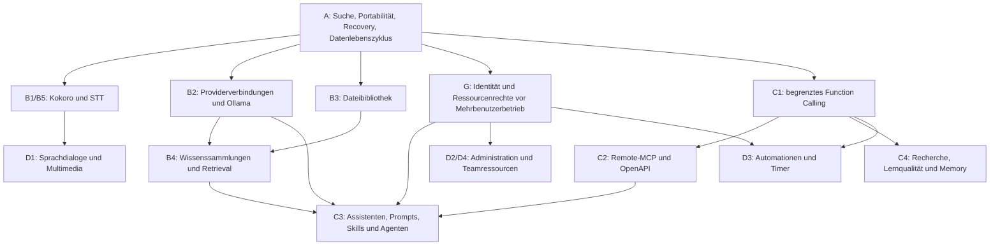

# Noris AI Chat: Entwicklungsroadmap nach Open-WebUI-Audit

Stand: **18.10.2026**, Basiscommit `1337dc863fa766018178f9c42be1cd6c28bdcf3c`, Referenz **[Open WebUI v0.12.3](https://github.com/open-webui/open-webui/releases/tag/v0.12.3)**. Die [Funktionsmatrix mit Codebelegen](OPENWEBUI-FEATURE-GAP.md) ist die verbindliche Bestandsaufnahme zu dieser Planung. Hier werden keine Features implementiert oder produktiven Einstellungen verändert.

## Ziel und Leitplanken

Noris soll den relevanten stabilen Open-WebUI-Funktionsumfang schrittweise abdecken und dabei Nuxt/Vue, FastAPI, PostgreSQL/Alembic, den gemeinsamen Nachrichtenbaum, REST-/WebSocket-Verträge, Providerinterfaces und die vorhandene Tool-Runtime erhalten. Vollständige funktionale Parität bedeutet überprüfbare Nutzerabläufe; sie erfordert keine Übernahme von Open-WebUI-Quellcode, Svelte, dessen Datenbankschema oder ausführbaren Pythonplugins.

**Bereits vorhanden und weiterzuverwenden:** Chatpersistenz, Varianten, Titel, Entwürfe, Archiv/Pins, Suche mit Snippets, Modellauswahl/Discovery, begrenzte Uploads, PDF-Retrieval, Vision, Browserdiktat, Slash-Aktionen, Lernmodus, Toolapprovals/Budgets sowie Websuche/Fetch/Grounding. Die ältere [FEATURE-ROADMAP.md](FEATURE-ROADMAP.md) enthält dafür wertvolle Vorarbeiten, aber auch inzwischen umgesetzte Pakete. Ihre Paketnummern P0–P12 sind nicht mit den nachfolgenden Prioritätsklassen gleichzusetzen.

Alle Aufwandsspannen sind zusätzliche PT à acht Stunden einschließlich Tests, Migration und Dokumentation. Sie sind keine Kalendertermine und gelten bei Verfügbarkeit der benötigten Dienste/Entscheidungen. Das untere Ende setzt Wiederverwendung und einen begrenzten ersten Lieferumfang voraus. Gemeinsame Ressourcenrechte, Providerverbindungen, Uploads und Runtimearbeit dürfen nur einmal eingeplant werden.

## Priorisierte Entwicklungsphasen

| Phase | Priorität / Ziel | Pakete | Abschlussbedingung |
| --- | --- | --- | --- |
| A | **P0: Stabilität, Suche, Chat-UX** | A1 Suchsemantik/Filter; A2 Portabilität; A3 Recovery-/Mobile-/Accessibility-Abnahme; A4 Datenlebenszyklus/Betriebsgrenzen | Kernabläufe sind messbar, wiederherstellbar und ohne irreführende Daten-/Verfügbarkeitsaussagen nutzbar |
| B | **P1: Kokoro, Modelle, RAG** | B1 Kokoro/Vorlesen; B2 Verbindungen/Ollama; B3 Datei-Memberships/Bibliothek; B4 Wissen/Retrieval; B5 STT | Konfigurierte Audio-/Modell-/Wissenspfade sind authentifiziert und Ende zu Ende abgenommen |
| C | **P2: Websuche, MCP, Lernen, Agenten** | C1 Function Calling; C2 MCP/OpenAPI; C3 Assistenten/Prompts/Skills; C4 Recherche/Lernqualität/Memory | Modellaufrufe bleiben typisiert, autorisiert, begrenzt, abbrechbar und replayfähig |
| D | **P3: Multimedia, Administration, Automatisierung** | D1 Sprachdialog/Bilder; D2 Admin/Analytics/Evaluation; D3 Scheduler/Webhooks; D4 Notes/Kollaboration/isolierte Ausführung | Jede Erweiterung besitzt eigenen Scope, Sicherheitsgrenzen und Abnahme |

**Identität und Ressourcenrechte sind ein bedingtes P0-Freigabetor (G1/G2):** Für den ausdrücklich bestehenden Single-Owner-Betrieb kann Phase A ohne kompletten Benutzereditor geliefert werden. Sobald eine Phase mehreren Nutzern persönliche oder geteilte Daten anbietet, müssen G1/G2 vorher abgeschlossen sein. Die zusätzliche Adminoberfläche bleibt P3. So bleiben die gewünschten Prioritäten erhalten, ohne Benutzerisolation bis zu einer späten Komfortphase aufzuschieben.

## Phase A — Bestehenden Kern absichern und gezielt ergänzen

| Paket | Konkreter Lieferumfang / Wiederverwendung | Abhängigkeiten | Aufwand |
| --- | --- | --- | --- |
| A1 — Suche (F02) | Vorhandenen SQL-/REST-/Dialogpfad um Wort-AND und explizite Archiv-/Pinfilter erweitern; Phrasenbevorzugung/Unicode festlegen; Nachrichtentextindex anhand synthetischer Querypläne wählen | Keine neue Suchplattform; Ordner/Tags später an vorhandenen Filtervertrag anschließen | 6–10 PT |
| A2 — Export/Restore (F01) | Versionierter Noris-Export mit Zweigen, Varianten, Entwürfen und nachvollziehbarem Attachmentumfang; validierter Restore über vorhandene Import-/Domainlogik | Bestehendes Importformat prüfen, Dateireferenzen und Größenvertrag entscheiden | 4–7 PT |
| A3 — Recovery, Mobil und Accessibility (F01/F24) | Vorhandene Retry-/Replay-/Fokus-/Viewportlogik gegen zusammenhängende Nutzerszenarien prüfen; nur belegte Defekte korrigieren; Safari/Firefox und Screenreader ergänzen | Lokale Fixtureprovider; separates Test-PostgreSQL nur bei Integration; keine pauschale UI-Neuentwicklung | 5–9 PT plus erst nachgewiesene größere Defekte |
| A4 — Datenlebenszyklus und Betrieb (F23) | Löschgraph/Retention spezifizieren und Hard-Delete-Job liefern; Backup/Restore isoliert nachweisen; TLS-/Single-Process-Betriebsgrenze und Secrets-Redaktion dokumentieren | A2 für gesicherten Restore; aktuelle Attachment-/Event-/Tool-Cleanups einbeziehen | 10–18 PT |

Abnahme A1: Ein Chat mit „Docker“ im Titel und „healthcheck“ in einer Antwort wird durch beide Suchwörter gefunden. Archiv-/Pinfilter sind mit Cursor und Snippets konsistent. Leere, sehr kurze, Unicode- und `%`/`_`-Abfragen liefern definierte Ergebnisse. Zugriffsprüfung findet vor Trefferprojektion statt. Auf einem vorher festgelegten synthetischen Datensatz, beispielsweise 10.000 Chats und 100.000 Nachrichten, werden Queryplan, Hardware und P50/P95 dokumentiert. Ein sinnvoller Zielwert ist P95 unter 500 ms für die serverseitige Suche auf der benannten Testhardware; das ist ein neues Abnahmekriterium, kein behaupteter Ist-Messwert.

Abnahme A2/A4: Export→Restore erhält IDs/Beziehungen/aktive Zweige entsprechend dem veröffentlichten Formatvertrag. Datenlöschung besitzt belegte Auswirkungen auf Nachrichten, Dateien, Toolresultate, Events, spätere Indizes und Backups. Ein Löschvorgang während einer aktiven Generierung führt weder zu erneuter Sichtbarkeit noch zu nicht autorisierten Restresultaten. Der bestehende „Sicherung“-Status wird nicht mit einem tatsächlich erstellten Backup gleichgesetzt.

Abnahme A3: Während Suche, Chatwechsel, Upload, Moduswechsel und Regenerate bleiben Entwurf und Fokus erhalten. Abbruch, Disconnect, Reload, unterbrochene Antwort und Versionskonflikt führen zu verständlichen und wiederherstellbaren Zuständen. Ein kompletter Weg von Chatstart bis Suche/Archiv/Restore funktioniert mit Tastatur, Screenreader und mobiler Bildschirmtastatur.

Nicht Teil von A: neue Suchressourcen ohne Datenmodell, universeller Suchdienst, Kokoro, MCP oder eine zweite Chatimplementierung.

## Freigabetor G — Identität und Rechte vor Mehrbenutzerbetrieb

| Paket | Lieferumfang | Abhängigkeiten / Tests | Aufwand |
| --- | --- | --- | --- |
| G1 — Identitätsadapter (F20) | Verifizierter Principal, Session-/OIDC-Pfad, explizite Migration des festen Bestandsowners und Widerruf | Eigentümer darf nie aus beliebigem Clientpayload stammen; Login/Logout/Expiry, falsche Audience/Issuer, REST/WS/Dateien mit zwei Nutzern | 15–25 PT |
| G2 — Ressourcenrechte (F21) | Zentrale Default-deny-Policy für persönliche/geteilte Ressourcen und Rollen; Ausführung prüft Rechte erneut | G1; Matrix für Chats, Dateien, Wissen, Modelle, Prompts, Tools, Exporte; Rechteentzug während laufender Jobs | 12–20 PT |

G1/G2 erhalten die Domain-Ownership. Sie dürfen nicht lediglich zwei Konten auf dieselbe `chat_owner_id` abbilden. Ein gemeinsames Basic-Zugangspaar ist für einen gemeinsamen privaten Owner vorhanden; es erfüllt keine individuelle Benutzertrennung. Lokale Testidentitäten reichen für Implementierungsprüfungen, die produktive IdP-/TLS-Konfiguration benötigt einen eigenen überprüfbaren Betriebsauftrag.

## Phase B — Audio, Modellverbindungen und Wissen

| Paket | Konkreter Lieferumfang / Wiederverwendung | Abhängigkeiten | Aufwand |
| --- | --- | --- | --- |
| B1 — Kokoro-TTS (F09) | TTS-Providerinterface, explizit konfigurierter Kokoro-Dienst, Stimmen-/Sprachwahl und Vorlesen/Stop in vorhandenen Nachrichtenaktionen; Text-Chat unverändert nutzen | A3; Audioformat, Datenschutz, verfügbare DE/EN-Stimmen und Dienstvertrag prüfen | 8–14 PT |
| B1b — Browser-Kokoro (F09) | Optionaler Worker, versioniertes Modell und lokaler Cache; benötigt eigenen Endgerätenachweis | B1s Nutzer-/Audiozustände wiederverwenden; kein externer Dienstkey im Client | zusätzlich 5–9 PT |
| B2a — Mehrere Verbindungen (F03/F05) | Verbindungs-ID statt globaler URL, serverseitige Credentials, Discovery/Teststatus, eindeutige Modellidentität und vorhandene Capability-Gates | G für geteilte/persönliche Verwaltung; bestehender Katalog/Gateway | 10–18 PT; kompatible Protokollerweiterungen zusätzlich 4–7 PT |
| B2b — Ollama (F04) | Nativer Chat-/Discoveryadapter plus begrenztes Pull/Delete über vorhandenen Verbindungsvertrag | B2a; explizite lokale Netzfreigabe statt global gelockerter Hostpolicy | 8–15 PT |
| B3 — Dateibibliothek (F06) | Additive Datei-/Membershipmigration, Wiederverwendung vorhandener Uploads, private Bibliothek mit Picker/Pagination, sichere Referenzzählung; ein erster zusätzlicher Extraktor | A4; G für mehrere Nutzer; vorhandenes Bibliotheksdesign abgleichen | 10–18 PT |
| B4 — Wissen/RAG (F07) | Collections, Indexjobs, Embeddingadapter, versionierter Index, Retrieval/Quellen und Reindexierung; PDF-Selektion erhalten | B3, B2a; ACL und Löschgraph; Qualitätsvergleich vor Indexproduktwahl | 20–35 PT |
| B5 — STT (F08) | Ein serverseitiger Transkriptionsadapter mit Aufnahme-/Zeit-/Bytelimits; Browserdiktat weiter anbieten | Audio-Lifecycle von B1; eigener Aufnahmetest | 6–10 PT |

B1 wird als eigener Lieferumfang vor Sprachgesprächen umgesetzt. Der erste Architekturentscheid ist Dienst-Kokoro versus zusätzliches Browser-Kokoro; beides ist in Open WebUI vorhanden, benötigt aber unterschiedliche Betriebsvoraussetzungen. Ein CPU-/GPU-Modellserver wird weder in FastAPI noch in den Nuxt-Prozess eingebaut. Keine nicht verifizierte Sprachqualität zusichern.

B2 erhält Katalogcache, Modellmetadaten, Limits und Auswahl. Ein Modellschlüssel muss Verbindung und Provider-ID eindeutig zuordnen; bisherige Nachrichten behalten ihre ursprüngliche Modellzuordnung. Bei Ausfall oder Widerruf darf kein stiller Wechsel auf einen anderen Provider stattfinden.

B3 wird vor großen RAG-Erweiterungen geliefert: Eine Datei darf in zwei Chats verwendet werden, ohne Bytes zu kopieren oder beim Löschen eines Chats die andere Bindung zu verlieren. Für ein neues Gespräch, Archiv, laufende Generierung, Retry und Cleanup sind Racebedingungen zu testen. Die vorhandenen [Dateibibliotheks-](FILE-LIBRARY-DESIGN.md) und [Toolentwürfe](TOOL-ARCHITECTURE.md) dienen als Ausgangspunkt und werden gegen aktuellen Code abgeglichen.

B4 wird mit einem synthetischen deutsch-/englischsprachigen Dokumentkorpus abgenommen. Goldfragen müssen erwartete Seiten/Abschnitte referenzieren; Retrievalqualität, unbelegte Antworten, Mehrdeutigkeit und das Verhalten bei fehlenden Rechten werden getrennt gemessen. Neue Indizes werden nach Provider-/Chunkversion nachvollziehbar aufgebaut. Löschung und Widerruf wirken vor dem nächsten Retrieval.

## Phase C — Kontrollierte Werkzeug- und Workspace-Erweiterungen

| Paket | Konkreter Lieferumfang / Wiederverwendung | Abhängigkeiten | Aufwand |
| --- | --- | --- | --- |
| C1 — Native Function Calls (F12) | Typisierte Providerereignisse und Ergebnisrollen, Fragmentassembler, begrenzter Callloop, persistente Callzuordnung; vorhandene Tool-Runtime/Approvals/Budgets/WS-Projektionen nutzen | A3; G bei mehreren Nutzern; kein Ausführen freien Modelltexts | 12–20 PT |
| C2 — Remote-MCP/OpenAPI (F13) | Verbindung, Discovery, Schemaversion, Auth, erlaubte Tools und Abbruch als Adapter in derselben Runtime | C1, B2a-Verbindungsprinzipien, G für OAuth/Nutzerrechte | 12–20 PT |
| C3a — Assistenten/Prompts/Slash (F14/F16/F17) | Versionierte Ressourcen, Editor, Variablenformulare und dynamische Kommandos im bestehenden Composer; Presets binden vorhandene Modelle/Wissen/Tools | B2a, G, optional B4/C2; gemeinsamen Versions-/ACL-Unterbau nur einmal entwickeln | 10–16 PT Assistenten + 7–12 PT Prompts + 3–5 PT Slashintegration, gemeinsamer Unterbau reduziert Summe |
| C3b — Skills und begrenzte Agenten (F15) | Instruktionsressourcen, Manifest/bedarfsweises Laden, Dateien, Parent-/Child-Runs und begrenzte Taskzustände | C1/C2/C3a; Researchprojektionen weiterverwenden | 15–25 PT |
| C4a — Webrecherche und Lernqualität (F11/F18) | Vorhandene SearXNG-/Fetchpipeline um definierte Recherchefälle erweitern; zusätzliche Provider und optional expliziter Deep-Research-Scope; Lernmodus mit Qualitätsrubrik prüfen | C1 für echte modellgesteuerte Recherche; B4 für Speichern in Wissen | 6–12 PT Recherche + 2–4 PT Lernen |
| C4b — Memory (E01) | Sichtbare, bearbeitbare, löschbare persönliche Erinnerungen mit kontrolliertem Abruf | C1, G und A4; eigenes Opt-in | 7–12 PT |

C1 muss vor MCP oder allgemeinen Agenten einen vollständigen synthetischen Toolturn absolvieren: fragmentierte JSON-Argumente → Schema → Rechte/Freigabe → Budgetreservierung → Toolrun → persistentes Ergebnis → Modellfortsetzung. Fehler-/Abbruchpfade dürfen keine doppelte Wirkung beim Replay erzeugen. Schreibende Tools verlangen einen ausdrücklich definierten Freigabevertrag.

C2 startet mit Remote-HTTP und einem lokalen Testserver. Frei konfigurierbare Shell-/`stdio`-Prozesse und beliebiger Python-Pluginimport sind nicht Voraussetzung für MCP-Parität. Sie benötigen ein eigenes Sandbox-/Betriebsdesign. Tokenablage, OAuth-Refresh und Rechteentzug dürfen die zentrale Policy nicht umgehen.

C3 unterscheidet Instruktion und Berechtigung: Ein Skill, Prompt oder Assistent kann kein Toolrecht verleihen. Der konfigurierte Ressourcenstand wird für eine laufende Generierung nachvollziehbar festgehalten; neue Starts berücksichtigen Widerrufe. Contextbudget und Policy gelten auch bei bedarfsweisem Laden.

C4 baut die vorhandene Recherche und den vorhandenen Lernmodus aus. Insbesondere sind weder SearXNG noch Tutoring neu zu entwickeln. Pädagogische Tests müssen direkte Lösungswünsche, Hilfen, Fehlvorstellungen und Zweigwechsel bewerten; Aktivitätszähler werden weiterhin nicht als Lernkompetenz behandelt.

## Phase D — Erweiterte Multimedia-, Team- und Betriebsfunktionen

| Paket | Lieferumfang / Voraussetzung | Aufwand |
| --- | --- | --- |
| D1a — Sprachgespräche (F10) | Standard-STT→Chat→TTS mit VAD und Unterbrechung nach B1/B5; Realtime als getrennter Providerpfad | 15–25 PT Standard; zusätzlich 12–20 PT Realtime |
| D1b — Bilder/Sketch (F19) | Bildgenerierung/-bearbeitung über Provider und atomaren Attachmentimport; Sketch exportiert in vorhandenen Uploadpfad | 15–25 PT |
| D2 — Administration/Qualität (F22/E06) | Ressourcen-/Nutzerübersicht, Usage-/Kostenaggregation, sichere Defaultverwaltung, Bewertungen und spätere Arena/Follow-ups; G ist Voraussetzung | 10–18 PT Admin/Usage + 6–10 PT erste Qualitätsfunktionen |
| D3 — Automationen/Timer/Webhooks (E05) | Persistente Zeitpläne, Ausführungshistorie, Stop/Resume und erlaubte Zustellziele über vorhandene Generierung/Budgets | 12–20 PT |
| D4a — Notes und Dokumenteditor (E02) | Versionierte eigenständige Dokumente, ausgewählte Passage bearbeiten, Einbindung in Chats und Sharing nach G | 10–18 PT |
| D4b — Team/Kollaboration (E04) | Ordner/Tags zunächst F01 (6–11 PT), später Kanäle/DMs/Mitgliedschaften/Ungelesen/Anwesenheit; E2E nur als eigener Auftrag | 20–35 PT Teambasis; Ordner/Tags separat |
| D4c — Rendering/Ausführung (E03) | Begrenztes Mermaid/Mathe-Rendering; Interpreter/Artefakte in getrennten Frames/Prozessen oder über Toolserver | 5–9 PT Rendering; zusätzlich 15–25 PT Ausführung |
| D4d — Externe API und Installierbarkeit (F05/F24) | Optionaler eingehender Kompatibilitätsadapter und separat spezifizierte PWA; vorhandene interne Verträge erhalten. Experimentelle direkte Browser-Verbindungen benötigen zusätzlich ein eigenes Credential-/CORS-Konzept | 3–5 PT API; PWA/Offline und Browser-Verbindungen erst nach Daten-/Cache-/Credentialkonzept schätzen |

Für D3 genügt kein Browser-Timer und kein weiterer unkoordinierter Startup-Task. Ein Neustart, Sommerzeitwechsel oder Retry darf dieselbe geplante Aktion nicht unkontrolliert mehrfach auslösen. Ausführung prüft aktuelle Eigentümerrechte und Budgets; Zustellziele werden gegen SSRF geschützt.

Für D4b ersetzt eine Freigabe-URL keine Mitgliedschaftspolicy. Die in Open WebUI v0.12.3 vorhandenen verschlüsselten Kanäle sind ein besonderer temporärer Kommunikationsmodus; Ende-zu-Ende-verschlüsselte KI-Inferenz wird daraus nicht abgeleitet. Eine Noris-E2E-Erweiterung benötigt einen eigenständigen Scope und ist in den Schätzungen nicht enthalten.

## Reihenfolge und Paketgrenzen

Die Grafik zeigt wesentliche technische Voraussetzungen, keine Erlaubnis zu parallelen Produktionsänderungen. G gilt zusätzlich für jeden Mehrbenutzerpfad von B/C/D. B1, B2 und B3 können nach stabiler Phase A organisatorisch unabhängig geplant werden. Es gibt bewusst keinen Gesamtkalendertermin und keine scheinpräzise Summe: Anbieterumfang, Identitymodell, RAG-Index und Endgeräteabnahme beeinflussen mehrere Pakete.

## Technische Risiken und Entscheidungen vor Umsetzung

| Entscheidung / Risiko | Empfehlung | Zeitpunkt |
| --- | --- | --- |
| Single-Owner oder mehrere Nutzer | Single-Owner explizit unterstützen; vor persönlichem Sharing G liefern, keine neue gemeinsame Ownerabkürzung | Vor erstem Mehrbenutzerpaket |
| Prozesslokale WS-Tickets/Generierungen | Bestehende Betriebsgrenze beibehalten; verteilte Ausführung erst nach gezieltem Mehrprozessnachweis und Shared-State-Design | Vor horizontaler Skalierung oder Scheduler |
| Suchindex und Semantik | Synthetische Messung statt pauschaler Suchtechnologie; Query- und Snippetsemantik gemeinsam definieren | A1 |
| Datei-/Index-Lebensdauer | Ein Lösch-/Ownership-Vertrag für Dateien, Memberships, Extrakte und Indizes | A4/B3/B4 |
| Kokoro-Dienst versus Browsermodell | Ersten Dienstpfad konkret abnehmen, Browsermodell als eigenen messbaren Lieferumfang behandeln | B1 |
| Modellidentität und API-Kompatibilität | Verbindung+Provider-ID eindeutig; Fähigkeiten über Vertragstests belegen | B2/C1 |
| RAG-Qualität und Indexbetrieb | PostgreSQL beibehalten; Indexadapter nach Goldfragen, Reindexierung, Betrieb und ACL auswählen | B4 |
| Tool-/Agenten-Seiteneffekte | Vorhandene Budget-/Approvalruntime nutzen; maximale Tiefe, Schritte, Bytes und Laufzeit festlegen | C1–C3 |
| Stabile Referenz driftet | Für jede Phase Version/Releasevergleich erneuern und geänderte Anforderungen sichtbar nachführen | Phasenbeginn |
| Umfang von „vollständig“ | Die F-/E-IDs in ein versioniertes Abnahmeregister pro Unterfunktion überführen; zusätzliche Provider/Plugins separat verhandeln | Vor verbindlicher Paritätszusage |

## Gemeinsame Abnahme und sichere Lieferung

Jedes Paket erhält ein enges PR mit Problem, resultierendem Verhalten, betroffenen F-/E-IDs, Tests und verbleibenden Grenzen. Bestehende Funktionen werden zuerst durch Code belegt. Neue APIs erzeugen aktuelle OpenAPI-/TypeScript-/WebSocket-Verträge; additive Datenmigrationen brauchen einen getesteten Expand-/Rollback-Plan. Retry, Cancellation, Replay, Versionenkonflikte und eingeschränkte Zugriffe gehören bei betroffenen Zustandsänderungen zur Abnahme.

Integrationstests laufen ausschließlich mit synthetischen Daten in wegwerfbaren `_test`-Datenbanken und auf eigenen Ports. Die vorhandene Integrationsfixture führt Downgrades aus und darf nie eine Anwendungsdatenbank erhalten. Reale Modell-, Audio-, Such- oder MCP-Dienste werden nur mit expliziter Betreiberkonfiguration und Kosten-/Datenfreigabe getestet. Produktive Einstellungen werden nicht im Rahmen eines Feature-PRs stillschweigend geändert.

Ein deaktivierter Menüeintrag zählt erst nach vorhandenem Handler, autorisierter API, Persistenz-/Providerpfad und erfolgreichem Nutzerszenario als Feature. UI-Fidelity allein ersetzt keine Funktionsabnahme. Der Lernmodus bleibt als vorhandene Noris-Funktion erhalten, auch wenn Open WebUI keinen separat belegten gleichnamigen Kernmodus dokumentiert.

Für den Audit selbst bestanden **277 gezielte Backend- und 85 Frontend-Tests**. PostgreSQL-/Playwright-/Liveprovider-Abnahmen wurden nicht erneut ausgeführt; der [Auditbericht](OPENWEBUI-FEATURE-GAP.md) dokumentiert die genauen Befehle und Grenzen. Der Audit-PR enthält ausschließlich die beiden angeforderten Dokumente und wird nicht automatisch gemergt.

## Empfehlung für den nächsten Codex-Auftrag

Als nächsten Auftrag **A1: vorhandene Chat-Suche um Wort-AND und Archiv-/Pinfilter erweitern** beauftragen. Das erfüllt P0, hat einen klaren aktuellen Codepfad und benötigt weder neue Infrastruktur noch eine Architekturentscheidung für spätere Funktionen.

Vorschlag für einen direkt nutzbaren Auftrag:

> Prüfe `docs/OPENWEBUI-FEATURE-GAP.md` F02 und diese Roadmap A1 gegen den dann aktuellen Branch. Erweitere den vorhandenen PostgreSQL-/REST-/Vue-Suchpfad um Wort-AND über Titel und Nachrichten sowie explizite Archiv-/Pinfilter. Definiere Phrasenranking, Unicode und das Verhalten von Treffern in nicht aktiven Zweigen. Erhalte Ownerprüfung, Cursorbindung, Snippets, Request-Abbruch und Nachrichtensprung. Ergänze nur nach synthetischem Queryplan einen passenden Index. Implementiere keine Suche nach noch nicht existierenden Dokument-, Ordner- oder Projektressourcen. Prüfe Migrationen ausschließlich in einer wegwerfbaren `_test`-Datenbank. Liefere Integrationstests für verteilte Wörter, Filterkombinationen, fremde Ressourcen und Cursorwechsel sowie Browserprüfungen für Tastatur/Mobile. Dokumentiere Datensatz, Hardware, Queryplan und P95. Verwende einen separaten Branch, erstelle ein PR und merge nicht automatisch. Ändere keine produktiven Einstellungen.

Danach A2/A4 abschließen und B1 Kokoro konkret planen. Falls Mehrbenutzerbetrieb bereits kurzfristig vorgesehen ist, G1/G2 vor die entsprechenden Lieferpakete ziehen; der heutige gemeinsame Owner darf dabei nicht als Benutzerverwaltung vorausgesetzt werden.
