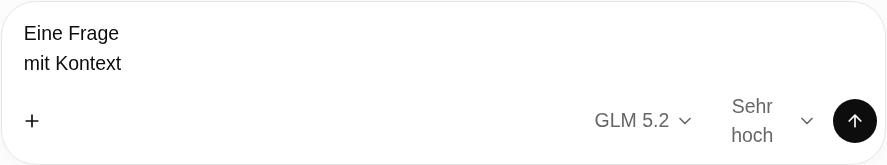
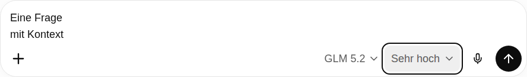

# Modellabhängige Denkstufen im Composer

Stand: 12.10.2026. Ausgangspunkt: `main` / `f367e33`.

## Ursache und Layoutkorrektur

`ChatReasoningMenu.vue` verwendete ein normales Textlabel ohne `white-space: nowrap`.
In `main.css` war der gesamte Trigger auf `max-width: 7.5rem` begrenzt, unter
768 px auf `6rem`. In diesen Platz mussten Text, 20-px-Chevron, Abstand und
horizontales Padding passen. Bei der responsiven Schriftgröße passte „Sehr hoch“
daher nicht mehr hinein. `flex-shrink: 0` war am Trigger bereits vorhanden und
verhinderte den Zeilenumbruch innerhalb des Buttons nicht. Der Modellbutton
beanspruchte gleichzeitig eine feste Flexbreite.

Der bestehende Trigger verwendet jetzt `inline-flex`, `items-center`, `shrink-0`
und `whitespace-nowrap`; auch das Label und der Chevron sind abgesichert.
`min-width: max-content` verhindert die zu kleine Breitenbegrenzung. Ein
reservierter Triggerplatz von 9rem beziehungsweise 7rem hält die Breite beim
Wechsel zwischen Standard und Denkstufen konstant. Der vorhandene Modellbutton
kann in schmalen Toolbars schrumpfen und sein Label weiterhin kürzen.

Composerbreite, Dock, Send/Stop, Anhänge und das nach oben wachsende Autosizing
bleiben in der vorhandenen Architektur. Auf schmalen Geräten verschiebt das
vorhandene `useComposerAutosize` das Eingabefeld bei Platzmangel über die Toolbar.
Denkstufen werden dafür nicht umgebrochen. Das Menü richtet Labels und
Beschreibungen in zwei Spalten aus und reserviert mobil gleiche Zeilenhöhen.
Reka/Nuxt UI übernimmt weiterhin Pfeiltasten, Enter, Escape und Fokusrückgabe.

## Fähigkeiten und Providervertrag

Der vom Benutzer bereitgestellte Providerkatalog, Schema 2.4, enthält bei
DeepSeek V4.1 Flash, GLM 5.3 Flash, Qwen3.8, Qwen3.6, GLM 5.2 und GPT-OSS nur
`reasoning: { type: "boolean" }`, keine Liste von Effort-Werten. Bei Gemma fehlt
auch dieser Parameter. Daraus werden keine Denkstufen abgeleitet. Die zwei
bereits vorhandenen exakten Registry-Profile haben zusätzliche dokumentierte
Parameterverträge; diese wurden am 12.10.2026 gegen die Noris-Dokumentation geprüft.

| Modell | UI-Stufen → tatsächlicher Wert | Providerparameter | Freigabe |
| --- | --- | --- | --- |
| GPT-OSS 120B | Sofort → `low`, Mittel → `medium`, Hoch → `high` | `reasoning_effort` | Exaktes Registry-Profil, `VERIFIED`, Quellen vorhanden |
| GLM 5.2 | Hoch → `high`, Sehr hoch → `max` | `chat_template_kwargs.reasoning_effort` | Exaktes Registry-Profil, `DOCUMENTED`, Quellen vorhanden |
| GLM 5.3 Flash | Keine steuerbaren Stufen belegt | Keiner durch die Auswahl | Providerstandard |
| DeepSeek V4.1 Flash | Keine steuerbaren Stufen belegt | Keiner durch die Auswahl | Providerstandard |
| Qwen3.8 27B | Keine steuerbaren Stufen belegt | Keiner durch die Auswahl | Providerstandard |
| Qwen3.6 27B | Keine steuerbaren Stufen belegt | Keiner durch die Auswahl | Providerstandard |
| Gemma 4 31B IT | Keine steuerbaren Stufen belegt | Keiner durch die Auswahl | Providerstandard |

„Sofort“ bedeutet den niedrigsten unterstützten Denkaufwand, nicht ausgeschaltetes
Reasoning oder garantierte Latenz. „Sehr hoch“ ist das UI-Label für GLMs `max`.
„Pro“ hat kein freigegebenes Profil und erscheint deshalb bei keinem Modell.
„Modellstandard“ bleibt als Rücksetzaktion bei Modellen mit Auswahl erhalten.

Quellen: [Noris GLM 5.2](https://noris.cloud/nai/models/glm-5-2/), insbesondere
`chat_template_kwargs.reasoning_effort` mit `high` und `max`;
[Noris Reasoning](https://noris.cloud/nai/concepts/reasoning/),
[Noris GPT-OSS 120B](https://noris.cloud/nai/models/gpt-oss-120b/) und die bestehende
Live-Abnahme in `docs/ETAPPE-2.1-LIVE-ABNAHME.md`.

## Bestehende Komponenten und Zustandsführung

- `ChatComposer.vue` blendet Reasoning ohne freigegebene Stufen aus.
- `ChatReasoningMenu.vue` filtert die bestehende Beschriftungstabelle mit den
  Backend-Freigaben und zeigt ausschließlich verfügbare Optionen.
- `ChatModelMenu.vue` bleibt die vorhandene Modellauswahl; ihre CSS-Flexbreite
  kann bei gleichzeitig sichtbarer Denkstufe schrumpfen.
- `useModelSelection.ts` übernimmt ausschließlich explizite
  `reasoning_preferences` aus einem frischen, verfügbaren, streamfähigen Katalog
  mit bestätigtem `reasoning: true`. Name, Kategorie und rohe Effort-Strings
  aktivieren keine Optionen.
- `ChatWorkspace.vue` aktualisiert den Composer sofort und wartet beim Laden auf
  Katalog und Wiederherstellung der gespeicherten Modellauswahl.
- `useChat.ts` entfernt inkompatible Präferenzen über dieselbe vorhandene
  Gesprächseinstellung samt Backend-Persistierung, Versionsprüfung, Busy- und
  Fehlerbehandlung. Der bestehende Sendepfad filtert weiterhin nach Modell.
- `conversations.ts` verwirft ungültige gespeicherte Präferenzwerte, ohne den
  Gesprächsverlauf oder seinen Entwurf zu verwerfen.
- Backend `reasoning.py`, `catalog.py` und `openai_compatible.py` benutzen dasselbe
  exakte Mapping für Katalog, Admission und die letzte Providergrenze. Veraltete
  Kataloge geben keine Präferenzen frei. Unbestätigte, inkompatible und erfundene
  Werte gelangen nicht zum Provider; direkte nicht unterstützte Chatpräferenzen
  werden weiterhin mit `REASONING_UNSUPPORTED` abgelehnt.

Es gibt keine zweite Modellauswahl oder Reasoning-Konfiguration. Kontextlimits,
Ausgabetokenlimits, Reserven, Tagesbudgets und Preiskonfiguration werden nicht
angehoben. Höherer Denkaufwand kann innerhalb dieser bestehenden Limits mehr
Reasoning-Tokens verbrauchen; die Auswahl ändert kein Budget.

## Gezielte lokale Prüfung

Auf Wunsch wurden nur betroffene Tests ausgeführt; CI wurde nicht abgewartet.

- ESLint: bestanden. Ruff-Lint und Formatprüfung der betroffenen Python-Dateien:
  bestanden. `git diff --check`: bestanden.
- Nuxt-Typecheck und `vue-tsc` einschließlich Testdateien: bestanden. Die lokale
  Installation meldet eine bereits vorhandene Warnung zum optionalen
  `vue-router/volar/sfc-route-blocks`-Plugin; die Prüfungen enden erfolgreich.
- Frontend: 45 Unit-Tests in sechs betroffenen Dateien bestanden.
- Backend: 186 Unit-Tests in sechs betroffenen Dateien sowie sieben zusätzliche
  Katalogfälle zum gelieferten Boolean-Parameter bestanden. Insgesamt 31 Fälle
  der neuen Datei `test_reasoning_selection.py` bestanden.
- Integration: sieben PostgreSQL-/WebSocket-Fälle zu gespeicherten Präferenzen
  und drei betroffene HTTP-Titeltests bestanden; ausschließlich lokale Fixtures
  und eine neue Wegwerf-Datenbank unter `/tmp`.
- Playwright: acht Reasoning-Fälle für 1700 × 900, 1440 × 900, 768 × 1024 und
  390 × 844, jeweils Light und Dark. Prüfung der tatsächlichen Textzeile,
  Chevronposition, unveränderten Sendeposition, fehlenden Überbreite,
  aufwärts wachsenden Eingabe, Menühöhen, Tastatur/Escape, aller sieben Modelle
  und der aufgezeichneten HTTP-Providerparameter.
  Jede Providerprüfung wartet auf den sendebereiten Composer und die neue
  HTTP-Chat-Anfrage, prüft die zusätzliche Antwort bis zu ihrem Abschluss
  und ordnet genau den zusätzlichen Provideraufruf dem gewählten Modell zu.
  Der zuvor abgeschlossene Generierungsstatus kann keinen neuen Sendetest
  mehr erfüllen. Ein absichtlich verzögerter Katalogrefresh deckt diesen
  Fall im Szenario 1700 × 900 / Dark ab.
- Bestehende betroffene Playwright-Prüfungen: sieben Lernmodus-Fälle sowie zwei
  PostgreSQL-/WebSocket-Browserfälle; ihre geänderten Screenshots sind aktualisiert.
- Nuxt-Produktionsbuild: bestanden.

## Vorher und nachher

Die Vorher-Bilder wurden mit dem vorhandenen Build vor der Korrektur und lokalen
Providerfixtures reproduziert. Die Nachher-Bilder stammen aus Playwright mit dem
korrigierten Produktionsbuild. Der Composer enthält ausschließlich synthetischen
Text. Für alle vier Größen und beide Themes liegen Bilder unter
`docs/ui-reference/reasoning/`; die endgültigen Composer- und Menü-Snapshots liegen
unter `frontend/tests/llm/__screenshots__/linux/desktop/reasoning-*.png`.

| Größe | Vorher Light | Nachher Light | Vorher Dark | Nachher Dark |
| --- | --- | --- | --- | --- |
| 1700 × 900 | [Bild](ui-reference/reasoning/before-1700-light.png) | [Bild](ui-reference/reasoning/after-1700-light.png) | [Bild](ui-reference/reasoning/before-1700-dark.png) | [Bild](ui-reference/reasoning/after-1700-dark.png) |
| 1440 × 900 | [Bild](ui-reference/reasoning/before-1440-light.png) | [Bild](ui-reference/reasoning/after-1440-light.png) | [Bild](ui-reference/reasoning/before-1440-dark.png) | [Bild](ui-reference/reasoning/after-1440-dark.png) |
| 768 × 1024 | [Bild](ui-reference/reasoning/before-768-light.png) | [Bild](ui-reference/reasoning/after-768-light.png) | [Bild](ui-reference/reasoning/before-768-dark.png) | [Bild](ui-reference/reasoning/after-768-dark.png) |
| 390 × 844 | [Bild](ui-reference/reasoning/before-390-light.png) | [Bild](ui-reference/reasoning/after-390-light.png) | [Bild](ui-reference/reasoning/before-390-dark.png) | [Bild](ui-reference/reasoning/after-390-dark.png) |

Vorher, Desktop:

Nachher, Desktop:

