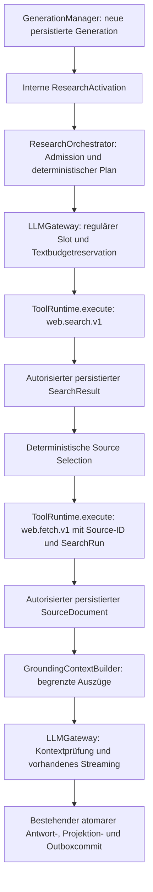

# P7b – Search Orchestration and LLM Grounding

P7c integriert inzwischen die versionierte Benutzeraktivierung und autorisierte
Quellenanzeige: [Web Search UX](WEB-SEARCH-UX.md). Die nachfolgenden Angaben zu
P7b/P2 beschreiben deren ursprünglichen Stand; Researchstatus verwendet jetzt
additiv dieselbe Outboxsequenz mit `researchEventVersion: 1`. ToolEventVersion 1
und der bestehende Socket bleiben unverändert.

P7b ergänzt eine ausdrücklich aktivierte, serverseitige Recherche in der vorhandenen
Chatgenerierung. `NORIS_RESEARCH_ENABLED` ist standardmäßig **false**. Die normale
App hat weiterhin keine Research-Execute-Route, keinen Composer-Webmodus und keine
Toolpermissions. Auch `true` allein aktiviert keine Benutzerrecherche. Dieser PR
führt weder Merge, Deployment, produktive Migration noch P7c durch.

## 1. Architektur

Der Orchestrator führt keine HTTPrequests, SQLstatements oder Providerbibliotheken
aus. Er verwendet `ToolRuntime.execute`, Repositorymethoden und `LLMGateway`.
Es gibt keine zusätzliche Tool-, Budget-, Chat-, Event- oder Cancellationruntime.
Plan und Quellenauswahl sind Datenoperationen, keine LLMagentenschleife.

## 2. Bestandsanalyse und Integrationsentscheidung

Basis: aktueller `origin/main`, `34f3d39`, Merge von PR #67 am 14.10.2026.
Untersucht wurden `llm/{gateway,provider,schemas}.py`,
`chat/{generation,repository,ws_protocol}.py`,
`tools/{runtime,registry,repository,policy,schemas,search,fetch}.py` sowie
[Tool Runtime](TOOL-RUNTIME.md), [Tool Events](TOOL-EVENTS.md),
[SearXNG Integration](SEARXNG-TOOL-INTEGRATION.md) und
[Secure Source Fetch](SECURE-SOURCE-FETCH.md).

| Bestand | Wiederverwendung in P7b |
| --- | --- |
| `begin_generation` persistiert Input, Antwortknoten, Modell, Owner, Conversation und Generation einmalig; gleiche Request-ID führt zu Resume. | Gleicher Manager und aktiver Pfad; der kleinste Integrationspunkt ist `_run` nach Bild-/PDFaufbereitung, vor Gatewayreservation und Providerstream. |
| `LLMGateway.reserve` prüft aktuellen Katalog, Reasoningpräferenz, Requestbytes, UTF-16-Nachrichtenlimits, Kontext, Output/Reasoningreserve, aktive Antworten, Parallelität, Rate und Tagesbudget. | Reguläre Admission reserviert zusätzlich eine begrenzte Inputobergrenze für die Recherche vor dem ersten Toolcall. |
| Modellkatalog verbindet Providerfähigkeit mit lokaler Policy; veraltete Kataloge berechtigen keine neuen Calls. | Textinput/-output, Streaming und Chatfreigabe werden geprüft; keine Annahme nativer Toolcalls. |
| Registry hat feste `web.search.v1`-/`web.fetch.v1`-Schemas und Permissions. | Keine zweite Suche, kein Execute-by-Name-Endpunkt, keine Modelltoolnamen. |
| ToolRuntime claimt/dispatched mit Executiontoken, Permission-/Configsnapshot und atomaren Reservations. | Jeder Search-/Fetchcall erhält dieselben Checks erneut. |
| ToolRun bindet Owner/Conversation/Generation/Parent, Step-Key/Inputdigest und optional `source_search_run_id`. | Rootsteps haben `parent_run_id=null`; Fetch und Search teilen diesen Parent. Ein erfolgreicher terminaler SearchRun kann kein live Parent sein. |
| Immutable `ToolResult` Version 1 enthält Registryoutput und SHA-256-Resultatdigest. | Persistierte Ergebnisse werden erneut autorisiert und validiert; Toolreturnwerte allein sind keine Quelle. |
| P2 hat gemeinsame DBsequenzen und `chat_stream_event` als transaktionale Outbox. | Alle realen Tool-Lifecycleevents bleiben unverändert; kein Researchevent oder zweiter Socket. |
| Runtimecancel schließt Handler/HTTPstream, akzeptierte Fences verhindern späten Erfolgscommit; Startup finalisiert verwaiste Tools und Textreservations. | Zusätzlich wird das vorhandene `ChatGeneration.cancelled_at` schon bei Stop als Generation-Fence persistiert, auch zwischen Toolsteps. |
| Normale Generierung nutzt bereits Bilder, PDFauszüge, Lerninstruktion, Gatewaystream und atomare Antwortwrites. | Der Researchkontext wird zusätzlich gezählt; bestehende Benutzer- und Systemnachrichten werden nicht gekürzt. |
| Explizite Fortsetzung erzeugt neue Generation/Antwort mit Quellenpfad zum alten Knoten; automatische Outputlimit-Fortsetzung behält den Antwortknoten und eigene Gatewayphase. | P7b startet für explizite `continue` keine neue Recherche. Automatische Fortsetzungen behalten den bereits vorbereiteten Kontext und die Researchdeadline, werden erneut regulär admitted und starten keine Tools. |

## 3. Research-Admission

Nur vertrauenswürdiger Servercode kann `GenerationManager.generate(...,
research=ResearchActivation(owner_id, language))` aufrufen. Die optionalen internen
Pythonparameter sind weder Bestandteil von REST-`ChatRequest` noch von
WebSocket-`chat.generate`. Produkt-WebSocketcommands bleiben unverändert und
übergeben keine Aktivierung. `ResearchActivation` ist kein Browser-/LLMtoken.

Vor Toolausführung gelten: Featureflag, konfigurierter aktiver Owner, nicht
gelöschte/archivierte Conversation, aktive und nicht gecancelte Generation,
passende Inputmessage/Modell-ID, Operation `generate`, aktuelle Modelladmission,
Search- und Fetchpermissions sowie verfügbare Budgets. Das Repository liest die
ursprüngliche Frage aus der unveränderlichen Benutzernachricht. Anhänge und
Chatgeschichte werden nicht zu Suchqueries.

P7b verlangt für beide Permissions `allow`. `approval_required` stoppt vor dem
ersten externen Request mit `RESEARCH_APPROVAL_REQUIRED`; ein Approval wird nicht
automatisch erstellt oder bestätigt. Die bestehenden P1b-Grants bleiben verfügbar,
aber eine interaktive Research-Approvalfortsetzung benötigt einen späteren
ausdrücklichen Integrationsvertrag. Keine Rechte werden aus dem Plan abgeleitet.

## 4. Rechercheplanung

`ResearchPlan` ist strikt/frozen, zusätzliche Felder sind verboten. Er enthält
Originalfrage (1–1000 Zeichen), feste Intention, bis zu drei `SearchInput`, Sprache,
maximal drei Fetches/sechs Toolcalls und eine UTCdeadline. Sprachkonsistenz,
Suchduplikate, leere Fragen, Steuerzeichen und Gesamtlimit werden validiert.
Der Plan hat keine Toolnamen, URLs, Permissionfelder oder Netzwerkkonfiguration.
Die Restzeit wird aus `deadline_at - utc_now()` abgeleitet, nicht neu vergeben.

Planung erfolgt einmal deterministisch. Semikolongetrennte Themen ermöglichen
bis zu drei unterschiedliche Anfragen. Füllwörter werden aus den Queries entfernt;
danach werden casefold-identische Queries einmalig zusammengeführt. Mehr als drei
verbleibende Queries werden abgelehnt. Direkt eingereichte doppelte Planqueries
bleiben ungültig. Reihenfolge und bedeutungstragende Begriffe bleiben erhalten.
Es gibt keinen LLMplanner, keine Parserreparatur, Wiederholungen oder Tooldispatch
aus Modellausgaben. Ungültige angebliche Modellpläne sind ungültige Daten.

## 5. Suchentscheidung

Nur innerhalb des expliziten Researchmodus werden feste Wortregeln ausgewertet:
beispielsweise `neu`/`Neues`, `aktuell`, `Entwicklungen`, `Version`, `geändert`/`verändert`,
`Förderprogramme`, `Veranstaltungen`, `new`, `news`, `latest`, `release`, `funding` oder
eine ausdrückliche Recherche-/Quellenbitte. Andere Fragen werden als
`not_required`/`skipped` mit normaler Gatewayantwort fortgesetzt. Allgemeine
Mathematik oder persönliche Unterhaltung ohne Recherche-/Aktualitätstrigger
erzeugen dadurch keine Webcalls.

Das ist eine konservative Wortheuristik, keine vollständige Intentanalyse; falsche
positive/negative Entscheidungen sind möglich. Unsicherheit erzeugt keine neuen
Berechtigungen. Außerhalb des Modus wird der Planner überhaupt nicht aufgerufen.

Die deterministische Qualitätsmatrix prüft OpenStreetMap, QGIS, PostgreSQL,
PostGIS und Open Data auf Deutsch/Englisch, drei Semikolonthemen, fünf Themen
innerhalb einer gemeinsamen Query und ausdrücklich aktuelle Folgefragen.
`Was ist neu in PostGIS 3.6?` wird gesucht. `Und bei PostGIS?` oder
`And what about the other one?` wird übersprungen: Es gibt keine Auflösung von
Pronomen oder Themen aus der History. Ein Satz mit vielen Themen bleibt eine
Query; bei Semikolon entscheidet die Intention der Gesamtfrage. Gemischte Teile
wie „aktuelle QGIS-Version; was ist zwei plus zwei“ können deshalb beide gesucht
werden. Wortregeln können persönliche „neue“ Inhalte irrtümlich als aktuell
klassifizieren. P7b behauptet keine semantische Recherchequalitätsgarantie.

## 6. SearchInput-Vertrag

Aktueller P6-Vertrag bleibt unverändert: `query` 1–1000 Zeichen, `language` exakt
`de` oder `en`, `time_range` `day/month/year/null`, `limit` 1–8. P7b setzt keinen
unbekannten SearXNG-Parameter, Engine oder Providerhost. Die deterministische
erste Version verwendet keinen Zeitfilter. Dänisch (`da`) ist nicht unterstützt;
eine Erweiterung benötigt separate Schema-/Kompatibilitätsprüfung.

## 7. Suchlimits und Budget

Servergrenzen: höchstens drei Suchrequests mit jeweils acht Ergebnissen, drei
Fetchversuche insgesamt und sechs Toolcalls. Keine Rekursion, keine Ersatzfetches
nach Fehlern, keine unbeschränkte Modellschleife. Auch fehlgeschlagene Versuche
verbrauchen das Aufruflimit.

`BudgetCoordinator.check_tool_capacity` prüft die konservativ geplante Summe
gegen vorhandene Tages-/Generationsledgers und jede Permissiongrenze. Diese
Admission ist eine Momentaufnahme; konkurrierende Generationen können Kapazität
verbrauchen. Sie ersetzt niemals die atomare Runtime-Reservation pro Call. Ein
engeres bestehendes Limit blockiert Research kontrolliert; der Plan erhöht es
nicht. Unterschiedliche Währungen werden abgelehnt.

Der Gateway reserviert vor Tooldispatch seinen regulären Slot und das Textbudget
einschließlich maximal verfügbarer zusätzlicher Inputtokens. Es entstehen weder
ein zweites Budgetledger noch doppelte Textreservations. Am Providerdispatch wird
der tatsächliche Prompt erneut gegen die reservierte Inputobergrenze geprüft.
Die konservative Obergrenze ist keine gemessene Tokenusage. Undispatchte dauerhafte
Textreservations werden über bestehendes `abandon` freigegeben; das vorhandene
prozesslokale Tageslimit bleibt konservativ. Toolaccounting folgt unverändert P1b.

## 8. Source Selection

Auswahl verwendet ausschließlich autorisierte persistierte erfolgreiche Suchruns.
Lexikalische Überlappung von Frage und Titel/Snippet ist ein binärer Tie-Breaker,
kein erfundener Qualitätsscore. Innerhalb jedes Suchlaufs bleibt danach die
Ergebnisreihenfolge maßgeblich. Die Kandidaten werden begrenzt per Round-Robin
über die Suchläufe verteilt, bevor verschiedene Hostnamen bevorzugt werden.
Identische URLs/Source-IDs werden dedupliziert; derselbe UUIDv5-Treffer
aus mehreren Suchruns behält ausdrücklich den zuerst ausgewählten Suchlauf.
Zunächst werden verschiedene Hostnamen bevorzugt, danach übrige relevante Treffer
bis zur Obergrenze. Gleiches Dokumentdigest wird später im Kontext dedupliziert.

Hostnamevielfalt beweist keine redaktionelle Unabhängigkeit. Subdomains und
verschiedene Domains können derselben Organisation gehören. Auch mehrere Treffer
derselben Domain sind keine automatisch unabhängigen Belege. Es findet weder
Reranking mit einem Modell noch eine Tatsachenprüfung der Snippets statt.
Round-Robin garantiert keine vollständige Themenabdeckung: Duplikate, dieselbe
Domain, fehlgeschlagene Fetches und das Kontextbudget können weitere Themen
unrepräsentiert lassen. Mehr als drei Dokumente werden dafür nicht nachgeladen.

## 9. Fetch-Ausführung und Resultatprüfung

`FetchInput` bleibt ausschließlich `source_id: UUID`. Jeder FetchRun referenziert
explizit `source_search_run_id`, dieselbe Generation/Conversation/Owner-/Parentbindung
und einen stabilen serverseitigen Step-Key/Run-ID. `ToolRepository.resolve_source`
bleibt die maßgebliche Source-ID-Auflösung. Keine globale UUIDsuche oder URLübergabe.

`research_result` prüft vor der Verwendung Runzustand, Scope, Parent, Cancel-Fence,
Registry-/Permission-/Provider-/Configversion, gespeichertes Outputschema und
Resultatdigest. SearchSources benötigen eindeutige korrekt abgeleitete UUIDv5;
Fetchdokumente werden gegen den persistierten ausgewählten Suchlauf und Input
aufgelöst, der SHA-256-Textdigest wird zusätzlich überprüft.

P7a behält sämtliche SSRF-/DNS-/IP-Pinning-/TLS-/Redirect-/Extraktionsgrenzen.
Webseitenlinks oder Modelloutput führen niemals zu zusätzlichen Downloads.

## 10. GroundingContextBuilder

Der Builder verarbeitet maximal drei validierte `SourceDocument`. Er bildet
begrenzte Präfixauszüge bis 8000 Zeichen pro Dokument; Originaltexte bleiben in
ToolResult. Weniger als 64 sichtbare Textzeichen werden nicht als sinnvolle
Quellenbasis benutzt. Navigation-/leere und nicht extrahierbare Dokumente liefern
keine künstlichen Inhalte. Gleiche Digests werden nur einmal eingebunden.

Jeder Auszug behält Marker `R1`–`R3`, SearchRun-/FetchRun-/Source-ID, Original- und
Final-URL, Suchresultattitel, tatsächliche Fetchzeit, Dokumentdigest und
`excerpt_start/excerpt_end`. Diese Offsets sind **Unicode-Codepoints**, keine
UTF-16-Offsets und keine PDFseiten. Der Digest bezieht sich auf das gesamte
normalisierte Fetchdokument, nicht auf den Teiltext.

Statische Limitations weisen unvollständige Präfixauszüge, ungeprüfte Claims,
teilweise Suchresultate und fehlgeschlagene Fetches aus. Eine zusätzliche
Omissionnotiz darf bei knapper Kapazität entfallen; bereits budgetierte
Partial-/Unavailablehinweise bleiben erhalten.

## 11. Kontextbudget

Obergrenze sind 12.000 **zusätzliche** geschätzte Inputtokens einschließlich
Rechercheinstruktion, JSONmetadaten und Message-Overhead. Sie wird auf das tatsächliche
Modellfenster abzüglich vorhandenem Input, reserviertem Output und Reasoningreserve
verkleinert. Unter 1200 Tokens Restkapazität startet P7b keine Webrequests.

Binäre begrenzte Auszuganpassung benutzt `LLMGateway.check_input` und
`input_tokens`: bestehende History, Lern-/Fortsetzungsinstruktionen, Bildreserve,
PDFkontext, Bytes und Systemreserven bleiben eingerechnet. Benutzer- und
Systemnachrichten werden nicht heimlich gekürzt. Wenn nicht alles passt, werden
Auszüge verkürzt oder Quellen weggelassen. Ohne sinnvolle Basis folgt
`RESEARCH_NO_SOURCES`; es gibt keinen stillen Wissensfallback.

Der serialisierte externe Kontext hat zusätzlich maximal 65.536 UTF-8-Bytes, damit
auch mit lokalem Tokenizer genug Platz für die begrenzte persistierte Bewertung
bleibt. Das ersetzt nicht die Modell-/Requestbyteprüfung.

## 12. Tokenzählung

Es gilt der vorhandene offline `TokenCounter`. Für das konfigurierte exakte Modell
benutzt er einen lokalen Tokenizer mit Sicherheitsaufschlag, ohne Downloads oder
Trunkierung. Andernfalls zählen UTF-8-Bytes konservativ als Tokens. Message- und
System-/Template-/Bilderreserven bleiben erhalten. Providerinterne Templates sind
nicht vollständig bekannt; diese Zahlen sind Schätzungen und keine Usagebelege.
Der finale Prompt wird vor Dispatch erneut geprüft und darf die vorher reservierte
Inputobergrenze nicht überschreiten.

## 13. LLMGateway-Integration

`GroundedChatRequest` ist eine interne Unterklasse des persistierten Requestvertrags,
nicht der öffentliche RESTrequest. Der Gateway setzt eine feste
`ResearchInstruction` als Systemmessage und separat
`EXTERNAL_SOURCE_CONTENT` als **user**-Message mit escaped JSON ein. Ursprüngliche
Nachrichten, Bilder und PDFkontext bleiben erhalten. Der Plan wird nicht als
Privileg oder ausführbare Promptanweisung übermittelt.

Gatewayadmission, aktueller Katalog, Providerabstraktion, Reasoning, Token-/Bytechecks,
Budget, SSE-/WSstreaming, Fehlerbehandlung, Outputlimit-Fortsetzung und Closing
bleiben dieselben. Die tatsächliche Generation-Fence wird nach Textbudgetdispatch
unmittelbar vor Providerstart geprüft, zusätzlich zur Researchdeadline.

## 14. GPT-OSS und DeepSeek

Beide verwenden ausschließlich `OpenAICompatibleProvider` mit dessen tatsächlichem
Katalog-/`/chat/completions`-/SSEvertrag. Kein modelspezifischer Dispatcher oder
Function-Calling-Zwang wird eingeführt; Requestpayloads enthalten keine `tools`
oder `tool_choice`. Vorhandene exakte Reasoningprofile entscheiden weiterhin,
welche Parameter/Präferenzen unterstützt sind; DeepSeekfähigkeiten werden nicht
aus einem Namen erfunden.

Kontrollierte HTTPfixtures prüfen für GPT-OSS und DeepSeek normale und recherchierte
Antwort, fragmentiertes Streaming, Stop/Socketclosing, Kontextüberlauf und
Providerfehler. Die Fixtures sind keine reale Modellqualitätsabnahme. Ein späterer
Livevergleich von Quellenverständnis/Halluzination und Providerlimits bleibt offen
und benötigt gesonderte Betreiberfreigabe; reguläre CI startet keine Live-API.

Zusätzlich wurde am 14.10.2026 auf ausdrücklichen Benutzerwunsch einmal die echte
Pipeline lokal geprüft: vorhandene SearXNG-Instanz, eine QGIS-Query, drei erfolgreich
abgerufene öffentliche HTTPSdokumente und GPT-OSS über den unveränderten Gateway.
Die Generation wurde completed, alle drei Auszüge blieben digest-/rungebunden,
`model_response_observed=true`, Claim Support weiterhin unverified. Der isolierte
Test benutzte ausschließlich eine separate disposable `_test`-Datenbank und einen
ownergeschützten Unix-Socket. Sein lokaler Testadapter gehört nicht zur Produktapp
oder zum öffentlichen API-/WSvertrag; es wurde keine produktive Aktivierung
vorgenommen. Dieser einzelne Funktionsnachweis ersetzt keine Modellqualitätsabnahme
und ist kein Live-API-Test der regulären CI.

## 15. Prompt-Injection-Grenzen

System-/Entwicklerinstruktion, Benutzerfrage, Serverplan und externe Daten sind
getrennte Vertrauensbereiche. Titel, Snippets, URLs und Dokumentauszüge bleiben
untrusted. JSONescaping verhindert keine semantische Prompt-Injection und
HTMLextraktion macht Text nicht vertrauenswürdig.

Die wirksame Aktionsgrenze liegt im Server: fester validierter Plan, feste Toolnamen,
Source-ID-Auflösung, Permissions, Budgets und keine Interpretation von Modelloutput
als Folgeaktion. Eine Seite mit „Ignore previous instructions“, Credentials-,
Shell-, SQL- oder Exfiltrationswunsch kann keine Tools freischalten oder weitere
Requests starten. Das Modell erhält keine Providercredentials oder private
Audits. Ein Prompt kann dennoch keine absolute Garantie für richtige/vertrauliche
Modellprosa geben; bestehende Gesprächsinhalte werden weiterhin dem ausgewählten
LLMprovider übergeben. P7b behauptet keinen vollständigen semantischen Firewallschutz.

## 16. Claim- und Source-Provenienz

Die drei Ebenen bleiben getrennt:

1. **Source exists:** Erfolgreicher autorisierter FetchRun und gespeichertes,
   digestvalidiertes SourceDocument.
2. **Context prepared:** `ResearchProjection.sources` enthält die für den
   GroundedChatRequest vorbereiteten Auszüge. Deduplizierte, zu kurze oder aus
   Platzgründen ausgelassene Dokumente erhalten keinen Marker. Vor Providerstart
   kann Cancel eintreten; vorbereitete Quellen beweisen keine Modellübergabe.
3. **Claim verified:** Eine konkrete Aussage müsste durch eine relevante
   Textstelle überprüft werden. Diese semantische Prüfung führt P7b nicht durch.

`model_response_observed` wird erst mit einem nichtleeren Textdelta aus dem
bestehenden Gatewaypfad atomar mit Antwortsnapshot und Outboxevent gespeichert.
Started, Toolabschluss, Budgetdispatch, leere Auto-Continuation-Admissiondeltas
und ein bloßer Completedstatus setzen es nicht. Das Flag belegt eine beobachtete
Modelltextantwort zur Generation mit vorbereiteten Quellenauszügen; es ist kein
Netzwerk-Receipt und beweist weder,
dass das Modell jeden Auszug gelesen hat, noch dessen semantische Verwendung.
`false` bedeutet fehlende Beobachtung, keine bewiesene Nichtübermittlung. Ältere
Projektionen ohne Flag werden konservativ als `false` gelesen.

`SourceProvenance` stellt die Dokument-/Auszugbasis bereit.
`GroundingAssessment` unterscheidet `unverified`, `missing`, `conflicting` und
`not_fetched`; `UnavailableSource` enthält tatsächlich nicht erfolgreiche Fetches.
P7b bewertet Modellclaims ausschließlich als **unverified** und fehlende Basis als
`missing`. Es gibt keine automatische semantische Konflikt-/Faktenprüfung und
keinen von einem Modell selbst erteilten „verified“-Status.

`[[R1]]`–`[[R3]]` werden serverseitig gegen die für den Kontext vorbereiteten Quellen
validiert. Nur bekannte Marker erzeugen `CitationReference` mit Codepointoffsets.
Unbekannte Marker, einschließlich erfundener UUIDs, erscheinen in
`unknown_markers`, werden niemals zu Belegen. Quellenreferenzen bleiben
`claim_support=unverified`. Die Modellprosa wird in P7b gespeichert; beliebige darin
genannte URLs, Daten oder Behauptungen sind keine validierten Quellenmetadaten.
Eine spätere UI darf sie nicht als geprüfte Zitate darstellen. Bewertungen haben
höchstens 256 Referenzen und 32 unbekannte Marker; Überlauf bleibt getrennt als
`citations_truncated` beziehungsweise `unknown_markers_truncated` ausgewiesen.

## 17. Persistenz

Migration `0017_research_grounding` ergänzt nur nullable JSONB `ChatGeneration.research`
mit Objekt-/131.072-Byte-Constraint. Es gibt keine neue Tabelle, Ereignisdatenbank
oder Quelle im Chatmessagebaum. Originaldokumente und vollständige SearchResults
bleiben unverändert in ToolResult. Nur für den Antwortkontext vorbereitete Auszüge
werden zusätzlich erhalten; ihre Existenz behauptet keine tatsächliche Verwendung.

Ein einmaliger Executionclaim an der Generation verhindert zweite Orchestrierung.
Plan, Phasen, Quellen, Unavailablehinweise, Limitations und finale Markerbewertung
sind typisiert. Der bestehende Antwortwriter committet Antwort, Terminalzustand,
Groundingassessment und Outboxevent in derselben Transaktion. Ein fehlerhafter
Eventwrite rollt auch die Provenienzbewertung zurück. Owner-/Conversationgrenzen
gelten über die vorhandene Generation; P7b veröffentlicht keine neue Readroute.

## 18. Cancellation

Phasen: planning, searching, selecting, fetching, grounding, generating, completed,
failed, cancelled sowie interrupted/skipped. Stop setzt sofort die lokale
Cancelanforderung, persistiert `cancelled_at`, dann cancelt die bestehenden Toolruns.
Researchvorbereitung wird im Manager kontrolliert gepollt und bei Stop gecancelt;
Runtimecleanup wird abgewartet. Jeder Phasenwechsel/Toolstart prüft die Generation.

Cancel in Planning verhindert Suche; Search/Fetchcancel beendet vorhandene
Handlertasks und HTTPstreams; Cancel nach Grounding verhindert den Providerstart.
Generating nutzt das bestehende Gatewayclosing. Auch blockierender Toolcleanup
erlaubt keinen neuen Modellstart. Deadlinechecks gelten vor Budgetdispatch und
unmittelbar vor Providerstream, nicht erst als `asyncio.timeout(0)`.
Ein akzeptierter Generationcancel kann keinen späten Erfolgsterminal committen.

## 19. Retry und Idempotenz

Run-IDs sind UUIDv5 aus Generation-ID und festen Steps
`research.v1.search.0..2`/`research.v1.fetch.0..2`. Der Plan liefert eine feste
Deadline; Inputdigests, Runtimeclaim und Execution-Fence bleiben bindend.
Search/Fetch behalten `max_retries=0`. Es gibt keinen Providerretry, keinen
automatischen Researchresume und keine Wiederholung eines unklar abgeschlossenen
Requests. Die Runtime kann einen erfolgreich persistierten identischen Toolstep
wiederverwenden; P7b startet deswegen nicht den gesamten Researchvorgang erneut.

## 20. Reconnect, Replay und Recovery

Reload/Reconnect verwendet weiterhin `chat.resume`, P2-Snapshots und die gemeinsame
DBsequenz. Es ruft keine neue Researchvorbereitung auf. Alte Clients ohne Tool-Opt-in
behalten ihren vorhandenen Chat-Snapshotvertrag. Keine neue WebSocketverbindung,
Sequenzverwaltung oder künstliche Fortschrittsmeldung wird hinzugefügt.

Startup finalisiert zunächst Runtime und Textbudgets, dann unterbricht die bestehende
Chat-Recovery offene Generationen. Researchprojektionen werden dabei
`interrupted` beziehungsweise bei vorhandenem Cancel-Fence `cancelled`, mit
erhaltener Provenienz. Kein Startup startet externe Requests. Archivierung sperrt
weitere Researchwrites; Soft Delete sperrt Reads/Starts. Explizite Fortsetzungen
erhalten ihre vorhandene Quellenpfad-/Toolgeneration-History, starten keine neue
Researchaktivierung und übernehmen keine fremde Generation als Suchscope.

## 21. Fehler- und Fallbackverhalten

| Situation | Deterministisches Verhalten |
| --- | --- |
| Nicht erforderliche Recherche | `skipped`, normale Gatewayantwort, null Toolcalls. |
| Flag/Owner/Schema/Modell/Permission/Approval/Budget ungültig | Fail vor externem Request; fester Fehlercode, keine Details/Query im öffentlichen Fehler. |
| SearXNG nicht verfügbar, Searchschemaverletzung, Policy-/Configwechsel | Kontrollierter Fehler, kein Providerfallback oder erneute Suche. |
| Keine Suchtreffer | Keine Fetches, `RESEARCH_NO_SOURCES`, kein LLM-Wissensfallback. |
| Teilweise Suchresultate | Validierte Treffer können genutzt werden; `partial_search_results`. |
| Einzelner Fetch: Provider-/Outputfehler | Versuch als unavailable dokumentieren, mit bereits ausgewählten übrigen Quellen fortsetzen; kein Ersatzdownload. |
| Alle Fetches fehlgeschlagen/kurz/leer/Navigation | `RESEARCH_NO_SOURCES`, kein scheinbar recherchierter Modelltext. |
| Cancel, Deadline, Budget-/Policy-/Configfence | Gesamten Lauf abbrechen; keine weiteren Requests. |
| Kontext zu klein | Vor Suche bei geringer Kapazität oder später beim Fit kontrolliert scheitern; vorhandenen Chat nicht kürzen. |
| LLM unavailable/Providerfehler/Outputlimit | Bestehende Gateway-/Chatfehler bzw. bounded Outputlimit-Fortsetzung; Quellenbasis bleibt nachvollziehbar. |
| Widersprüchliche Seiten/Injection | Daten bleiben untrusted, Claims unverified; keine zusätzlichen Aktionen. Semantische Widersprüche können vom Modell benannt werden, werden nicht serverseitig als erkannt behauptet. |

Die sechs zusätzlichen festen Researchfehler werden in der bestehenden
Frontendfehlerpräsentation normalisiert. Das aktiviert keine Research-UI.

## 22. Datenschutz

Nur notwendige Begriffe der aktuellen unveränderlichen Frage werden als POSTquery
an die konfigurierte SearXNG-Instanz gesendet. Keine vollständige Konversation,
Anhänge, Systemprompts, private Audits oder Credentials werden als Query übernommen.
Offensichtliche Credentialbezeichnungen (einschließlich Kennwort/API-Schlüssel),
bekannte Schlüsselpräfixe, E-Mail-/URL-/lange Nummernformen werden vor Suche
abgelehnt. Ein separater Detektor prüft den Originalinput auf Singular-/Plural-
Tokenzuweisungen, Besitzbezeichnungen, JSON-/escaped-JSON-/Markdownlabels,
übliche begrenzte Credential-Feldnamen wie `clientSecret`/`dbPassword`/
`AWS_SECRET_ACCESS_KEY` und
bezeichnete persönliche Daten beziehungsweise formatierte Telefonnummern.
Nur eng definierte Fachbegriffe wie `Token-Limits`, `API-Token-Budgets` und
`OAuth Access Tokens` in erkennbarem Themenkontext dürfen für diese Klassifikation
maskiert werden. Die tatsächliche Query bleibt unverändert; eine Wertzuweisung
wird vor jeder Topicmaskierung abgefangen. Unklare Formen bleiben fail-closed,
auch wenn dadurch etwa labelartige technische Zuweisungen abgelehnt werden.
Ein Regexfilter erkennt **nicht zuverlässig alle personenbezogenen
Inhalte oder unmarkierte Geheimnisse**. P7c muss explizite Aktivierung,
Datenflussinformation und eine überprüfbare Sucheingabe bereitstellen.

SearXNG kann Suchbegriffe an administrativ konfigurierte externe Engines weitergeben.
Instanz/Engines können Query, Zeit und Netzwerkadressen sehen; Public-Sourcehosts
sehen Fetchziel und Server-IP. Fetch übernimmt keine Auth-, Cookie-, Chat- oder
Suchheader. Der LLMprovider erhält den bestehenden Chatkontext und die begrenzten
ausgewählten Quellen. Es gibt keine automatischen requests an Webseitenziele,
die ein Modell oder Sourceinhalt neu benennt.

## 23. Sicherheitsmodell und unabhängiges Review

Alle A–O-Fragen des Auftrags wurden unabhängig gegen Code und gezielte lokale
Gegenproben geprüft. Keine freie Toolausführung, Planpermission, globale Source-ID,
fremde Generationsbindung, Source-Folgeaktion oder Kontext-/Budgetumgehung wurde
gefunden. Tatsächliche bestätigte Befunde und minimale Korrekturen:

| Befund | Regression/Korrektur |
| --- | --- |
| Cancel wartete auf Toolcleanup, bevor lokale Stopanforderung sichtbar wurde. | `test_stop_during_blocked_tool_cleanup_prevents_llm_start`; lokale Anforderung früh und erneuter DBfence vor Provider. |
| Abgelaufene Deadline konnte vor `asyncio.timeout(0)` noch einen Providerrequest starten. | Deadline vor Dispatch und nach Budgetdispatch; zwei Deadlinegegenproben mit null Providercalls. |
| Erkennbare deutsche Credentialbezeichnungen/Schlüsselpräfixe gelangten in Queries. | Fail-closed ergänzter Filter, Kennwort/API-Schlüssel-/Credentialregressionen und dokumentierte Restgrenze. |
| Abschlussreview: technische Token-Limits/-Budgets wurden blockiert, bezeichnete Pluraltokens/formatierte Telefonnummern und Camel-/Snakecase-Credentialfelder konnten passieren. | Originalinput-Disclosureprüfung vor eng begrenzter Topicmaskierung; Plural-/Ownership-/Assignment-/JSON-/escaped-JSON-/Markdown-/Credentialfeld-/PIIgegenproben in `test_research_quality.py`. |
| Verkürzte identische Queries verwarfen den gesamten Plan; der erste Suchlauf konnte alle Fetchplätze belegen. | Normalisierte Queries deduplizieren; begrenztes Round-Robin der gespeicherten Suchläufe, unveränderte Scope-/Domain-/Fetchgrenzen. |
| Vorbereitete Quellen wurden als benutzt beschrieben; Überlauf unbekannter Marker blieb unsichtbar. | Vorbereitete Auszüge von atomarer Modellresponse-Beobachtung und unverifizierten Claims getrennt; eigener Unknownüberlaufhinweis, Null-Providercall-Cancel und Outboxrollbacktests. |
| Erfolgreiche normale Antwort überschreibt `skipped`. | `test_skipped_research_remains_skipped_after_normal_answer`. |
| Knappes Kontextbudget konnte Partialhinweis mit zusätzlicher Omissionnotiz entfernen. | `test_partial_limitation_survives_context_omission`; bereits gezählte Hinweise erhalten. |
| Cancel nach Textreservationcommit konnte die mögliche Reservation bis Startup unbereinigt lassen; ein weiterer Taskcancel konnte Cleanup unterbrechen. | Phase vor Await registrieren, bei Admissionfehler über bestehendes Settlement freigeben und den vorhandenen Runtime-Cleanupdrain auch im Gateway verwenden. Zwei Regressionen prüfen einmaliges Settlement nach Commitcancel und bei wiederholtem Cancel während Cleanup. |

Keine Prüfung behauptet vollständigen semantischen Promptschutz oder Faktenbeweis.
Die vollständigen betroffenen Suiten und Actions werden nach den Korrekturen
erneut ausgeführt. Konkrete endgültige Laufreferenzen stehen im PR.

## 24. Performance

Messungen verwenden ausschließlich kontrollierte lokale Provider, PostgreSQL 18.6
und synthetische Daten. `test_research_runtime.py -s` misst vorbereiteten Researchlauf,
Gesamtlauf und Cancel/Timeout; `test_http_research.py -s` misst HTTP-Modellstart bis
Abschluss/Closing für beide Modellprofile. Werte enthalten lokale Scheduler-/DBlast,
sind keine Internet-/Produktionslatenzen und keine echte Modellleistung.

Die deterministische Planung/Selection arbeiten auf höchstens 1000 Zeichen der Frage
bzw. 24 Sources; der Builder hat höchstens drei Dokumente und logarithmisch
begrenzte Fits. Toolrequests werden bewusst sequenziell ausgeführt, ohne rekursive
Fanouts. Gatewayadmission und P7a-Verbindungsgrenzen gelten weiter. Langsame
Suche/Fetch/LLM, große Unicodeinhalte, kleine Fenster und Cancellation sind
kontrollierte Fixtures. Öffentliches Lasttesting wird nicht durchgeführt.

Kontrollierter Messlauf am 14.10.2026, parallel zu lokalen Browserregressionen:

| Messung | Beobachtete Zeit |
| --- | --- |
| Ein Researchlauf: Vorbereitung / Antwortcommit | 1644,6 / 1812,4 ms |
| Vier parallele Generationen: Planning inklusive Admission/DB | 819,3–892,0 ms |
| Searching inklusive Runtime-/DBchecks | 1690,0–2479,6 ms |
| Selecting inklusive Phasen-/DBchecks | 184,0–397,5 ms |
| Fetching inklusive Runtime-/DBchecks | 2522,5–2856,5 ms |
| Grounding inklusive Projektioncommit | 92,3–189,7 ms |
| Vier parallele vorbereitete Requests gesamt | 6416,8 ms |
| PostgreSQL-Projektionswrite, 20 Stichproben | 33,8–236,2 ms |
| Cancel nach begonnenem Download | 419,1 ms bis Pipelineende/Closing |
| Deadlinefall nach begonnenem Download | 1432,1 ms bis Ende, bei 3 s Gesamtdeadline |
| GPT-OSS Research: LLMstart / erstes Token / Abschluss | 16,5 / 59,4 / 68,5 ms |
| DeepSeek Research: LLMstart / erstes Token / Abschluss | 67,2 / 109,0 / 111,7 ms |

Diese Phasenwerte schließen Admission, Locks, Treiber und Scheduling ein; sie sind
keine isolierten CPU-/Internetmessungen. Vier Researchvorbereitungen halten die
regulären Gateway-Slots; konkurrierende Reentries derselben Generation werden ohne
Redispatch abgelehnt. Langsame Anbieter und große Dokumente/kleine Kontextfenster
bleiben reproduzierbare bounded Fehler-/Fitfixtures, keine öffentlichen Lastproben.
Die Messfixtures werden mit `pytest -s` reproduziert.

## 25. Teststrategie und Qualitätsgates

Neue Suiten: `unit/test_research.py`, `unit/test_research_review.py`,
`unit/test_research_quality.py`,
`integration/test_research_runtime.py`, `llm_integration/test_http_research.py`,
`frontend/tests/websocket/research.spec.ts`. Sie prüfen strikte Planung, Limits,
Sourceauswahl/-IDs, Digest, Unicode, untrusted Inhalte, Markervalidierung,
Gatewayreserve, Scope, Budget, Restart, atomaren Commit und Cancel/Deadline.

Die vorhandenen P1b/P2/P6/P7a-Suiten bleiben verbindliche Kreuzprüfungen für
Approval, Parent, Policy/Configwechsel, Executiontoken, Ownerisolation,
Manipulation, Archiv/Soft Delete, Replay und HTTPclosing. Browser-Research wird
ausschließlich durch eine `environment=test`/`*_test`-geschützte Testcomposition
aktiviert; die produktive App erhält keinen Testcommand oder Executeendpunkt.

Alle vorhandenen Makefile-/CIprüfinhalte bleiben erhalten: Ruff/Format, striktes
Pyright, Backend-/API-/HTTPtests, disposable PostgreSQL-/Migrations-/Runtime-/
Proxytests, Frontendunits/ESLint/Nuxt/Vue-/Generator-Typcheck, API-/WSdrift,
UI-/HTTP-LLM-/WSbrowser Desktop/Mobile/Light/Dark, Wheel/Sourcepaket und
Produktionsbuild, Actions `checks` und `compose-smoke`. Fehlgeschlagene Erstläufe
werden nicht als bestanden gezählt. Reviewfreigabe erst nach grünen Gates.

Die Gesamtlaufzeit der Actions-Jobs beträgt jetzt 45 Minuten für `checks` und
30 Minuten für `compose-smoke`. Begründung: ein erfolgreicher vollständiger
checkslauf benötigte 29:58 Minuten; ein vollständiger Compose-Lauf bestand in
18:45 Minuten, während derselbe Commit im langsameren PR-Lauf am vorherigen
20-Minuten-Limit abbrach. Das erlaubt den vollständigen Prüfumfang mit Laufzeit-
schwankungen. Einzelne Testtimeouts, Assertions, Researchdeadline und
Providerlimits werden dadurch nicht verändert. Kein Skip oder Retry wurde ergänzt.

## 26. Rollback und Migration

Migration 0017 ist additiv, nullable, ohne Backfill oder Produktivänderung. Readiness
erfordert den neuen Head. Upgrade, wiederholtes Upgrade, Schemadrift und Downgrade
werden ausschließlich in flüchtigen Testdatenbanken geprüft.

Rollback zuerst mit Flag aus/neue interne Starts sperren, laufende Generationen
geordnet canceln und gespeicherte Toolresultate behalten. Coderollback kann die
additive Spalte behalten. Downgrade zu 0016 entfernt nur die Researchprojektion;
Chatantworten und ToolResult bleiben, aber Auszug-/Claimzuordnung geht verloren.
Deshalb ist Downgrade kein verlustfreier produktiver Betriebsrollback.

## 27. Bekannte Einschränkungen

Keine Benutzeraktivierung, Researchresume, interaktive Approvalkette, LLMplanung,
native Toolcallingabnahme, vollständige Faktprüfung oder sichtbare Zitat-UI.
Wortheuristik und Präfixauszüge können relevante Informationen verpassen.
Keine Garantie redaktioneller Unabhängigkeit oder Veröffentlichungstermine.
Unmarkierte Geheimnisse und semantische Modellhalluzination bleiben Grenzen.
Die bestehenden Single-Worker-/DNS-/HTML-/Provider-Tokenzählungsgrenzen bleiben.
Die konservative Textobergrenze kann größer sein als der verwendete Kontext.
Reale Modelle/Internetqualität, Produktionslast und Betreiberfreigaben sind offen.

## 28. Integrationsvertrag für P7c

P7c muss eine ausdrückliche informierte Benutzeraktivierung erst serverseitig in
`ResearchActivation` übersetzen; kein Browserplan oder Execute-by-Name-Vertrag.
Sprache bleibt de/en, Budget/Policy/Owner/Generationadmission bleibt im Server.
Composer-UX, Suchdatentransferhinweis und etwaige Approvalfortsetzung sind separat.

Für Quellenanzeige stehen Generation-ID, SearchRun-ID, FetchRun-ID, Source-ID,
Original-/Final-URL, Titel, Fetchzeit, Digest und für den Kontext vorbereiteter Auszug
bereit. Ein späterer Reader muss Owner und Conversation über Generation und beide
Toolruns autorisieren, Schema/Digest erneut validieren und Soft Delete beachten.
Ein Source-UUID allein erteilt keinen Zugriff. Die neue JSONprojektion ist intern,
kein fertiger öffentlicher Zitiervertrag.

P7c muss „abgerufen“, „Kontext vorbereitet“ und „Modelltextantwort beobachtet“
getrennt darstellen. `model_response_observed` beweist keine semantische
Quellenverwendung oder Faktenprüfung. Eine explizite Chatfortsetzung bleibt der
bestehende Normalpfad mit `source_message_id`-Ancestry; sie erhält ohne neue interne
Activation keinen neuen Quellenkontext und keine neue ResearchProjection. Marker
aus einer früheren Generation dürfen deshalb nicht automatisch auf die
Fortsetzung übertragen werden. Automatische Fortsetzungen innerhalb derselben
Researchgeneration behalten Kontext/Deadline und reservieren erneut Textbudget;
sie starten keine zusätzlichen Tools.

P7c darf nur serverseitig validierte Marker als Quellenreferenz anzeigen und muss
Codepointoffsets für JavaScript korrekt umrechnen. Claim Support bleibt ausdrücklich
unverified, bis eine getrennte überprüfbare Claimprüfung existiert. Unbekannte
Marker/Modell-URLs/Daten sind keine Quellen. P2-Lifecycle/Snapshots und derselbe
Socket bleiben maßgeblich; etwaige neue öffentliche Events brauchen eine eigene
kompatible Vertragsprüfung. Dieser PR beginnt P7c nicht automatisch.
