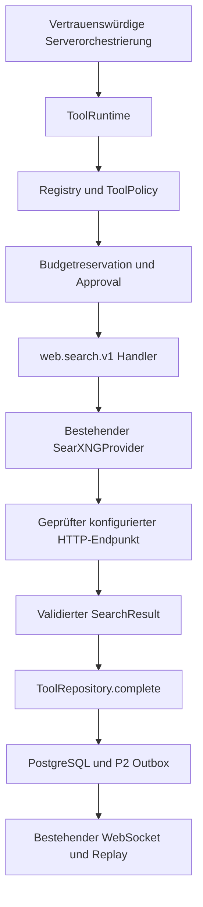

# P6 – sichere SearXNG-Anbindung

P6 implementiert eine ausführbare, serverseitig kontrollierte Suchfunktion,
aktiviert aber noch keine automatische Websuche für Chatbenutzer.

## Bestandsanalyse und Architekturentscheidung

Ausgangsbasis: aktueller `main`, `b8cc076d518b3a1fe8d749a5adaf68b2e4809553`,
nach Abruf von `origin/main` am 13.10.2026. PR #62, #63 und #64 sind enthalten.
Es liegen keine zusätzlichen `AGENTS.md`-Anweisungen im Arbeitsverzeichnis vor.

| Bereich | Tatsächlicher Bestand | P6-Entscheidung |
| --- | --- | --- |
| Provider | `tools/providers/searxng.py`, `httpx.AsyncClient`, POST `/search`, JSON, feste Kategorie `general`, Sprachen `de`/`en`, optionaler Zeitfilter; kein Brave-/SearchProvider-Dispatcher | Bestehenden Provider anbinden, keinen Fallback hinzufügen |
| Registry | Einmalige Definition `web.search.v1`; Handler/Provider fehlen, Kostenpolicy disabled; 4096 Inputbytes, 65536 Outputbytes | Factory erhält optional einen lebenszyklusgebundenen SearXNGProvider und ergänzt genau diese Definition |
| Runtime | `execute`, Claim, Dispatch, Policy-/Configbindung, Reservation, Approval, Execution-Fence, Deadline, Cancelwatcher, Commit, Recovery | Vorhandene Steuerung unverändert verwenden |
| Resultate | `chat_tool_result.output` speichert schema-validiertes JSON; `complete` prüft Scope/Fence und schreibt Resultat, Budgetabschluss und Events atomar | Keine neue Tabelle und keine Migration erforderlich |
| P2 | `chat_stream_event`, Repositorywriter, sequenzierte Projektion, Snapshot/Replay, `toolEventsOnly`, Version 1 | Handler liefert ausschließlich Daten an die Runtime; kein eigener Publisher |
| APIs | Authentisierte Capabilities, `GET /api/v1/chat/tool-runs/{run_id}`, Approvalentscheidung | Keine Execute- oder zusätzliche Resultatroute |
| Anwendung | Composition-Root erstellt ToolRuntime mit leerer `ToolPolicy()`; LLM-Orchestrierung führt keine Tools aus | Default verweigernd halten; Providerkonfiguration erteilt keine Permission |

Nachgewiesene Lücken des vorbereiteten Providers: zufällige Quellen-IDs,
keine Prüfung und Bindung der aufgelösten Netzwerkadresse, keine Handlerbindung
an `GenerationToolContext`, kein Abgleich der Outputobergrenze mit der reservierten
Byteobergrenze. P6 schließt diese Lücken innerhalb der vorhandenen Komponenten.
Der bereits strikte SearchInput-Vertrag wird erhalten: dänische Zeichen sind
als Suchtext möglich; `language="da"` ist weiterhin außerhalb von Version 1.

## Provider-, Input- und Resultatvertrag

`create_tool_registry(searxng)` bindet den bestehenden Eintrag `web.search.v1`
über `tools/search.py:search_handler` an genau dieses Providerobjekt. Ohne Objekt
bleiben Handler und Providerbindung leer. `web.fetch.v1` bleibt nicht ausführbar.
Der Client wird im FastAPI-Lifespan erstellt und nach dem Runtimeabschluss
geschlossen. Es gibt keine globale veränderbare Handlerkonfiguration.

`SearchInput` bleibt Version 1: `query` (1–1000 Zeichen, nicht leer, keine
Steuerzeichen oder ungepaarten Surrogate), `language` (`de`/`en`), `limit`
(1–8, Default 8), `time_range` (`day`/`month`/`year` oder null). Zusätzliche
Felder, doppelte JSONschlüssel, Typkonvertierungen und mehr als 4096 Inputbytes
werden abgewiesen. Dänische Suchtexte mit æ/ø/å sind erlaubt, eine neue Sprache
`da` wird nicht eingeführt. Es gibt kein Kategorie-, Host-, Header-, Proxy- oder
Enginefeld. Der vorhandene Schutz gegen SearXNG-Bangs und Sprach-/Timeoutoperatoren
bleibt bestehen. POST-Formparameter werden strukturiert an HTTPX übergeben.

Der Provider sendet `q`, `format=json`, `language`, `categories=general`,
`pageno=1`, `safesearch=1` und optional `time_range` an den konfigurierten
`/search`-Endpunkt. Die [offizielle Such-API](https://docs.searxng.org/dev/search_api.html)
beschreibt POST-Formparameter und die erforderliche JSONfreigabe in `search.formats`.
Suchbegriffe können durch SearXNG an dessen administrativ konfigurierte Engines
weitergegeben werden; P6 sendet keine Chatgeschichte oder Anhänge.

`SearchResult` und `SearchSource` bleiben unverändert: maximal acht Quellen,
`source_id`, Titel bis 500 Zeichen, HTTP(S)-URL bis 2048 Zeichen, Snippet bis
4096 Zeichen und optionales Datum mit Zeitzone. Ergebnisfelder sind `sources`,
begrenzte feste `warnings`, `provider`, `config_version`, `fetched_at`, `partial`.
Der Handler validiert das serialisierte Ergebnis erneut, einschließlich Provider
und Configbindung; anschließend validiert das Repository nochmals vor dem Commit.

Die vorhandene Normalisierung entfernt HTMLmarkup, Steuerzeichen, Fragmente und
bekannte Trackingparameter, dedupliziert kanonische URLs und erhält die Rangfolge.
Leere Titel und ungültige Einträge werden mit fester Warnung verworfen. Fehlende
Snippets ergeben leeren Text; unbrauchbare oder überlaufende Zeitstempel ergeben
null. Textkürzung und Engineausfälle werden ausgewiesen. Zusätzlich gilt die
65536-Byte-JSONobergrenze auch für mehrbyteige Unicodezeichen.
Quellen-IDs sind jetzt reproduzierbare UUIDv5 aus Provider, Configversion und
normalisierter URL. `fetched_at` ist absichtlich der tatsächliche Abrufzeitpunkt.
Bereits gespeicherte UUIDs oder Resultate werden nicht umgeschrieben.

Eine echte Nulltreffersuche (`results=[]`, keine gemeldeten Enginefehler) ist
erfolgreich. HTTP-/JSON-/Schemafehler und ein leeres Ergebnis mit gemeldetem
Engineausfall werden als Providerfehler behandelt. Einzelne ungültige Treffer
bleiben nach bestehendem Vertrag filterbare Einträge mit `partial=true`.

## Provider- und Konfigurationsbindung

Die Definition deklariert `provider_key="searxng"`; kein anderer Suchanbieter wird
ausgewählt. Run, Permission und Approval binden denselben Provider und dieselbe
Configversion. Claim, Dispatch und Commit prüfen den bestehenden Policyvertrag
und `policy_snapshot`. Der Handler prüft zusätzlich die unveränderliche Version
seines Providerobjekts. Eine Permission mit neuer Version kann dadurch keinen
alten Provider verwenden. Config-/Providerwechsel erzeugen kontrollierte Fehler
und keinen Fallback. Konfigurationswerte werden während eines Runs nicht erneut
aus der Umgebung geladen. Änderungen benötigen einen neu zusammengestellten
Lifespan und eine neue geprüfte `config_version`.

## Vertrauens- und Netzwerkgrenzen

Nur vertrauenswürdiger Servercode ruft `ToolRuntime.execute` auf. LLMantworten,
Chattexte und Browsercommands besitzen keine Toolausführungsberechtigung. P6
erstellt keinen LLMprompt und keine Tool-Chaining-Entscheidung aus Suchresultaten.
Titel und Snippets einschließlich „Ignore previous instructions“ sind ausschließlich
externe Daten. HTMLentfernung erteilt keine Vertrauensfreigabe; spätere Renderer
müssen escapen und P7 muss die Daten ausdrücklich von Systeminstruktionen trennen.

Der Endpunkt stammt ausschließlich aus Betreiberkonfiguration. URLcredentials,
Query/Fragment, nicht erlaubte Hosts, falsche Schemes, Steuerzeichen und ungültige
Ports werden abgewiesen. `EndpointTransport` prüft zusätzlich exakt Methode und
Endpunkt. Redirects werden immer abgewiesen; es gibt keine Redirectausnahme.
`HTTP_PROXY`, `HTTPS_PROXY`, `ALL_PROXY` und `NO_PROXY` werden wegen `trust_env=False`
nicht übernommen. TLSprüfung bleibt aktiv; für öffentliche Ziele ist HTTPS Pflicht.

Bei Hostnamen wird DNS außerhalb des Eventloops innerhalb des Connectlimits
aufgelöst. **Alle** Antwortadressen werden geprüft, dann verbindet HTTPX zur
ausgewählten numerischen IP. Der ursprüngliche Hostheader und TLS-SNI bleiben
erhalten; Zertifikate werden gegen den konfigurierten Host geprüft. Zwischen
Prüfung und Verbindung findet keine zweite Hostnamensauflösung statt. Auch ein
neuer DNSwert bei einer späteren Anfrage wird erneut geprüft. Die Implementierung
verwendet den vorhandenen [HTTPX-Transportvertrag](https://www.python-httpx.org/advanced/transports/)
und die bereits installierte HTTPX-/HTTPCore-SNI-Erweiterung, keine zweite HTTPbibliothek.

Öffentliche IPs sind ohne zusätzliche Adressliste zulässig. Eine nicht leere
`allowed_addresses`-Liste beschränkt auch öffentliche Ziele auf genau diese IPs.
Loopback, RFC1918 und IPv6-ULA erfordern explizit freigegebene **einzelne IPs**
dieses Endpunkts. Es gibt keine CIDR-/Subnetzfreigabe. Link-local, Metadatenadressen,
Multicast, unspecified, reservierte Sondernetze und IPv4-mapped IPv6 werden auch
bei Listeneintrag abgewiesen. HTTP ist nur für exakt freigegebene interne Ziele
zulässig. Ein privater Zielwechsel benötigt einen überprüften Konfigurationswechsel.
DNS mit gemischten erlaubten und unerlaubten Antworten schlägt vollständig fehl.

Ergebnis-URLs sind untrusted data. P6 löst deren DNS nicht auf, öffnet sie nicht
und lädt nichts herunter. Die vorhandene syntaktische URLfilterung ist kein
Netzwerkfreigabenachweis für P7. Insbesondere darf P7 die private Providerausnahme
nicht auf Quellenfetch übertragen. Deterministische Source-IDs ersetzen keine
Owner-/Conversationprüfung beim späteren Fetch.

## Policy, Budget und Approval

Die produktive Composition-Root verwendet weiterhin `ToolPolicy()` ohne Grants.
`NORIS_SEARXNG_ENABLED=true` bedeutet nur, dass der Provider vorbereitet wird.
Eine URL, ein Handler oder ein Providerflag erteilen keine Permission. Fehlende
Permission/Provider ergeben `TOOL_UNAVAILABLE`, explizites deny `TOOL_FORBIDDEN`.
InvocationKinds bleiben `web_mode` und `research_step`; `user_action`/LLMdispatch
sind für dieses Tool nicht erlaubt.

P1b prüft Owner, Conversation, Generation, Parent, Deadline, Approval und Budget
vor dem Dispatch. Die bestehende Reservation bindet Calls, Tokens, Bytes, Kosten,
Währung, UTC-Tag und Generationsgrenze atomar. Suchpermissions benötigen pro Run
einen Call und mindestens 65536 Bytes für das maximale normalisierte JSONresultat.
Der Handler verweigert kleinere Reservierungen vor HTTP. Das HTTPkörperlimit
(standardmäßig 1 MiB) ist eine separate Transportgrenze, nicht die Definition der
Budgetdimension `bytes`. Eine lokale Instanz rechtfertigt keine unbegrenzten Calls.
Eine explizite Kostenobergrenze von null ist nur eine Betreiberentscheidung;
Calls-/Byte-/Generations-/Tagesgrenzen bleiben erforderlich.

Es wird keine neue Abrechnung eingeführt. Erfolg rechnet nach dem vorhandenen
konservativen Vertrag die reservierte Obergrenze ab; undispatchte Reservationen
werden freigegeben, dispatchte Fehler bleiben konservativ angerechnet.
Approvals werden weiterhin durch die vorhandene autorisierte Entscheidung
bestätigt und explizit serverseitig fortgesetzt. Inputdigest, Provider, Version,
Scope, Calls, Kosten, Währung und Ablauf bleiben bindend. Kein automatisches Approve.

Die Suchdefinition ist als read-only/idempotent klassifiziert, hat aber weiterhin
`max_retries=0`. Diese Klassifizierung bewahrt die vorhandenen Zustände
`failed`, `cancelled`, `timed_out` und `interrupted` für die Suche; die generischen
`outcome_unknown`-Verträge anderer Tools bleiben unverändert. Ein Wiederanlauf
führt keinen dispatchten Suchrun erneut aus. Identische laufende Aufrufe teilen
denselben Run; persistierter Erfolg wird wiederverwendet. Reconnect löst keine
neue Invocation aus. Auch 429/5xx/Timeout erhalten keinen automatischen Retry.

## Cancellation, Deadlines und Ressourcen

Der Handler prüft Cancel/Deadline vor und nach HTTP; die Runtime überwacht zusätzlich
die autoritativen Generation-/Parent-/Conversationfences. Runtimecancel stoppt den
Handlertask und damit DNSawait, Verbindungsaufbau oder Streamlesen. Ein akzeptierter
Cancel direkt vor dem Commit verhindert über den bestehenden Execution-Fence
weiterhin Erfolg. Browserdisconnect folgt der bestehenden Chat-Graceperiode,
ein kurzzeitiger Reconnect stoppt die Suche nicht. Shutdown beendet die Runtime
vor dem Providerclient; Recovery bleibt in P1b.

Eine reproduzierte Integrationslücke wurde minimal in `runtime.py` geschlossen:
Runtime und Handler konnten bei gleicher Deadline zweimal den Handlertask
abbrechen. Der zweite Cancel unterbrach den HTTPstreamabschluss. Die Runtime
bricht bereits abbrechende Handler nicht erneut ab und wartet deren Abschluss ab.
Der echte lokale Timeouttest belegt Zustand und Socketabschluss.

Der wirksame Zeitraum ist das Minimum aus Run-/Parent-/Registrydeadline (Registry
15 s) und Providergesamtlimit. Connect/DNS/Pool standardmäßig 3 s, Read-/Writeidle
10 s und Gesamtlimit 15 s. Eine langsam sendende Antwort kann das Gesamtlimit
nicht verlängern. Vier Semaphorslots und maximal vier gepoolte Verbindungen
begrenzen parallele Sucharbeit; wartende Tasks zählen zum Gesamtlimit und sind
abbrechbar. Responses werden roh in 8192-Byte-Blöcken begrenzt gelesen, Kompression
wird abgewiesen. Standardobergrenze 1 MiB, konfigurierbar höchstens 2 MiB;
höchstens 1000 Rohresultate und 1–8 normalisierte Quellen.
Keine DBtransaktion bleibt während HTTP geöffnet.

Das Betriebssystem kann einen bereits laufenden `getaddrinfo`-Worker nicht
zwangsläufig abbrechen. Dessen verspätete Antwort startet nach Cancel keinen
HTTPrequest. Resolverlatenzen und Egressregeln müssen im Betrieb ebenfalls
begrenzt werden; P6 verändert keine Firewall oder Systemdienste.

## Fehlermodell

Alle Browserfehler verwenden vorhandene `ToolErrorCode`-Werte. Diagnostische
Providergründe sind feste interne Werte; Responses, Credentials, Resolverdetails
und Stacktraces werden weder in die Outbox noch in öffentliche Fehlermeldungen kopiert.

| Ursache | Code / Verhalten |
| --- | --- |
| Fehlender/deaktivierter/geschlossener Provider oder fehlende Permission | `TOOL_UNAVAILABLE` |
| Falscher Provider, Version, Scope, Policy oder Netzwerkziel | `TOOL_FORBIDDEN` |
| Ungültiger Input oder SearXNG-Steueroperator | `TOOL_INPUT_INVALID` |
| Handlerresultat ungültig oder falsch gebunden | `TOOL_OUTPUT_INVALID` |
| DNSfehler, Connection refused, TLS-/Transportfehler | `PROVIDER_ERROR` |
| Connect-/Read-/Gesamt-/Tooldeadline | `TOOL_TIMEOUT`, `timed_out` |
| HTTP 429 | `PROVIDER_RATE_LIMIT`, `failed` |
| 403, 5xx, sonstiger Status oder Redirect | `PROVIDER_ERROR`, `failed` |
| Ungültiges UTF-8/JSON, doppelte Schlüssel, falsches MIME, Kompression, zu große Antwort | `PROVIDER_ERROR`, `failed` |
| Leere Antwort mit gemeldeten Enginefehlern | `PROVIDER_ERROR`, `failed` |
| Budgetgrenze | `BUDGET_LIMIT` |
| Fehlendes/abgelaufenes Approval | `APPROVAL_REQUIRED` / `APPROVAL_EXPIRED` |
| Fremder oder veralteter Execution-Fence | `TOOL_STATE_CONFLICT` |
| Akzeptierter Cancel / Shutdown | `TOOL_CANCELLED` / `TOOL_INTERRUPTED` |

## Persistenz, Lifecycle und Replay

`ToolRepository.complete` validiert das Ergebnis innerhalb des kurzen Commits,
prüft den aktuellen Execution-Fence, Scope, Cancel, Policy und Deadline und schreibt
`chat_tool_result`, Runzustand, Budgetabschluss und `chat_stream_event` atomar.
Ein Outboxfehler rollt Resultat und Erfolg zurück. Kein neuer Resultatspeicher,
keine Migration und keine Änderung historischer Ergebnisse sind erforderlich.

Erfolg durchläuft `queued → running → succeeded`, Ereignisse
`tool.progress → tool.started → tool.result → tool.completed`. `sourceCount`
stammt aus dem validierten persistierten Resultat. Fehler/Cancel/Timeout verwenden
`tool.failed`/`tool.cancelled`/`tool.timed_out`; `interrupted` und `outcome_unknown`
bleiben durch die generische P2-Projektion darstellbar. Es gibt keinen erfundenen
Providerfortschritt. Der Handler publiziert keinerlei WebSocket-Nachricht.

`GET /api/v1/chat/tool-runs/{run_id}` liefert das Ergebnis durch bestehende
Authentisierung, Owner-/Conversationscope und Soft-Deletefilter. Archivierte
Chats bleiben lesbar; neue Runs auf archivierten Chats werden verweigert.
P2 sendet nur geprüfte Metadaten und Resultatreferenzen, keine Providertexte.
Snapshot, persistente Sequenzen, Outboxdrain, `toolEventsOnly`, ToolEventVersion 1
und bestehende Frontend-Deduplizierung bleiben unverändert. Offlineabschluss,
laufender Reconnect, wiederholtes Reload und explizite Fortsetzung rekonstruieren
Toolzustände über vorhandene Replay-/Active-Path-Projektion. Ein bereits beendeter
Chat erhält durch Toolbeobachtung keinen neuen Textlauf. P1b erlaubt keinen
erfolgreichen Resultatcommit nach terminaler Generation; spätere Fehler-/Cancel-
Terminals bleiben über P2 rekonstruierbar.

## Konfiguration und nativer Betrieb

| Prozessvariable | Vorgabe / Grenze |
| --- | --- |
| `NORIS_SEARXNG_ENABLED` | false; aktiviert ausschließlich Provideraufbau |
| `NORIS_SEARXNG_BASE_URL` | erforderlich bei Provideraufbau, exakte HTTP(S)-Basisadresse |
| `NORIS_SEARXNG_ALLOWED_HOSTS` | erforderliche JSONliste exakter Hosts |
| `NORIS_SEARXNG_ALLOWED_ADDRESSES` | Default `[]`; JSONliste exakter kanonischer IPs, zwingend für interne Ziele |
| `NORIS_SEARXNG_CONFIG_VERSION` | erforderliche geprüfte nicht geheime Version |
| `NORIS_SEARXNG_CONNECT_TIMEOUT_SECONDS` | 3, positiv, höchstens Gesamtlimit |
| `NORIS_SEARXNG_READ_TIMEOUT_SECONDS` | 10, positiv, höchstens Gesamtlimit |
| `NORIS_SEARXNG_TOTAL_TIMEOUT_SECONDS` | 15, positiv, höchstens 15 |
| `NORIS_SEARXNG_MAX_RESPONSE_BYTES` | 1048576, 1024–2097152 |
| `NORIS_SEARXNG_MAX_RESULTS` | 8, 1–8; reduziert das validierte Inputlimit |

Provideroptionen werden wie bisher aus der **Prozessumgebung** gelesen, ohne
implizite Provider-dotenv-Datei. Das Enableflag gehört zu den bestehenden Appsettings.
Fehlende/ungültige Providerkonfiguration lässt das Tool nicht verfügbar und
verhindert den normalen Chatstart nicht. Es gibt keine öffentliche Defaultinstanz
oder hartcodierte Produktivdomain. Die `.env.example` enthält ausschließlich
deaktivierte Beispielwerte; ein Betreiber muss Providerwerte ausdrücklich exportieren.

Native Voraussetzung: vorhandene Python-3.14-/FastAPI-Installation, PostgreSQL,
erreichbare separat betriebene SearXNG-Instanz mit JSONfreigabe, DNSauflösung und
bei externem Betrieb gültige TLS-Zertifikate. Backend und Suchinstanz müssen
nicht auf demselben Host laufen. Für eine lokale Instanz ist beispielsweise
`127.0.0.1` zusätzlich als exakte Adresse freizugeben. Es wird keine Infrastruktur
installiert oder gestartet. Compose bleibt eine optionale Entwicklungs-/Testhilfe.
Der optionale Backendoverlay gibt keine Permission und aktiviert den Provider
standardmäßig nicht; private Containeradressen müssen explizit geprüft werden.

## Tests, Messungen und Einschränkungen

Adversarialer Review des P6-Heads `36feecad51335b7c4a6a726ae17cd4a71e8b6cca`
am 13.10.2026 bestätigte zusätzliche Grenzfälle. Der Transport sperrt jetzt
IPv6-Site-Local- und reservierte Adressen ausdrücklich, auch wenn Python sie als
global klassifiziert (etwa `fec0::1` und IPv4-einbettende reservierte IPv6-Adressen).
Exakt freigegebene Loopback-/RFC1918-/ULA-Adressen bleiben die einzigen internen
Ausnahmen. Der Runtime-Abbruch und Shutdown warten auch bei wiederholtem
`Task.cancel()` auf Stream-, Worker- und Watcherbereinigung. Shutdown wartet
zusätzlich auf bereits begonnene Run-Anlage, bevor Datenbank und Provider schließen.
Caller-Cancel während der Run-Anlage setzt auch für bereits committeden Runs den
persistierten Cancel-Fence; diese bleiben nach Reconnect nicht erneut ausführbar.
Persistierte Ein-/Ausgaben verwenden bei erneuter Validierung dieselbe kompakte
UTF-8-Kodierung wie der ursprüngliche Payload; ASCII-Escapes dürfen gültige
Unicode-Suchen oder Resultate nicht künstlich über das Bytelimit vergrößern.
Die Korrekturen ändern weder Policy, Provideraktivierung, Retries noch P2-Vertrag.

Reguläre CI verwendet ausschließlich kontrollierte Fake-SearXNG-Antworten.
Providerunits decken Sprachen/Unicode, Operatoren, HTML, URLangriffe, Dubletten,
Mengen-/Bytegrenzen, Status-/Transportfehler und JSONangriffe ab. Netzwerkunits
prüfen exakte interne Freigaben, Metadaten, gemischtes DNS, DNS-Rebinding mit
geprüfter tatsächlicher Verbindung, DNS-Cancel/-Timeout sowie Host-/SNI-Erhalt.
Echte Loopbacksockets prüfen Streams, langsame Antworten und Abbruch. Zusätzlich
belegen lokale IPv4-/IPv6-TLS-Sockets mit einem ausschließlich für den Test erzeugten Zertifikat,
dass IP-Pinning die Hostzertifikatsprüfung erhält: passender Host erfolgreich,
falscher Host oder fehlendes Zertifikatsvertrauen `PROVIDER_ERROR` ohne
HTTP-Suchdispatch. Proxy-Umgebungsvariablen bleiben wirkungslos.
Zertifikatsprüfung bleibt aktiv.

`test_searxng_runtime.py` verbindet den echten Handler mit lokalen HTTP-Sockets
und einer disposable PostgreSQL-Datenbank (`*_test`). Es prüft Admission,
Approval, Konkurrenz, vorhandenes Budget, Dispatch, Config-/Policywechsel,
Fencing, Cancel vor Commit, Recovery, Resultat-/Eventrollback, REST-Isolation,
Archiv/Soft Delete und Replay. Die bisherigen P1b-/P2-Suiten bleiben zusätzliche
Regressionen für Parent-/Approval-/Generationmanipulationen und späte Terminals.
Die bestehende P2-Browserfixture benutzt jetzt den echten Provider; nur die
ausdrücklich ausgewählte Testapp erkennt Testorchestrierungsbefehle. Sie ist
auf `environment=test` und eine `*_test`-Datenbank begrenzt. Eine normale
Appinstanz besitzt weder diesen Pfad noch die Teststatistikroute.

Browserfälle prüfen Lifecycle, echte persistierte Suchresultate, Offlineabschluss,
mehrfachen Reconnect/Reload, Fehler, Timeout, Stop und Fortsetzung in Desktop/Mobile
und Light/Dark. Bestehende UI-/HTTP-LLM-/WebSocketfälle prüfen den normalen Chat,
Modelle, Reasoning, Regenerate, Anhänge, Lernmodus und History bei deaktivierter
Suchfreigabe. API-/WebSocket-Verträge werden mit `pnpm api:check` geprüft;
öffentliche Schemas und generierte Dateien werden nicht manuell geändert.

Lokale Messung am 13.10.2026: CPython 3.13.15, PostgreSQL 18.6, Loopback-HTTP,
fünf synthetische Quellen, normaler HTTPX-Pool, keine künstliche Antwortwartezeit,
einzelne Runs in einer Generation. Währenddessen liefen Browserfixtures auf
demselben Host; CPU und I/O waren nicht isoliert. `test_controlled_latency_measurements`
schreibt die Rohwerte als `performance.json` in den Pytest-Tempordner und als
`P6_PERFORMANCE` in die Testausgabe. Die ersten Requests schließen Poolaufbau ein.

| Messung | Wiederholungen | Median ms | Minimum ms | Maximum ms |
| --- | ---: | ---: | ---: | ---: |
| Providerrequest einschließlich Normalisierung | 10 | 13,06 | 8,52 | 21,01 |
| ToolRun von execute bis Rückgabe | 10 | 133,41 | 109,58 | 376,97 |
| Resultat-/Budget-/Eventcommit einschließlich DBprüfungen | 10 | 36,15 | 27,81 | 131,88 |
| Sofortiger P2-Replayabruf nach Runtimeabschluss | 10 | 36,29 | 13,40 | 69,07 |
| Cancelrequest bis terminaler Run und geschlossenem HTTPstream | 5 | 155,26 | 119,10 | 222,86 |

Browser messen separat den Abstand vom abgeschlossenen DBcommit bis zum Empfang
von `tool.completed` mit derselben Hostuhr und drei unabhängigen Chats je
Desktop-/Mobile-/Themefall. Unter parallel laufender UI-Suite: zwölf Messungen,
Median 72,05 ms, Minimum 13,02 ms, Maximum 167,53 ms; alle 24 P2/P6-Browserfälle
bestanden im zugehörigen Lauf. Es handelt sich um synthetische Loopbackmessungen
ohne echte Engines, keine Suchqualitäts- oder Produktivlastprüfung. Die kleine
Stichprobe begründet weder Kapazitäts- noch p95-Zusagen.

Aktualisierte Messung nach den Runtime-/Unicode-Nachträgen, erneut unter hoher
paralleler Testlast: Provider 22,31 ms (12,27–58,10), ToolRun 384,34 ms
(201,96–582,94), Commit 63,68 ms (38,02–205,41), Replay 58,62 ms (31,28–167,40),
jeweils zehn Wiederholungen; Cancel 514,66 ms (387,31–1062,33), fünf Wiederholungen.
Im erweiterten Browserlauf: zwölf Empfangsmessungen, Median 87,46 ms,
Minimum 12,38 ms, Maximum 179,10 ms. Die Variation zeigt den Einfluss der
konkurrierenden Hostlast; daraus wird keine Produktivlatenzzusage abgeleitet.

Lokaler und aktualisierter CI-Prüfstand:

| Vorhandenes Gate | Ergebnis |
| --- | --- |
| Backend-Units, Verträge, HTTP einschließlich IPv4-/IPv6-TLS | 729 bestanden |
| Frontend-Units | 504 bestanden |
| PostgreSQL, Migrationen, echte Caddy-/Nginx-Proxys | lokaler Basislauf 223 bestanden; aktualisiertes CI-DB-Gate bestanden |
| Erweiterte P1b-/P6-Runtimeprüfungen | 76 bestanden, beide zusätzlichen Racefälle bestanden; 233 Fälle in der Gesamtsuite gesammelt |
| UI-Browser, Desktop/Mobile und Themes | 308 bestanden, 33 bestehende Projekt-/Viewport-Skips |
| HTTP-LLM-Browser | 83 bestanden, 13 bestehende bedingte Skips |
| WebSocket-Gesamtlauf | 152 bestanden, 22 bedingte Skips, zwei Fixturefehler im Erstlauf |
| Erweiterte P2-/P6-Browser, Tastatur und Button | 31 bestanden; ein Artefaktkonflikt, isolierte Fortsetzungswiederholung bestanden |
| Ruff, Format, striktes Pyright, ESLint, Nuxt/Vue, Generator-Typecheck | bestanden |
| API-/WebSocket-Vertragsdrift | bestanden, generierte Dateien unverändert |
| Backend-Sourcepaket/Wheel und Frontend-Produktionsbuild | bestanden |
| Basis-/Dev-/SearXNG-/Backendoverlay-Composekonfiguration | syntaktisch gültig |

CI-Laufreferenzen und endgültiger Reviewstatus stehen im PR. Lokale Fehlstarts
(Testdatenbankvoraussetzungen, lokale Node-Abhängigkeiten, Hilfsportkollision und
Fixture-Synchronisation) werden dort getrennt von bestandenen
Prüfungen aufgeführt. Der lokale Standard-Compose-Smoke konnte bisher wegen eines
Paketdownloadfehlers im Buildcontainer nicht abgeschlossen werden; dessen CI-Gate
bleibt erforderlich.

Bekannte Grenzen: kein Live-Engine-Qualitätsnachweis, kein Sourcefetch, kein
autonomer Chat-Webmodus, keine LLMquellenübergabe, keine Zitate oder Quellen-UI.
Unverändert ein Backendworker; horizontale Tool-/Event-/Ticketadmission benötigt
gesonderte Betriebsarbeit. DNS wählt eine geprüfte Adresse ohne automatischen
Verbindungsfallback. SNI-Pinning hängt am vorhandenen gepinnten HTTPX-/HTTPCore-
Vertrag; Upgrades müssen die Netzwerk-/TLS-Regressionen bestehen.

## Integrationsvertrag für P7 und spätere Aktivierung

P7 verwendet ausschließlich `ToolRuntime.execute(owner, request, payload)`:
Generation muss autoritativ laufen, Run-ID und Step-Key müssen stabil bleiben,
Input wird per Registry validiert, Provider und geprüfte Configversion kommen vom
Server. P7 muss eine explizite begrenzte `ToolPermission` (`allow` oder
`approval_required`) in der vorhandenen Policy zusammenstellen und den
Providerlebenszyklus erhalten. Mindestens ein Call/65536 Ergebnisbytes pro Suchrun
sind zu reservieren; Tages-/Generationsgrenzen und Währung bleiben explizit.
Resultate werden nach Erfolg aus dem bestehenden Repository/REST gelesen;
Reconnect beobachtet P2 und erzeugt keine neue Invocation.

Vor späterer Freigabe: eigene Instanz und Engines prüfen, Endpunkt/IPs/TLS,
Timeouts und Mengenlimits reviewen, Version dokumentieren, Kosten-/Budget- und
Approvalpolicy explizit freigeben, P7-Orchestrierung und Daten-/Promptgrenze
implementieren und GPT-OSS/DeepSeek Ende-zu-Ende mit Quellenkontext testen.
Providerflag allein genügt nicht. Rollback: Providerflag deaktivieren, Permission
entfernen und laufende Runs über vorhandenes Cancel/Shutdown beenden. Persistierte
Ergebnisse und P2-Replay bleiben im bestehenden Speicher. Dieser PR führt keine
Aktivierung, Migration, Deployment oder Merge aus.

## P7a: Secure Source Fetch

[Secure Source Fetch and Content Extraction](SECURE-SOURCE-FETCH.md) bindet den
bestehenden `web.fetch.v1`-Handler optional an `public_source/p7a-v1`. Der
Toolinput bleibt ausschließlich `source_id`; eine interne Suchlaufreferenz am
ToolRun sichert Owner, Conversation, Generation und Parent. Persistenz, Budgets,
Cancel-Fences, Outbox, begrenzte P2-Projektionen und Replay bleiben im bestehenden
Runtimepfad. Private SearXNG-Ausnahmen werden nicht übernommen. Beide Permissions
bleiben separat und deny by default; P7b-Orchestrierung wird nicht aktiviert.
