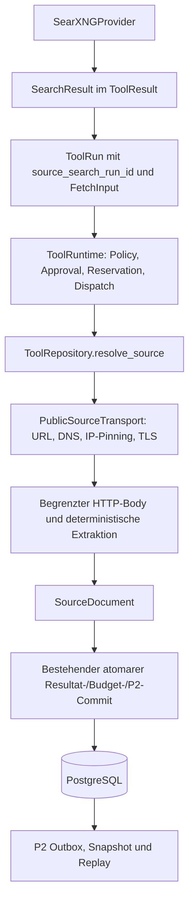

# P7a — Secure Source Fetch and Content Extraction

P7a bindet `web.fetch.v1` an einen ausführbaren, typisierten Backendhandler. Es gibt
keine produktive Permission, automatische Suche, Modellorchestrierung, neue
Execute-API oder Quellenübergabe an ein LLM. Merge, Deployment und Aktivierung
sind separate menschliche Entscheidungen. Grundlage ist `main` nach PR #66,
Commit `a33beba`; verwendet werden die tatsächlichen P1b-/P2-/P6-Komponenten.

## 1. Architektur und Bestandsanalyse

| Untersuchte Bestandsfrage | Befund / Entscheidung |
| --- | --- |
| Speicherung des SearchResult | `ToolRepository.complete` validiert die Registryausgabe und speichert JSONB in `chat_tool_result`, Version 1, einschließlich kanonischem SHA-256-Resultatdigest. |
| Erzeugung der Quellen-ID | P6 verwendet UUIDv5, Namespace URL, Name `noris-ai:searxng:{config_version}:{url}`. Die identische Funktion heißt jetzt `search_source_id`. |
| Zuordnung zum Suchresultat | `SearchResult.sources` enthält die IDs und Original-URLs. Eine ID ist kein global eindeutiger Suchlauf oder Berechtigungsnachweis. |
| Owner und Conversation | `ToolRunCreate` ist vertrauenswürdiger Serverkontext. Die Repositoryabfragen prüfen Owner/Conversation/Generation; zusammengesetzte Fremdschlüssel erzwingen diese Grenzen. |
| Speicherung des Fetchresultats | Derselbe `ToolResult`-Speicher und derselbe Runtimecommit wie bei Search; kein Schreiben aus dem Handler. |
| Geeignete Abfragen | `_run`, `_scope`, `_live_parent`, `get_run`, `get_result` und die Verbindung `ToolRun.id = ToolResult.run_id` sind bereits vorhanden. |
| Persistenzerweiterung | Eine nullable Suchlaufreferenz am bestehenden ToolRun ist nötig, um kollidierende IDs ausdrücklich einem Suchlauf zuzuordnen. Keine neue Tabelle, keine duplizierte URL oder Quelltextkopie. |
| Cancellation | P1b-Event/Watcher, persistierter Cancel-Fence und Cancellation/Shutdown-Drain aus P6 bleiben maßgeblich. |
| Providerkonfiguration | Optionale Startupbindung im bestehenden `create_tool_registry`; `public_source` und `p7a-v1` sind unabhängig von `searxng` und dessen Configversion. |
| P2-Writer | `ToolRepository._event` erstellt die begrenzte Projektion; `chat.stream.append_event` schreibt die vorhandene transaktionale Outbox. |

## 2. Source-ID-Vertrag

`FetchInput` enthält weiterhin ausschließlich `source_id: UUID`, Extra-Felder
sind verboten. Registry: `permission="web_fetch"`, Aufrufarten `web_mode` und
`research_step`, Inputlimit 256 Bytes, absolute Ausführungsgrenze 10 Sekunden,
Outputlimit 262.144 Bytes. `SourceDocument.text` bleibt auf 65.536 Zeichen begrenzt.
Die Outputfelder und öffentlichen API-/WebSocketverträge ändern sich nicht.

Der Server muss zusätzlich im **internen** `ToolRunCreate.source_search_run_id`
den ausdrücklich erlaubten Suchlauf binden. Diese additive optionale Eigenschaft
ist kein Toolinput und wird von keiner neuen Browserroute angenommen. Beim Fetch
ist sie erforderlich; andere Tools dürfen sie nicht verwenden.

## 3. Autorisierte Source-Resolution

Die Admission prüft die Quelle vor dem Anlegen eines Fetchruns. Der Handler löst
sie nach Policy/Reservation/Dispatch erneut auf; der Erfolgscommit prüft dieselbe
persistierte Zuordnung nochmals in seiner Transaktion.

Erforderlich sind exakt derselbe Owner, Conversation, Generation und Parent wie
beim gebundenen Suchlauf. Die Conversation muss vorhanden, nicht gelöscht und
für Ausführung nicht archiviert sein. Die Generation muss `queued`/`running`
bleiben. Ein Parent muss aktiv und innerhalb seiner Deadline sein. Ein bereits
erfolgreicher Searchrun kann deshalb **nicht** selbst der Runtimeparent sein:
Search und Fetch sind Geschwister unter einem aktiven Orchestrierungsparent oder
haben beide keinen Parent.

Der ausgewählte Suchlauf muss `web.search.v1`, Schema 1, `succeeded`, nicht
cancelled und dem gespeicherten Provider/Configpaar zugeordnet sein. Es darf
genau ein Resultat in Version 1 geben. Schema, Bytegrenze, Resultatdigest,
Provider, Configversion, alle Quellen-UUIDv5 und eindeutige IDs werden erneut
validiert. Genau eine Quelle muss die angefragte ID besitzen. Fehlende,
manipulierte, doppelte oder mehrdeutige Referenzen liefern `TOOL_FORBIDDEN`
ohne Information über einen fremden Suchlauf.

Dieselben URLs in verschiedenen Suchläufen sind zulässig, weil jeder Fetch eine
konkrete persistierte Suchlaufreferenz besitzt. Ein Retry mit geänderter Referenz
scheitert am bestehenden Idempotenzvergleich. Es gibt keine Suche über globale
Source-IDs und keine implizite Quellenfreigabe über Generationen hinweg.

## 4. Berechtigungsmodell

`ToolPolicy()` bleibt leer und deny by default. Das Binden eines Providers oder
Aktivieren eines Infrastrukturflags erteilt keine Benutzerpermission. Search und
Fetch benötigen separate `ToolPermission`s mit passenden Provider/Configwerten.
Die existierende Approval-API bleibt unverändert. Ein Approval startet keinen
Fetch; die vertrauenswürdige Orchestrierung muss denselben Run explizit fortsetzen.
Abgelaufene/revoked Permissions und Approvals blockieren Dispatch/Commit.

## 5. SSRF-Schutz

`EndpointTransport` bleibt an den administrativen SearXNG-POST-Endpunkt gebunden.
`PublicSourceTransport` erlaubt nur GET zu öffentlichen HTTP(S)-Quellen. Die
SearXNG-Allowlist wird niemals in den Sourceprovider übernommen.

URLgrenze: 2.048 Zeichen vor und nach HTTPX-Normalisierung; keine Credentials,
Backslashes, URLkontrollzeichen, verschleierte Authority oder ungewöhnlichen
Ports. HTTPS verwendet ausschließlich 443. HTTP ist standardmäßig verboten;
mit ausdrücklicher Operatorpolicy ist ausschließlich Port 80 zu öffentlichen
Adressen erlaubt. Andere Schemes und Unix-Sockets sind ausgeschlossen.

Die gemeinsame IP-Klassifizierung verwirft Loopback, RFC1918, CGNAT, Link-local,
Metadata, Docker-/Kubernetes-Privatnetze, Multicast, reservierte und nicht globale
Adressen, IPv6-ULA/site-local, IPv4-mapped IPv6 sowie IPv6 außerhalb globalem
Unicast `2000::/3`. NAT64-/kompatible IPv4-Formate, `2001::/23`, 6to4 und spezielle
IPv4-Routing-/Cloudplattformadressen werden konservativ gesperrt. Die private
SearXNG-Ausnahme gilt nur für dessen exakt allowlistete interne Adressen.

## 6. DNS, IP-Pinning und TLS

Die gemeinsam extrahierte `checked_addresses`-Funktion prüft **jede** A-/AAAA-
Antwort einschließlich der durch CNAME-Auflösung erhaltenen Zieladressen.
Eine unsichere Adresse sperrt die gesamte Antwort. Auch DNS-Auflösung für
Redirects und ausdrücklich neue Runs wird erneut durchgeführt. IDNA verwendet
die ASCII-Authority (`raw_host`) für DNS und TLS-SNI.

Der eigentliche Connect erhält ausschließlich eine geprüfte numerische IP.
Es gibt keine zweite Hostauflösung oder Adressfallback. Hostheader und
Zertifikats-/SNI-Hostname bleiben die ursprüngliche Authority. Vier fest begrenzte
Connection-Slots halten jeweils höchstens eine Verbindung. Vor dem Wechsel des
ursprünglichen `(scheme, hostname, port)` wird der betreffende Pool geschlossen.
So kann TLS zu zwei Hostnamen mit derselben IP keine Zertifikatsprüfung durch
Wiederverwendung einer bereits bestehenden Verbindung umgehen.

TLSprüfung bleibt aktiv (`verify=True`), HTTP/2-Coalescing ist deaktiviert.
`trust_env=False` gilt sowohl im Client als auch im Transport; HTTP_PROXY,
HTTPS_PROXY, ALL_PROXY, Umgebungszertifikate und Proxy-/Socketparameter werden
nicht übernommen. Lokale TLSfixtures prüfen echte Handshakes, IPv4/IPv6,
Zertifikatsvertrauen, falsche Hostnamen, IDNA und gemeinsame Ziel-IP.

## 7. Redirects

Maximal drei Redirects; nur 301/302/303/307/308. Jeder Hop erhält neue URL-,
DNS- und IP-Prüfungen. Schleifen werden anhand der normalisierten URL erkannt;
die Gesamtdeadline wird nicht zurückgesetzt. HTTPS→HTTP ist immer verboten,
HTTP→HTTPS ist nur bei ausdrücklich erlaubtem initialem Public-HTTP möglich.

Raw `Location` wird bereits im Responsehook geprüft, bevor HTTPX seine
`next_request`-Metadaten erzeugt. Danach verarbeitet die eigene begrenzte
Redirectschleife das Ziel. Fehlende/doppelte Locations, Schemes, Ports und
Credentials scheitern geschlossen. Redirectbodies werden nicht konsumiert,
sondern der Stream wird geschlossen. Bereits konsumierte Bodybytes gehören
zum Gesamtzähler des Abrufs. Jedes Requestobjekt hat ausschließlich feste
serverseitige Header; keine Cookies, Authorization, Referrer oder Antwortheader
werden übernommen. Der Clientcookiejar wird nach Antworten/Fehlern geleert.

## 8. HTTP-Client und Shutdown

Ein async HTTPX-Client pro gebundenem Provider; feste vier parallele Fetches,
vier höchstens einkanalige Pools, Connect-/Pooltimeout 2 Sekunden, Readtimeout
3 Sekunden, keine Transport-/Toolretries. Semaphorewartezeit, DNS, TLS,
Download und Verarbeitung liegen innerhalb derselben Gesamtdeadline.

Streams werden bei Erfolg, Fehler, Redirect, Cancel und Timeout geschlossen.
Appshutdown schließt zunächst Generationmanager/ToolRuntime, danach die Provider.
Die bestehenden P6-Fixes für wiederholten Taskcancel und Admissiondrain bleiben
unverändert. Ein geschlossener Provider ist `TOOL_UNAVAILABLE`.

## 9. Downloadlimits

| Dimension | Feste technische Grenze |
| --- | --- |
| Konsumierter komprimierter HTTP-Body | 1.048.576 Bytes insgesamt |
| Dekomprimierter Body | 2.097.152 Bytes |
| Verarbeitete Antwortheader | 16.384 Bytes, höchstens 100 Header |
| Rohbodychunks | 16.384 Bytes |
| HTML-Feedchunks | 4.096 Unicodezeichen |
| Parsercallbacks | 50.000 |
| HTML-Tiefe / Attribute pro Element | 128 / 128 |
| Extraktionsdauer | 2 Sekunden innerhalb der 10-Sekunden-Deadline |
| Gespeicherter Text | 65.536 Zeichen und kanonisches Outputlimit |

Header werden vor Verarbeitung geprüft; der zugrunde liegende HTTP/1-Parser
kann Header bis zu seinem eigenen begrenzten Empfangspuffer vorab einlesen.
Netzwerk-/Kernelpuffer und TLSframing sind nicht als Bodybytes budgetiert.
Gzip wird mit `zlib.decompress(..., remaining + 1)` begrenzt: nie vollständiges
ungeprüftes Entpacken. Überschreitung, abgeschnittenes Gzip, weitere Members,
Trailingdata oder beschädigte Kompression scheitern. Unsupported Encodings
werden zurückgewiesen; es gibt keine automatische HTTPX-Dekompression, da der
Fetcher ausschließlich `aiter_raw` liest.

## 10. Content-Type-Validierung

Nur eindeutiges `text/html` und `text/plain`, optional ein eindeutiges Charset.
Fehlender/mehrfacher/kommagetrennter Content-Type scheitert. PDF, Archive,
Octet-stream, Medien und JavaScript werden nicht verarbeitet. Bekannte
PDF-/ZIP-/Bild-/Medienmagicbytes können diese Grenze nicht durch einen falschen
Textheader umgehen. Ungewöhnliche Transfer-Encoding-Werte und gleichzeitig
Content-Length/Transfer-Encoding werden verworfen.

Erlaubte Codecs: UTF-8/UTF8, ASCII, ISO-8859-1 und Windows-1252; ohne Charset
striktes UTF-8. Ungültige Sequenzen werden nicht still durch Ersatzzeichen
verdeckt. HTML-Metacharsets und heuristisches Encodingraten ändern die deklarierte
HTTP-Codierung nicht. Ein HTTP-200 allein genügt nicht.

## 11. HTML-Extraktion

Der bestehende Standardbibliotheksstack wird um einen begrenzten `HTMLParser`
erweitert; keine neue HTMLengine-Abhängigkeit und kein DOMaufbau. Lesbare
`main`-/`article`-Inhalte haben Vorrang; andernfalls deterministischer Bodyfallback.
Überschriften, Absätze, Listen und Tabellenzellen erhalten Textstruktur. Entities
werden dekodiert. Entfernt werden script/style/noscript/head/nav/header/footer,
aside/Formulare/Templates/Frames/aktive Einbettungen, versteckte Attribute/CSS
sowie erkennbare Ad-/Tracking-/Cookie-/Navigationselemente.

Unvollständiges HTML ist zulässig innerhalb der Parsergrenzen. JavaScript,
Subresources und Linkziele werden nie ausgeführt/geladen. Clientseitig erzeugte
Artikel können leer/nicht extrahierbar sein; semantische Boilerplateerkennung
ist bewusst eine Heuristik und keine Garantie für jede Webseite.

## 12. Unicode-Normalisierung und Trunkierung

Strikte Dekodierung, optionaler initialer BOM entfernt, Unicode NFC,
CRLF/CR→LF. NUL, Kontroll-/Format-/Surrogatzeichen werden entfernt;
Unicodewhitespace wird reduziert, Absatzgrenzen auf höchstens zwei LF begrenzt,
Ränder getrimmt. Die Ausgabe ist reiner untrusted Text, kein Chat-HTML.

Kürzung ist ein deterministisches Präfix nach Unicode-Codepoints, zuerst maximal
65.536 Zeichen, dann per binärer Suche passend zum tatsächlich kanonischen
UTF-8-JSON. Alle Metadaten und JSON-Escapes zählen mit. Ein zusätzlicher Abstand
von 64 Bytes hält auch PostgreSQLs `jsonb::text`-Constraint einschließlich dessen
Feldzwischenräumen ein. Keine Ergänzung erfundener Inhalte oder Ellipse. Der
unveränderte v1-Vertrag enthält keinen Trunkierungsmarker; Verbraucher müssen
diesen dokumentierten möglichen Informationsverlust berücksichtigen.

## 13. SHA-256-Digest

`digest = sha256(final_normalized_and_truncated_text.encode("utf-8")).hexdigest()`.
Keine Hashbildung über ursprüngliches HTML, BOM oder ausgelassenes Textende.
Die Commitvalidierung prüft diesen Zusammenhang erneut. Zusätzlich enthält
ToolResult den bestehenden separaten Digest über das gesamte kanonische
SourceDocument-JSON (`sort_keys`, `ensure_ascii=False`, kompakte Separatoren).

## 14. SourceDocument und leere Seiten

Genau `source_id`, `text`, `digest`, `mime`, `final_url`, `fetched_at` gemäß
bestehendem strict/frozen/extra-forbid-Schema. MIME ist der unterstützte
Ursprungstyp; final_url das letzte sicher geprüfte Redirectziel; fetched_at
UTC nach dem tatsächlichen Bodyempfang, vor Extraktion. Ein leerer Body oder
eine strukturell leere HTMLseite ist erfolgreich leer. Ausschließlich verworfene
technische Inhalte liefern `TOOL_OUTPUT_INVALID`; HTTPfehler, Cancel und Timeout
bleiben eigene Runtimezustände. Keine erfundenen Veröffentlichungsdaten.

## 15. Persistenz und Provenienz

`Fetch ToolRun.source_search_run_id → Search ToolRun → Search ToolResult.sources`
liefert die ursprüngliche URL und den Suchlauf. `Fetch ToolRun.input.source_id`
und dessen validierter Inputdigest binden die Quelle. `Fetch ToolResult` liefert
den gespeicherten Text, final_url, Textdigest und fetched_at. Owner/Conversation/
Generation/Parent bleiben am vorhandenen ToolRun. Die Referenz wird auch im
GenerationToolContext serverseitig gebunden; sie bleibt interne Provenienz und
wird nicht als neue öffentliche Dispatchmöglichkeit exponiert.

Resultat, bestehender Budgetabschluss, succeeded und tool.result/tool.completed
werden nach Execution-Fence, Source-/Policy-/Cancel-/Deadlineprüfung atomar
committed. Ein Outboxfehler rollt den gesamten Erfolg zurück. Die bestehende
noris_app-Rolle darf ToolResult-Payloads nicht aktualisieren; Tests überprüfen
diesen Schutz. Privilegierte Datenbankkorruption liegt außerhalb der Runtime-
Autorisierung; Digest-/Identitätsvalidierung erkennt dennoch manipulierte Daten.
Ein Abruf belegt Herkunft und Zeitpunkt, nicht die inhaltliche Richtigkeit.

## 16. Budgetverwaltung

Keine zweite Verwaltung: BudgetCoordinator reserviert vor Dispatch Calls,
Outputbytes, Tokens, Kosten und Tages-/Generationslimits. Der Handler verlangt
mindestens die volle Registry-Outputreservation und genau einen Call. Kein
HTTPrequest ohne erfolgreiche Reservation und Permission. Fetchresultate kosten
keine LLMtokens; die serverseitige Permission definiert die konservativen
Token-/Kostenobergrenzen, nicht die Webseite.

Die bestehende Byte-Dimension beschreibt **reservierte maximale serialisierte
Tooloutputbytes**, nicht gemessene Netzwerkbytes. Wie P6 rechnet P1b nach Dispatch
bei unbekanntem Verbrauch konservativ die Reservation ab. Das separate technische
Download-/Dekompressionslimit schützt HTTPinput und Arbeitsspeicher. Diese
Dimensionen werden weder gleichgesetzt noch doppelt verrechnet. Ein neuer Run
braucht eine neue Reservation; globaler Cachezugriff ist nicht vorhanden.

## 17. Cancellation

`context.check()` vor Resolution, Netzwerk, jedem Hop/Bodychunk/Parserchunk und
nach Ausgabevalidierung. Runtimecancel unterbricht den Handler auch während
DNS/Connect/TLS/Read und Semaphorewartezeit. Begrenzte synchrone Dekompressions-
und Parserstücke werden an kooperativen Checkpoints abgebrochen. Akzeptierter
persistierter Cancel verhindert jeden späteren Erfolgscommit. Generation- und
Parentcancel verwenden dieselben bestehenden Fenceprüfungen. Doppelcancel,
Cancel vor Dispatch/vor Commit und Shutdown sind getestet.

## 18. Timeouts und native DNS-Grenze

10 Sekunden absolute Fetchdeadline, zusätzliche Connect/Pool-/Read-/Parsergrenzen
wie oben; bei Redirects und Warteschlange kein Neustart der Deadline. Timeout
wird auf `TOOL_TIMEOUT`/`tool.timed_out` abgebildet. Keine Recovery lädt automatisch.

Wie P6 läuft libc-getaddrinfo außerhalb des Eventloops. Cancellation beendet
Await/Handler und verhindert jeden nachfolgenden Connect, kann jedoch einen
bereits gestarteten Betriebssystem-Resolveraufruf nicht physisch abbrechen.
Native Resolvertimeouts/retries müssen begrenzt sein; dies ist eine Grenze der
vorhandenen getaddrinfo-Technik, keine Zusage zur sofortigen Beendigung eines
Kernel-/Resolveraufrufs. Alle asyncio-Tasks und HTTPstreams werden geordnet beendet.

## 19. Idempotenz

Run-ID, Generation/Step-Key, normalisierter Inputdigest, Provider/Config und nun
auch source_search_run_id bilden den vorhandenen Wiederholungsvertrag. Gleicher
erfolgreicher Run liefert das gespeicherte autorisierte Resultat ohne Download.
Gleichzeitige Aufrufe teilen im Singleworker denselben aktiven Task. Andere
Worker/Executions können den Fence nicht übernehmen; kein neues Workermodell.
Ein Crash nach Dispatch endet durch bestehende Recovery als interrupted statt
automatischem Retry. Fetch ist idempotent markiert, hat aber null automatische Retries.

## 20. Caching

Nur bestehendes erfolgreiches Runresultat über Owner-/Conversation-geprüfte
Repository-/APIabfragen. Kein globaler URL-/Source-ID-Cache, keine TTL oder
implizite Aktualisierung. Ein ausdrücklich neuer Run darf neu laden und braucht
eigenen Step-Key/Run-ID/Reservation. Reconnect, Snapshot und Replay sind readonly.

## 21. Fehlercodes

| Code | Bedeutung |
| --- | --- |
| TOOL_UNAVAILABLE | Provider fehlt/geschlossen oder keine serverseitige Permission |
| TOOL_FORBIDDEN | Policy-/Scope-/Source-/URL-/DNS-/Redirectverletzung |
| TOOL_INPUT_INVALID | Inputschema/Bytevertrag verletzt |
| TOOL_OUTPUT_INVALID | MIME/Charset/Kompression/Größe/Extraktion/Schema/Digest ungültig |
| PROVIDER_ERROR | HTTPstatus oder sichere Netzwerk-/TLSfehlerabbildung |
| PROVIDER_RATE_LIMIT | HTTP 429 |
| TOOL_TIMEOUT | Absolute oder technische Deadline überschritten |
| TOOL_CANCELLED / TOOL_INTERRUPTED | Vorhandene Cancel-/Shutdown-/Recoverypfade |
| BUDGET_LIMIT | Reservation oder Handlerbudget nicht ausreichend |
| TOOL_CONFLICT / TOOL_STATE_CONFLICT | Geänderter Retry/terminaler Run/Execution-Fence |
| APPROVAL_REQUIRED / APPROVAL_EXPIRED | Vorhandene Approvalinfrastruktur |

Keine upstream Fehlermeldungen, Bodies, Querysecrets oder Credentials in Errors.
Tasklokale Loggingfilter unterdrücken HTTPX-URL- und httpcore-Responseheaderlogs
für Fetchtraffic; andere HTTPclients behalten ihre Logs.

## 22. WebSocket-Events

Bestehende P2-Sequenz: tool.progress → tool.started → tool.result → tool.completed.
Fehlerpfade: tool.failed, tool.cancelled, tool.timed_out. Keine Handlerpublikation,
keine neue Verbindung, Version oder Änderung am Chat-v1-Subprotokoll. Nur die
bereits freigegebene begrenzte Resultatreferenz erscheint in Events.

## 23. Replay und Reconnect

Toolprojektionen/Snapshots bleiben begrenzt und enthalten keine SourceDocument-
Textkörper. Autorisierte Inhalte sind über die bestehende ToolRun-Resultatabfrage
lesbar. Restart-/Reconnecttests prüfen, dass terminale Fetches ohne neue
Reservation/Requests rekonstruiert werden; Browserfälle decken Desktop/Mobile
und Light/Dark mit derselben P2-Testfixture ab.

## 24. Sicherheitsgrenzen und adversariales Review

| Reviewpunkt | Nachweis / Ergebnis |
| --- | --- |
| A: Fremde Source-ID | Explizite vierdimensionale Suche; fremde bestehende und unbekannte Suchläufe liefern denselben sicheren Fehler. |
| B: UUIDv5-Kollisionen | Persistierte Suchlaufreferenz und unveränderlicher Retryvertrag; doppelte IDs innerhalb eines Resultats gesperrt. |
| C/D/F: SSRF, Rebinding, Redirects | Gemeinsamer IPclassifier; alle DNSantworten geprüft, numeric Connect, jeder Redirect neu geprüft, kein privates Allowlisting. |
| E: TLS | Echtes TLS mit Host-/SNIbindung; bei anderer Hostauthority Poolwechsel, auch bei identischer IP. |
| G: Kompression | Rawstream und begrenzte zlib-Ausgabe; Bomben, Members und Abbruch regressionsgetestet. |
| H: Parserressourcen | Body-, Knoten-, Tiefen-, Attribut-, Chunk- und Zeitgrenzen; kein DOM/Browser. |
| I: Cancel/Commit | Persistierter Cancel-/Execution-Fence; kein Resultat bei Cancel, Fencekonflikt oder Outboxrollback. |
| J: Doppeldownload | Run-/Step-Key-Idempotenz, Restart/Replay, neue Runs ausdrücklich separat. |
| K: Prompt-Injection | Text bleibt Daten; kein LLM/Shell/SQL/JS/Subrequestpfad aus heruntergeladenem Inhalt. |
| L: Logs | Sichere fixe Fehler und tasklokale HTTPloggingfilter, Secrets-/Body-Logtests. |

Bestätigte Reviewbefunde und minimale Korrekturen:

1. HTTPX parst opaque Redirectschemes auch bei deaktivierten Auto-Redirects:
   Raw-Location-Prüfung im Responsehook; javascript/data-Regressionen.
2. `URL.host` liefert IDNA dekodiert: ASCII-`raw_host` für DNS und SNI;
   Unit- und echte TLS-/IDNA-Regressionen.
3. Numeric-IP-Pooling kann TLS verschiedener Hosts vermischen: vier bounded
   hostnamegebundene Slots; falscher Host nach vier gültigen Verbindungen scheitert.
4. Kompaktes JSON kann PostgreSQLs JSONB-Textgrenze exakt überschreiten:
   64-Byte-Abstand, echter mehrbyteiliger PostgreSQL-Commitregressionstest.
5. Generische HTTPlogs enthalten Querys/Header: tasklokale Filter und Logregression.

## 25. Regressionstests und Qualitätsgates

Neue Fetchsuiten: `tests/unit/test_source_fetch.py`, `test_source_network.py`,
`tests/llm_integration/test_http_source_fetch.py`,
`tests/integration/test_source_fetch_runtime.py`,
`frontend/tests/websocket/source-fetch.spec.ts`. Ergänzt werden ausschließlich
Testorchestrierung und der bestehende lokale Toolfixtureserver, keine Produkt-UI.

Verwendet werden `make lint`, `make typecheck`, `make check-api`, `make test-unit`,
`make test-integration`, `make test-e2e`, `make test-e2e-websocket`, `make build`
und `infrastructure/scripts/compose.sh` für Syntaxprüfungen. PostgreSQL 18.6
läuft ausschließlich in disposable `_test`-Datenbanken, native TLS-/nginx-/Caddy-
Fixtures verwenden lokale Sockets. Chat, Reasoning, Stop, Fortsetzung/Regenerate,
Modelle, History/Archiv/Löschen/Titel, Attachments/PDF/Textreferenzen, Lernmodus,
Einstellungen und Reconnect bleiben durch die vorhandenen vollständigen Suiten geprüft.

Der PR bleibt Draft, bis lokale erforderliche Prüfungen und die bestehenden
Actions `checks`/`compose-smoke` grün sind. Konkrete abschließende Testergebnisse
und CI-Links stehen in der PR-Beschreibung; keine fehlgeschlagenen oder noch
laufenden Prüfungen werden als bestanden gezählt.

## 26. Performance

Kontrollierte Messungen vom 14.10.2026 unter parallelen lokalen Regressionen,
CPython 3.13.15/PostgreSQL 18.6: Artikel mit 245.051 UTF-8-Bytes und 5.000
Absätzen/Links, fünf Extraktionen 371,6 / 374,1 / 570,9 / 447,4 / 560,9 ms.
Eine separate 250.000-Byte-Plaintextnormalisierung hat per tracemalloc
3.698.339 Bytes Pythonpeak. Tracing verlangsamt Verarbeitung; diese Heapmessung
ist kein Gesamtprozess-RSS und kein Maximalwert bei vier parallelen 2-MiB-Bodies.

`test_controlled_source_commit_replay_and_cancel_measurements` misst getrennt
Source-Resolution, Gesamt-Run, Commit, Replay und Cancel gegen PostgreSQL.
`test_controlled_extraction_and_memory_measurements` druckt reproduzierbare
Extraktions-/Heapwerte. Reale HTTP/TLSfixtures prüfen Handshakes und Closing;
langsame DNS/Reads/Downloads werden kontrolliert simuliert. Mocktransportzeiten
sind keine öffentliche Internet-/Produktionslatenz. Vier parallele Fetches und
vier Connections sind feste technische Grenzen, keine frei konfigurierbare Last.
Es gibt keine öffentlichen Lasttests oder Live-Webqualitätsbehauptung.

## 27. Konfiguration

| Setting | Standard / Wirkung |
| --- | --- |
| NORIS_SOURCE_FETCH_ENABLED | false; bindet optional Provider/Handler, erteilt keine Permission |
| NORIS_SOURCE_FETCH_CONFIG_VERSION | p7a-v1; einzige implementierte Version der Policy/Extraktion |
| NORIS_SOURCE_FETCH_ALLOW_HTTP | false; explizit true erlaubt nur public HTTP:80, niemals TLSdowngrade |

Keine produktiven Env-/Composewerte oder Berechtigungen werden geändert.
Limits sind feste Policykonstanten; Änderungen erfordern eine geprüfte neue
Konfigurationsversion und passende serverseitige Permissions. Ungültige
Providerkonfiguration macht das Fetchtool unavailable, normale Chatdienste
bleiben verfügbar. Search kann unabhängig gebunden/deaktiviert bleiben;
Resolution benötigt weiterhin ein gültiges gespeichertes SearchResult.

## 28. Native Betriebsanforderungen

Vorhandener Singleworker, CPython 3.13, HTTPX, PostgreSQL und System-CAstore;
keine neuen Pythonbibliotheken. Für spätere explizite Aktivierung: begrenzter
Systemresolver, öffentliche DNSauflösung und Public-HTTPS-Egress; private Netze
zusätzlich per Infrastrukturpolicy begrenzen. SearXNG-Egressfreigaben sind keine
Sourcefetch-Freigaben. Betriebsinstallation/Servermigration/Aktivierung sind
nicht Bestandteil dieses PRs. Entwicklergates benötigen OpenSSL, Chromium,
nginx und Caddy nur für ihre lokalen Fixtures.

## 29. Migration und Rollback

Alembic `0016_source_fetch`: nullable `chat_tool_run.source_search_run_id`,
zusammengesetzter Scope-FK auf ToolRun und Checkconstraint für Fetch/nicht-self.
Altdaten bleiben unverändert, keine Backfills aus globalen UUIDs. Readiness folgt
dem neuen Head. Upgrade/repeated upgrade/Drift/Downgrade und gespeicherte Ergebnisse
sind mit echten PostgreSQLtests abgedeckt.

Zuerst neue Fetchstarts sperren und laufende Arbeit geordnet canceln, Ergebnisse
lesbar behalten. Featurerollback per Flag/Code belässt die additive Spalte.
Downgrade zu 0015 entfernt ausschließlich diese Referenz/Constraints: Chatdaten
und ToolResultbodies bleiben, die gewählte Suchlaufprovenienz geht jedoch verloren
und wird beim erneuten Upgrade nicht rekonstruiert. Deshalb kein ungeprüfter
Produktivdowngrade. Dieser Auftrag führt keine Produktivmigration aus.

## 30. P7b-Integrationsvertrag

Nur vertrauenswürdige spätere Serverorchestrierung darf Search/Fetch auslösen.
Sie liefert dieselbe aktive Generation/Conversation/Owner-/Parentbindung,
explizite source_search_run_id, Source-ID, feste Run-ID/Step-Key, passende
public_source/p7a-v1-Permission und erfolgreiche Budgetreservation. Sie nutzt
autorisierte ToolResultabfragen für SourceDocument und Herkunft, behandelt Text
als untrusted data und respektiert mögliche Trunkierung. Neue Suchgenerationen
oder Freigaben lokaler Dokumente werden hier nicht implizit übernommen.

P7b entscheidet später über Quellenauswahl und sichere LLM-Kontextübergabe;
P7c über geprüfte Zitier-/Quellen-UX. P7a erzeugt keine Modellentscheidung,
keine Aussagen über Webseitenwahrheit und startet diese Folgearbeiten nicht.

Technische Grundlagen: [HTTPX-Transports](https://www.python-httpx.org/advanced/transports/),
[Python HTMLParser](https://docs.python.org/3.13/library/html.parser.html),
[Python IP-Klassifizierung](https://docs.python.org/3.13/library/ipaddress.html).
