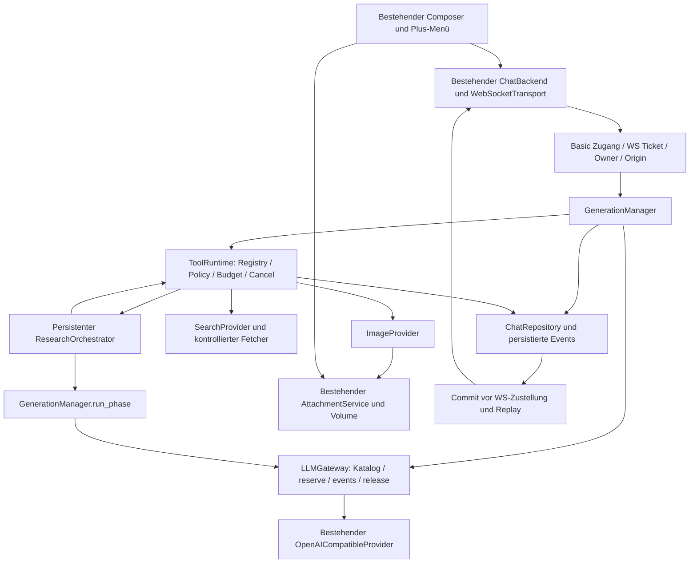

# Tool-Architektur für das Plus-Menü

Aktueller Implementierungsnachtrag: [P1b](TOOL-RUNTIME.md) und [P2](TOOL-EVENTS.md)
sind gemergt. [P6](SEARXNG-TOOL-INTEGRATION.md) bindet den bestehenden SearXNGProvider
an die vorhandene Runtime an. Grants und automatische Chat-Websuche bleiben deaktiviert.
Die folgenden Planungsabschnitte beschreiben den ursprünglichen Architekturstand.

Status: Architekturplan mit begonnener Implementierung der P1a-Grundlage; keine neue Produktfunktion aktiviert. Stand: 2026-10-12. Bestandsabgleich auf aktuellem `main`, konkrete Registry-/Persistenzverträge, Migration und lokale Tests: [Tool-Grundlage P1a](TOOL-FOUNDATION.md).

## 1. Grundlage, Umfang und Entscheidungen

Geprüfter noris-Stand: `main` bei `4024c0eea62965bd161c8fccc36bc81141535d47`, über Remote-Abfrage bestätigt. Die Bestandsanalyse umfasst Backend-Quellen, Frontend-Komponenten und Composables, Migrationen, API-/WebSocket-Verträge, Tests, Build-/CI-Konfiguration, Compose, Proxy und vorhandene Architektur-/UX-Dokumentation. Screenshots sind UX-Evidenz, Lockfiles Abhängigkeitsnachweise; historische Planungen werden nicht als implementierte Funktion gewertet. Keine Provider-Credentials, Nutzerdaten oder Produktivdienste wurden geprüft.

Im ursprünglichen Arbeitsverzeichnis liegt zusätzlich uncommittete Arbeit auf `feat/composer-plus-menu`: unter anderem `composerMenu.ts`, Composer-/Workspace-Änderungen, Menütests und UX-Dokumentation. Sie ist **kein Bestandteil dieses main-Stands oder dieses Planungs-PRs**. Ihre Aktions-IDs `upload`, `library`, `image`, `web`, `research`, `sketch` sind ein geeigneter Anschlussvertrag. Vor Funktions-PRs muss diese Arbeit integriert oder der tatsächlich integrierte Menüstand erneut geprüft werden. Bestehende fremde Änderungen werden nicht übernommen.

Verbindliche Architekturentscheidungen:

1. Ein Composer und ein Chat-State bleiben bestehen. Funktionen ergänzen Aktionen, Modusauswahl und Ergebnisansichten.
2. `GenerationManager` bleibt Besitzer von Chatgeneration, Nachrichtenbaum, Streaming, Replay und Stop. Jeder Textmodellaufruf geht durch `LLMGateway.reserve/events/release` und den vorhandenen Provider.
3. Eine typisierte Python-Registry steuert ausschließlich fest registrierte Tools. Kein Shell-Tool, dynamischer Python-Import, Browseragent oder beliebiger MCP-Server wird eröffnet.
4. Websuche wird zunächst servergesteuert ausgeführt. Recherchemodelle liefern validierbare Pläne, keine direkt ausführbaren Befehle. Native LLM-Toolcalls sind für die fünf Funktionen nicht erforderlich.
5. PostgreSQL speichert Zustände, Budgets und strukturierte Ergebnisse. Bilddateien und Bibliotheksdateien verwenden ausschließlich `AttachmentService` und dessen vorhandenes Volume.
6. Das explizite Single-Owner-Modell bleibt erhalten. HTTP Basic identifiziert einen gemeinsamen Zugang, nicht verschiedene Personen. Keine Behauptung einer bestehenden Mandantentrennung.
7. Die Umsetzung startet weiter mit einem Backend-Worker. Mehrere Worker erfordern zusätzlich verteilte Gateway-Admission, Ticketverwaltung und Eventzustellung; DB-Leases allein lösen das nicht.

Die einzelnen Funktionskonzepte stehen in [Websuche](WEB-SEARCH-DESIGN.md), [Bibliothek](FILE-LIBRARY-DESIGN.md), [Bilderstellung](IMAGE-GENERATION-DESIGN.md), [Deep Research](DEEP-RESEARCH-DESIGN.md) und [Skizzieren](SKETCH-DESIGN.md). Umsetzung und Freigabegates: [PR-Roadmap](FEATURE-ROADMAP.md).

## 2. Konkrete Komponentenkarte des Bestands

Pfade in dieser Tabelle sind relativ zur Repositorywurzel; die aufgeführten Symbole wurden im Quellcode geprüft.

| Bereich | Vorhandene Komponenten | Verhalten und Wiederverwendung |
| --- | --- | --- |
| Frontend-Shell | `frontend/app/components/chat/{ChatWorkspace,ChatHeader,ChatSidebar,ChatRail,ChatTimeline,ChatMessage}.vue`; `layouts/default.vue`, `pages/index.vue` | Workspace verbindet bestehenden Chat-State, Seitenleiste, Timeline, Dialoge und Composer. Toolkarten erweitern Timeline/Message, keine zweite Unterhaltung. |
| Composer/Plus | `ChatComposer.vue`, `useComposerAutosize.ts`, `useChatViewport.ts`, `ChatModelMenu.vue` | Auf main eine `UChatPrompt`-Instanz, Plus/`UDropdownMenu` mit Upload, natives Datei-Input, Attachment-Vorschau, Senden/Stop, IME und Autosize. Das Sechs-Aktionen-Menü ist nur lokal vorliegende Folgearbeit. |
| Chat-State | `composables/{useChat,useChatStream,useChatBackend,useChatDrafts,useWorkspace,useConversations,useChatScroll}.ts`; `lib/chat/{types,branches,conversations,loadCache,scroll}.ts` | Bestehende Records, Varianten, Entwürfe, aktive Pfade, pagination und Scroll-Verhalten. Additive Tool-/Quellenprojektionen sind nach Generation/Conversation indexiert. |
| Transporte | `useChatTransport.ts`; `lib/chat/{mockTransport,realTransport,webSocketTransport,backend,persistence}.ts` | `mock`: Demo/localStorage; `real`: SSE und lokaler Chatbestand; `websocket`: REST-Ressourcen und PostgreSQL-Chat. Neue persistente Serverfunktionen zunächst nur im WebSocket-Modus. |
| Text-/Markdown-UX | `ChatTextSelection.vue`, `MarkdownContent.ts`, `CodeBlock.vue`, `MessageVariants.vue`; `lib/chat/{selection,textReferences}.ts` | Bestehende Textreferenzen, escaped/sanitized Markdown, Copy und Varianten weiterverwenden. Quellen werden zusätzlich strukturiert gespeichert. |
| REST/Composition Root | `backend/src/noris_ai/main.py:create_app`, `api/v1/{health,llm,conversations,attachments,chat_ws}.py` | Lifespan erstellt Engine, Repository, AttachmentService, Gateway, Tickets und GenerationManager; neue Services hier injizieren, keine globale Parallel-App. |
| WebSocket | `api/v1/chat_ws.py`, `chat/ws_protocol.py`, `chat/tickets.py`; `docs/websocket/chat-v1.json` | Einmal-Ticket, Origin-/Host-/WSS-Prüfung, versionierte Commands, begrenzte Peerqueues, Heartbeat, Rate-Limit und Reconnect. Dieselbe Verbindung künftig auch für Toolereignisse. |
| GenerationManager | `chat/generation.py:{GenerationManager,LiveGeneration,Peer}` | Atomare Aufnahme über `begin_generation`, serverseitiger Nachrichtenpfad, Bild-/PDF-Kontext, Gateway-Admission, gebündelte Deltas, commit-before-delivery, Titel, Abbruch, Disconnect-Frist und Shutdown. |
| LLM-Gateway | `llm/gateway.py:LLMGateway`; `provider.py:LLMProvider`; `openai_compatible.py:OpenAICompatibleProvider` | Kontext-/Byte-/Tokenlimits, parallele Requests, Rate-/Tagesbudget, Timeout, sichere Fehler, SSE-Dekodierung, Fortsetzung. Bestehendes Interface liefert Textdeltas; Toolcalls werden vom Provideradapter derzeit abgewiesen. |
| Modellkatalog | `llm/{catalog,registry,provider_models,schemas,pricing,tokens,vision}.py`; `useModelSelection.ts`, `lib/chat/modelMetadata.ts` | Discovery, exakte IDs, Providerfakten getrennt von Betreiberlimits, Freshness und Freigabe. `supports_images` verlangt reale Text-/Bild-Eingabemodalitäten; Vision ist keine Bildausgabe. |
| Attachments | `chat/{attachments,attachment_parser,attachment_content}.py`; `api/v1/attachments.py`; `useChatAttachments.ts` | Raw-Upload, Besitzer-/Datei-/Anzahlquota, SHA-256, private Zufallskeys, Parserprozess, PNG/JPEG/TXT/MD/PDF, Fortschritt/Retry/Abbruch, sichere Downloads/Vorschau. Keine Bibliothek über Chatgrenzen. |
| PDFs | `chat/pdf_context.py:pdf_request`; Migration `0008_pdf_sections` | Physische Seiten und vollständige Textabschnitte persistent; lexikalische, kontextbudgetierte Auswahl. Kein OCR, keine Vollanalyse gescannter PDFs. Wiederverwenden für Bibliothek und lokale Recherchequellen. |
| Persistenz | `chat/{models,repository,service,pagination,cursors}.py`; `db/{base,readiness}.py`; Alembic `0001`–`0009` | SQLAlchemy/PostgreSQL als Wahrheit, Versionkonflikte, Eigentümerfilter, zusammengesetzte FKs, immutable Nachrichtenvarianten, Keysetpagination, Entwürfe/Präferenzen, dauerhafter Titelclaim und Soft Delete. |
| Auth | `core/access.py`; `conversations.py:chat_access`; `llm.py:access` | HTTP Basic mit konstantzeitlichem Vergleich, Schreib-Origin-/Fetch-Site-Prüfung und serverseitigem `chat_owner_id`; unkonfiguriert deny. WS-Tickets transportieren keine Providerkeys. |
| Sicherheitsgrenzen | `core/{config,schemas,middleware}.py`; `llm/limits.py`; Parser; Docker/Caddy/DB-Rollen | Strict Pydantic und unbekannte Felder verboten; Secrets serverseitig; Providerhostallowlist/keine Redirects; Requestlimits; Parser ohne geerbte Credentials und mit Ressourcenlimits; getrennte Migrator-/App-Rolle. |
| Betrieb | `compose*.yaml`, `infrastructure/docker/*`, `infrastructure/proxy/Caddyfile`, `infrastructure/nftables/*`, `infrastructure/scripts/*` | Persistente DB-/Attachment-Volumes, Non-root-Backend, Readiness nach Migration, explizites Proxytrust. Öffentliche Quellen brauchen neue begrenzte Egresspolicy; keine laufende Netz-/Serverkonfiguration verändern. |
| Verträge/CI | `scripts/generate-api.mjs`, `backend/scripts/export_{openapi,websocket}.py`, `frontend/app/types/generated/*`, `.github/workflows/ci.yml`, `Makefile` | OpenAPI und WS-JSON erzeugen TypeScript, Driftprüfung fail-closed. Bestehende CI führt Lint, strikte Typprüfung, Units, Migration/Integration, Browser und Builds aus. |

`pydantic-ai-slim` ist installiert, im Backend ist kein produktiver `pydantic_ai.Agent` eingebunden. Eine neue Agentenschleife dieses Frameworks würde den Gatewaypfad umgehen und ist deshalb nicht die Ausgangsarchitektur. `PLAN.md` und ältere Etappenberichte enthalten historische Zielbilder; tatsächlicher Code und aktueller Vertrag haben Vorrang.

### Vorhandene HTTP-Verträge

Alle Pfade beginnen mit `/api/v1`. Ressourcen außer Health verlangen vorhandene Zugangskontrollen.

| Pfad | Methoden / Zweck |
| --- | --- |
| `/health/live`, `/health/ready` | GET Liveness bzw. DB-/Migrationsreadiness |
| `/llm/models` | GET aktueller freigegebener Chatkatalog |
| `/llm/chat`, `/llm/conversation-title` | POST SSE-Kompatibilität bzw. Titel |
| `/conversations` | GET paginierte Listen/Suche, POST Anlegen |
| `/conversations/{id}` | GET, PATCH versionierte Änderungen, DELETE Soft Delete/Abbruch |
| `/conversations/{id}/messages`, `/conversations/{id}/active-path` | GET Fenster und aktiver Pfad/Varianten |
| `/conversations/{id}/draft`, `/chat/drafts/new` | PUT bestehender Textentwurf |
| `/chat/drafts`, `/chat/preferences` | GET Entwürfe; GET/PUT Präferenzen |
| `/conversations/import` | POST idempotenter Import mit Konfliktprüfung |
| `/chat/attachments` | POST Raw-Datei mit `conversationId`/`filename`; GET chatbezogene Liste |
| `/chat/attachments/limits`, `/chat/attachments/references` | GET Limits; POST Textsnapshot aus einer Quellnachricht |
| `/chat/attachments/{id}`, `/chat/attachments/{id}/content` | DELETE ungebundenen Anhang; GET Original bzw. `preview=true` |
| `/chat/ws-ticket`, `/chat/ws` | POST Ticket; WebSocket mit `noris-chat.v1` und `ticket.<ID>` |

### Vorhandenes WS-/Generierungsverhalten

Commands: `chat.generate`, `chat.cancel`, `chat.resume`, `chat.ping`. `requestId` ist die idempotente Generation-ID. Der Browser übermittelt Text, freigegebene Modell-ID, Message-/Parent-IDs, Conversationversion und Attachment-IDs; weder Providerpayload noch Bild-URL, Dateipfad oder vollständiger selbst behaupteter Nachrichtenverlauf wird übernommen.

Events: `chat.connected`, `chat.message.created`, `chat.generation.{started,delta,completed,incomplete,failed,cancelled,interrupted}`, `chat.conversation.updated`, `chat.title.updated`, `chat.resume.{accepted,snapshot}`, `chat.error`, `chat.heartbeat`, `chat.pong`. Sequenzen sind **pro Generation**, nicht global. `persist_generation_event` committet Antwortsnapshot und Event vor Zustellung. Reconnect liefert gespeicherte Events oder einen Snapshot bei abgelaufener Retention; der Client verwirft Duplikate und erkennt Lücken.

`GenerationManager.cancel` setzt aktuell eine kooperative Cancel-Anforderung. Shutdown beendet Tasks; Neustart markiert laufende Generierungen `interrupted`. Ohne Peers endet normale Generierung nach der konfigurierten Disconnect-Frist. Automatische Fortsetzungen bleiben auf demselben persistierten Antwortknoten und verwenden separate Gateway-Admission-IDs.

### Vorhandene Datenmodelle und Lücken

| Modell | Bestehende Invariante | Erweiterung |
| --- | --- | --- |
| `ChatConversation` | owner, version, active leaf, archive/delete | Bleibt Quelle für Konflikte und Schreibberechtigung. |
| `ChatMessage` | user/assistant, Parent im selben Chat, Varianten, generation_id | Additive Ergebnis-/Quellenprojektion; keine neuen Toolnachrichtenrollen im bestehenden Baum. |
| `ChatGeneration` | Status `queued/running/completed/incomplete/cancelled/failed/interrupted`, letzte Sequenz | Additive `mode`/Inputdigest/Capabilitysnapshot; Änderungen an Recovery explizit absichern. |
| `ChatStreamEvent` | PK `(generation_id, sequence)` | Auch v2-Tool-/Research-Events; Typ/Version persistieren. |
| `ChatAttachment` | unique storage_key, genau eine conversation_id und höchstens eine message_id; `ready/stored/deleted` | Viele Bindungen über Zusatzrelation; Originaldatei bleibt einmal gespeichert. |
| `ChatDraft` | owner + draft_key, Text | Additive versionierte Modusmetadaten; alter Textvertrag bleibt akzeptiert. |
| `ChatUserPreferences` | gemeinsamer owner, aktiver Chat und Modell | Weiterverwenden; keine Credentials oder global eingeschalteten Webmodus speichern. |

### Bestehende Testkarte

| Testbereich | Konkrete vorhandene Suites / neue Anschlussfälle |
| --- | --- |
| Python Unit | `test_{chat_protocol,chat_ws_handshake,llm_api,llm_provider,model_catalog,provider_capabilities,vision,attachments,text_references,pdf_documents,auto_continuation,long_output,long_responses,config,readiness}.py`: Tooladmission, Schema und Capabilitytests ergänzen. |
| Vertrag | `backend/tests/contract/test_openapi.py`, Unit `test_chat_protocol.py`, `make check-api`: neue REST-Schemas und getrennte WS-v2-Unions prüfen. |
| PostgreSQL Integration | `test_{chat_api,chat_schema,chat_websocket,chat_pagination,attachments,text_references,pdf_documents,database,chat_ws_proxy}.py`: atomare Aufnahme, Replay, Cancel während Commit, Ownership, Migrationsdrift und Quoten weiterlaufen lassen. |
| HTTP-Provider | `backend/tests/llm_integration/test_http_{catalog,streaming}.py`, `tests/fixtures/*`: lokaler HTTP-/SSE-Simulator, keine kostenpflichtigen echten Requests. Such-/Bildprovider entsprechend simulieren. |
| Frontend Unit | `frontend/tests/unit/{chat-composer,chat-stream,websocket-transport,chat-backend,model-selection,text-reference-attachments,chat-lazy-loading,chat-branches,markdown}.spec.ts`: additive reducer-/modusspezifische Fälle. |
| Playwright | `tests/e2e/{adaptive-composer,composer-layout,chat-text-selection,chat-markdown-overflow,...}.spec.ts`; `tests/websocket/{persistent-chat,attachments,auto-continuation,pagination,import}.spec.ts` | Desktop/Mobile, echte lokale WS-/DB-Integration, Upload-/PDF-/Branch-/Stop-Regressionsszenarien. |
| CI/Betrieb | Produktionsbuild und Compose-Smoke, Caddy-/nginx-Proxytests | Bestehende Upload-/WS-Routen hinter Proxy erhalten. Neue Egressregeln nur separat reviewen. |

Integrationsfixtures führen destructive Downgrades aus und verlangen `NORIS_TEST_DATABASE_URL` mit Suffix `_test`. Browser-WS-Tests löschen synthetische Chats. Beide dürfen ausschließlich gegen disposable Testsysteme laufen. Die aktuelle Dokumentationsprüfung ist von den zukünftigen Featuretests zu unterscheiden; Ergebnisse stehen in der Roadmap.

## 3. Codex-Architekturstudie: verifizierte Konzepte

Referenz: `openai/codex`, untersuchter Commit `a9b0815167c27ab13719dd12d13b63e02b70d221`. Alle folgenden Quelllinks sind auf diesen Snapshot fixiert. Der aktuelle Baum hat ausgelagerte `codex-tools`, `codex-mcp` und `rollout`-Crates; ältere Pfadbeschreibungen sind nicht vorausgesetzt.

| Thema | Geprüfte Quelle und Befund | Übertragbare Entscheidung für noris |
| --- | --- | --- |
| Toolausführung | [`ToolExecutor`](https://github.com/openai/codex/blob/a9b0815167c27ab13719dd12d13b63e02b70d221/codex-rs/tools/src/tool_executor.rs) und [`CoreToolRuntime`/Dispatch](https://github.com/openai/codex/blob/a9b0815167c27ab13719dd12d13b63e02b70d221/codex-rs/core/src/tools/registry.rs) trennen Spec, Runtime, Invocation und Output. | Python `Protocol` + Pydantic-Modelle; Provideradapter enthalten nur Transport/Normalisierung. |
| Registrierung | [`ToolRegistry`](https://github.com/openai/codex/blob/a9b0815167c27ab13719dd12d13b63e02b70d221/codex-rs/core/src/tools/registry.rs) unterscheidet trusted/external, prüft Toolpolicy und Namenskollisionen; [`ToolRouter`](https://github.com/openai/codex/blob/a9b0815167c27ab13719dd12d13b63e02b70d221/codex-rs/core/src/tools/router.rs) verwaltet ausführbare und modellseitig sichtbare Specs getrennt. | Registry bei Startup einfrieren; doppelte IDs ablehnen. Registriert bedeutet weder UI-verfügbar noch LLM-ausführbar. |
| App-Server | [`common.rs`](https://github.com/openai/codex/blob/a9b0815167c27ab13719dd12d13b63e02b70d221/codex-rs/app-server-protocol/src/protocol/common.rs) beschreibt Requests/Notifications; [`turn.rs`](https://github.com/openai/codex/blob/a9b0815167c27ab13719dd12d13b63e02b70d221/codex-rs/app-server-protocol/src/protocol/v2/turn.rs) typed Start/Interrupt/Status; JSON-/TS-Schemas liegen im selben Paket. | Typisierte Commands/Events und generierte TS-Unions übernehmen; vorhandene REST-/WS-Formate behalten, keine JSON-RPC-Neuschreibung. |
| Berechtigungen/Approvals | [`orchestrator.rs`](https://github.com/openai/codex/blob/a9b0815167c27ab13719dd12d13b63e02b70d221/codex-rs/core/src/tools/orchestrator.rs) ordnet Approval, Sandbox und Versuch; [`approvals.rs`](https://github.com/openai/codex/blob/a9b0815167c27ab13719dd12d13b63e02b70d221/codex-rs/core/src/tools/approvals.rs) hat strukturierte Aktionen/Cachekeys. | Policy vor jedem Provideraufruf; Freigabe an konkrete Argumente/Provider/Budget binden. Kein automatisches Ausweiten nach Denial. |
| Ausführungszustände | [`v2/item.rs`](https://github.com/openai/codex/blob/a9b0815167c27ab13719dd12d13b63e02b70d221/codex-rs/app-server-protocol/src/protocol/v2/item.rs), [`dynamic.rs`](https://github.com/openai/codex/blob/a9b0815167c27ab13719dd12d13b63e02b70d221/codex-rs/core/src/tools/handlers/dynamic.rs) und turn status unterscheiden Item-/Tool- und Turnlebenszyklus. | Toolstatus ist vom Chatstatus getrennt; partial/timeout/unknown sind keine erfolgreiche Antwort. |
| Streaming | Turn-/Item-Started/Completed und Delta-Notificationtypen, [`v2/notification.rs`](https://github.com/openai/codex/blob/a9b0815167c27ab13719dd12d13b63e02b70d221/codex-rs/app-server-protocol/src/protocol/v2/notification.rs). | Stabile IDs und strukturierte Fortschrittsereignisse. Die PostgreSQL-Sequenz-/Replaygarantien werden aus noris erhalten, nicht Codex zugeschrieben. |
| Sitzungen | [`thread_manager.rs`](https://github.com/openai/codex/blob/a9b0815167c27ab13719dd12d13b63e02b70d221/codex-rs/core/src/thread_manager.rs) verwaltet ThreadStore/Start/Resume/Fork; [`rollout/recorder.rs`](https://github.com/openai/codex/blob/a9b0815167c27ab13719dd12d13b63e02b70d221/codex-rs/rollout/src/recorder.rs) persistiert JSONL-Rollouts. | Conversation → Generation → ToolRun als Identitäten; PostgreSQL-Checkpoints statt zusätzlicher JSONL-Sitzungsdateien. |
| Abbruch | [`function_tool.rs`](https://github.com/openai/codex/blob/a9b0815167c27ab13719dd12d13b63e02b70d221/codex-rs/core/src/function_tool.rs) und [`session/turn.rs`](https://github.com/openai/codex/blob/a9b0815167c27ab13719dd12d13b63e02b70d221/codex-rs/core/src/session/turn.rs) propagieren CancellationToken/child tokens. | Parent-Cancel an alle Childruns, HTTPstreams und Wartezustände; Commit und finaler Zustand bleiben atomar geschützt. |
| MCP | [`McpHandler`](https://github.com/openai/codex/blob/a9b0815167c27ab13719dd12d13b63e02b70d221/codex-rs/core/src/tools/handlers/mcp.rs), [`connection_manager.rs`](https://github.com/openai/codex/blob/a9b0815167c27ab13719dd12d13b63e02b70d221/codex-rs/codex-mcp/src/connection_manager.rs): Namensräume, Discoveryfilter, Startup-/Tooltimeouts und Cancellation. Read-only annotations beeinflussen Parallelität. | MCP später hinter derselben Registry; serverseitige Allowlist und harte Policy, Annotationen allein sind keine Sicherheitsgarantie. Für diese Roadmap nicht erforderlich. |
| Fehler | [`error_code.rs`](https://github.com/openai/codex/blob/a9b0815167c27ab13719dd12d13b63e02b70d221/codex-rs/app-server/src/error_code.rs) trennt invalid request/params, internal und overloaded; Registry nutzt `FunctionCallError` und Lebenszyklusabschluss. | Feste noris-Fehlercodes, retryable-Kategorie und saubere Terminalereignisse. Providerfehlertexte niemals unverändert weiterreichen. |

Die ergänzende [offizielle App-Server-Dokumentation](https://learn.chatgpt.com/docs/app-server) beschreibt das Thread-/Turn-/Item-Protokoll und korrelierte Freigabeanfragen. Diese Hierarchie dient als konzeptionelle Referenz; noris bleibt bei seiner bestehenden Conversation-/Generation-Hierarchie.

**Nicht übernommen:** Rust-Ausführung, Codex als Sidecar/App-Server, Shell-/PTY-Sandbox, automatische Sandboxeskalation, ChatGPT-Authentifizierung, Skills-/Plugin-Installation, Code Mode und Multi-Agent-Laufzeit. Für fest begrenzte HTTPtools und Canvas fehlen technische Vorteile, während zweite Credentials, Deploymentartefakte und Zustandswahrheiten entstehen würden. Falls später fremder Code ausgeführt werden soll, ist eine eigene begründete Sandboxentscheidung nötig. Die jetzige Planung portiert keine Rust-Implementierung und führt keine Codex-Laufzeitabhängigkeit ein.

## 4. FastAPI-Zielarchitektur



### Geplante Module und Verantwortlichkeiten

| Neues Modul unter `backend/src/noris_ai/` | Verantwortung |
| --- | --- |
| `tools/{schemas,registry}.py` | ToolDefinition, Eingabe-/Ausgabemodelle, erlaubte Invocationarten und Registry; keine Netzoperationen. |
| `tools/{policy,budget,cancellation}.py` | Ausführungsrechte, Grants, durable Budgetreservationen, Deadline und Child-Cancel. |
| `tools/{runtime,models,repository,errors}.py` | ToolRunlebenszyklus, Claims, strukturierte Resultate, Retrypolicy und feste Fehler. |
| `tools/providers/{search,searxng,brave,image,openai_images}.py` | Austauschbare Provider, Betreiberkonfiguration und HTTPnormalisierung; keine Policyumgehung. |
| `tools/web/{fetch,sources,context}.py` | SSRF-begrenztes Fetching, Provenienz, Plaintext und budgetierter Kontext. |
| `research/{models,repository,orchestrator,schemas}.py` | Persistente Plan-/Schritt-/Evidence-Zustände und Wiederaufnahme. |
| `api/v1/{tools,library,research}.py` | Feste Auth-/Owner-geprüfte Ressourcenrouten. Kein öffentliches `execute(toolName, arbitraryArgs)`. |

Geplante Frontendergänzungen: `useChatTools.ts` für Capability-/Modusdaten, `FileLibraryDialog.vue`, `SketchDialog.vue`, `ToolRunCard.vue`, `SourceList.vue`, `ResearchProgress.vue`. Sie verwenden bestehenden Workspace-State, `ChatBackend.request`, Nuxt-UI-Dialoge und den bestehenden WebSockettransport. Datei-Auswahl und Sketch erzeugen normale Attachmenteinträge.

### Typverträge

`ToolDefinition[InputT, OutputT]` enthält `name`, `schemaVersion`, Pydantic input/output types, `handler`, `permission`, `allowedInvocationKinds`, `providerKey`, `timeoutPolicy`, `retryPolicy`, `maxInputBytes`, `maxOutputBytes` und `costPolicy`. Der ausführende Context kommt nur aus dem Server. `GenerationToolContext` enthält owner, conversation/generation/run IDs, Capabilitysnapshot, Scopegrant, Budgetreservation, Deadline, Cancelhandle und strukturierten Eventwriter. `ResourceActionContext` enthält owner, Zielconversation und idempotente actionId für kurze Nutzeraktionen wie Bibliotheksbindungen; dafür werden weder Generation noch Providerbudget erfunden. Beide verwenden dieselbe Registry-/Policyprüfung. Der Client liefert weder Context noch Secrets.

| Tool-ID | Typisierte Eingabe → Ausgabe | Invocation |
| --- | --- | --- |
| `web.search.v1` | `SearchInput(query, language, timeRange, limit)` → `SearchResult(sources, warnings, provider, fetchedAt)` | expliziter Webmodus oder begrenzter Researchschritt |
| `web.fetch.v1` | `FetchInput(sourceId)` → `SourceDocument(sourceId, text, digest, fetchedAt)` | nur vorhandene erlaubte Quelle desselben Runs |
| `library.attach.v1` | `LibraryAttachInput(requestId, conversationId, attachmentIds)` → bestehende `AttachmentResponse[]` | authentifizierte Nutzeraktion; nicht LLM |
| `image.generate.v1` | `ImageInput(prompt, imageModelId, size, quality)` → `ImageResult(attachmentIds, providerOperationId, usage)` | expliziter Bildmodus und gültiger Kostenscope |
| Research | `ResearchInput(question, scope, localAttachmentIds, limits)` → `ResearchResult(reportMessageId, sources, limitations)` | persistenter Orchestrator, keine frei rekursive Toolinvocation |
| Sketch | `File(image/png)` → bestehende `AttachmentResponse` | vorhandener Upload; kein unnötiger Remote-ToolRun |

JSON-Schemas sind strict, `extra=forbid`, begrenzt und versioniert. Netzwerkantworten werden separat als Providerdaten normalisiert und dann als ToolOutput validiert. Ein Provider kann keine Registryeinträge oder Berechtigungen liefern. `succeeded` setzt ein valides, persistiertes Output voraus.

### Ausführung im vorhandenen Generierungspfad

1. WS-/REST-Zugang und Owner prüfen; Conversation/Parent/Version, IDs, Capability und Modus validieren. Idempotenzdigest enthält künftig auch Modus, Settings, Attachments und Grant-ID.
2. `ChatRepository.begin_generation` bleibt atomare Aufnahme von Input, Assistantplaceholder und Generation. Admission und laufende Jobexklusivität vor Providerkontakt klären.
3. Normaler `chat`-Modus: unveränderter `_run`-Pfad. `web`: ToolRuntime führt Recherchevorstufe aus, speichert Quellen und ergänzt begrenzten Userkontext; danach bestehender PDF-/Bild-/Gatewaypfad. `image`: derselbe Manager persistiert eine Bildantwort mit Attachment; Bild-HTTP läuft im ImageProvider, nicht im Textprovider.
4. `research`: Manager hält den userseitigen Generation-/Assistantknoten. Orchestrator führt DB-checkpointierte Schritte aus. Neues internes `GenerationManager.run_phase` verwendet denselben Gateway und dieselbe Kontext-/Bild-/PDFvorbereitung. Zwischenantworten/Pläne liegen als ResearchStepresultate außerhalb des Nachrichtenbaums; erst der Bericht streamt in die Assistantantwort.
5. Ein zentraler Eventwriter serialisiert alle Child-/Text-Events unter dem vorhandenen Generationlock und DB-Zeilenlock. Ergebnis, Toolstatus, Sequenz und Snapshot werden in einer Transaktion gespeichert; erst danach `Peer.offer`.
6. Cancel beendet Parent und Children. Kein Child darf nach einem terminalen Parent ein neues Providerrequest oder Erfolgsevent veröffentlichen. Titelgenerierung bleibt eine eigene, begrenzte Textphase nach erfolgreichem Abschluss.

Bei Bildmodus ist die Bildmodell-ID über den separaten Bildkatalog zu autorisieren. Eine fehlende Chatmodellfreigabe darf eine reine Bilderstellung nicht pauschal verhindern; die mode-spezifische Admission erweitert den Manager explizit. Bildreferenzen/Edits sind nicht Teil des initialen Bildvertrags. Textmodi verwenden weiter ausschließlich den vorhandenen Chatkatalog.

## 5. Persistenz, Zustände und Transaktionen

| Neue Tabelle / Ergänzung | Wesentliche Felder und Constraints |
| --- | --- |
| `chat_tool_run` | UUID, owner, conversation/generation FK, parent_run, tool/schemaVersion, normalized input/digest, provider/configVersion, state, attempt, reservation_id, deadline, started/finished, cancel_requested_at, error_code; unique `(generation_id, step_key)`; zusammengesetzte FKs sichern Chatzugehörigkeit. |
| `chat_tool_result` | run_id + resultVersion, output_schema, bounded JSONB, result_digest, created_at; unveränderliches Ergebnis und Provenienz. Bildbytes nur per Attachment-ID referenzieren. |
| `chat_tool_approval` | owner/run, inputDigest, provider/configVersion, permissionScope, Kosten-/Aufruflimit, `pending/approved/denied/expired`, expires_at, decision_request_id unique. Kein clientseitiges `approved=true` im Generierungscommand. |
| `chat_budget_reservation` / Tagesledger | owner, budget_day UTC, run/phase/idempotency key, calls/bytes/tokens/cost reserved and accounted, currency, estimated/measured distinction; unique Phase/Attempt und nonnegative counters. |
| `chat_resource_action` | id/requestId, owner, target_conversation_id, action_kind, input_digest, bounded response_projection, created_at; unique `(owner,id)`. Transaktionales Idempotenzrecord für kurze Bibliotheksmutationen ohne Chatgeneration. |
| `chat_generation` | mode, input_digest, mode_settings, capability_snapshot; Default `chat` für Altbestand. |
| `chat_draft` | optionale begrenzte `composer_metadata` mit schemaVersion/mode/settings; Default normaler Chat, bestehende content-only PUTs bleiben gültig. |
| Bibliotheksrelationen | [Attachmentbindungen, Pins und Cleanup](FILE-LIBRARY-DESIGN.md); kein neues Blobvolume. |
| Recherchetabellen | [ResearchRun, Steps, Quellen und Claims](DEEP-RESEARCH-DESIGN.md); alle an vorhandene Generation gebunden. |

ToolRun: `queued → awaiting_approval → running → succeeded`. Auch direkt `queued → running`. Terminalalternativen: `failed`, `cancelled`, `timed_out`, `interrupted`, `outcome_unknown`. Jede Transition verwendet erwarteten Zustand und Zeilenlock/CAS; genau ein terminales Event. Budgetverweigerung ist `failed/BUDGET_LIMIT`, nicht Erfolg. Unklarer kostenpflichtiger Providerabschluss ist `outcome_unknown`; niemals blind neu erzeugen.

DB-Transaktionen bleiben kurz: Claim/Reservation committen, dann Netzwerk außerhalb der Transaktion, dann Ergebnis-/Eventcommit. Bestehende Uploads halten heute ihren Quotalock über Schreiben/Parsing; neue Providerrequests dürfen diesen langen Uploadpfad nicht unter einem offenen Runclaim-DBlock aufrufen. Lockreihenfolge vereinheitlichen: Owner-Budget/Quota → Conversation → Generation → Run → Attachment/Binds. Vor Implementierung Deadlocktests mit Upload, Link, Cancel und Cleanup.

Für Bildresultate erst private temporäre Datei schreiben/validieren/fsync, dann canonical Attachmentregistrierung und Run-/Message-/Eventcommit. Fehlgeschlagener Commit entfernt Stagingbytes; Absturz vor Commit wird von derselben begrenzten Orphanbereinigung erkannt. Bei mehreren Dateien ist ein AttachmentService-interner Batchfinalizer nötig. Kein Event mit einer noch nicht verfügbaren Datei.

Retention: vorhandene Streamretention bleibt transportbezogen. Toolresultate/Quellen bleiben bis zur Chat-/Run-Löschung verfügbar, auch nach Eventpruning. Vorgeschlagene Obergrenzen: 256 KiB je JSONresultat, maximal 30 Quelldokumente je Recherche mit jeweils 64 KiB normalisiertem Text. Keine Roh-HTML-Archive oder unbeschränkten DBpayloads. Soft Delete verhindert sofort weitere Lese-/Schreibzugriffe; idempotenter Cleanup entfernt zugehörige Daten unter Beachtung legitimer Bibliotheksbindungen. Keine fremden Secrets oder kompletten Prompts im Auditlog.

## 6. Berechtigungen, Provider und Budgetkontrolle

**Kein unkontrollierter LLM-Zugriff:** Browseraktionen wählen einen erlaubten Modus. Der Server bestimmt Tools, Provider, Aufrufzahl, Quellen und Limits. Ein Researchplan ist Dateninput mit erlaubten Aktionen/Source-IDs. Unbekannte Tools, frei gelieferte URLs/Keys/Hosts, Prompt-Injection und zusätzliche JSONfelder ergeben Ablehnung. Der bestehende Provideradapter weist native tool_calls weiterhin ab; spätere Unterstützung wäre ein eigener Vertrag und PR.

Policyentscheidung ist `allow / approval_required / deny`. Ein `allow` gilt nur innerhalb vorhandener Betreiberpolicy und eines vom Benutzer aktivierten Modus. Webmodus gestattet Suchbegriffe, nicht vollständige Chat-/Dateiinhalte als Suchpayload. Bibliothek/Sketch brauchen keine zusätzliche Approvalbox. Die Auswahl und anschließendes Senden im Bild-/Researchmodus können bereits den klar dargestellten Provider-/Kostenscope freigeben; eine wiederholte identische Bestätigung ist nicht erforderlich. Eine Scope-/Provider-/Budgetausweitung braucht eine neue konkrete Zustimmung. Denial beendet die Aktion; kein automatischer Fallback zu externem Anbieter oder größere Rechte.

Approvalentscheidungen verlangen vorhandene Basic-/Originchecks, Owner, gültigen Pendingstatus, Digest, Ablaufzeit und idempotente decision request ID. Serverzustand ist Wahrheit. Freigaben mit geändertem Input oder nach Cancel/Neustart/Expiry sind ungültig. Ein gemeinsamer Basiczugang kann nicht beweisen, welche natürliche Person zugestimmt hat.

Provider werden in `Settings` durch feste Providerkeys, `SecretStr`, Base-URL, exakte Host-/Port-/Netzallowlist, TLSanforderung, Timeouts, Modellfreigaben und Kostenpolicy konfiguriert. Vorschläge: `NORIS_TOOL_FEATURES`, `NORIS_SEARCH_PROVIDER`, `NORIS_SEARCH_BASE_URL`, `NORIS_SEARCH_ALLOWED_HOSTS`, `NORIS_SEARCH_API_KEY`, `NORIS_IMAGE_PROVIDER`, `NORIS_IMAGE_MODEL_ALLOWLIST`, `NORIS_TOOL_DAILY_*_BUDGET`. Diese Variablen sind **noch nicht implementiert**; konkrete Feldnamen werden im Vertrags-PR fixiert. Keine Credentials in öffentlicher Capabilityantwort.

Budgetkontrolle hat zwei Ebenen: bestehende Gatewaylimits bleiben verbindlich; persistente Tool-/Researchbudgetreservationen ergänzen sie. Für Restartfeste globale Textbudgets wird ein injizierter BudgetCoordinator **hinter** der Gatewayadmission ergänzt; lokale `_active`-/Rate-Schutzmechanismen bleiben erhalten. Jede Textphase einschließlich Titel/automatischer Fortsetzung reserviert genau einmal global und einmal gegen ihren Parentumfang, nicht zweimal im selben Ledger. Einheitliche Phase-IDs und Tests verhindern Doppelzählung.

Reserviert werden konservative maximale Tokens, Providercalls, Bytes und Kosten in Decimal/Währung. Providerusage wird getrennt als gemessen gespeichert; unbekannte Usage bleibt unbekannt. Ein fehlender Preis erlaubt keine angeblich sichere Geldobergrenze: Betreiber muss einen konservativen Callpreis konfigurieren oder die kostenpflichtige Funktion bleibt gesperrt. Nach Fehler oder Cancel wird nur der nachweislich ungenutzte Anteil freigegeben; bei unklarem Providerabschluss bleibt die Reservation bis zur Abstimmung bestehen. Kein Neustartreset dauerhafter Tagesbudgets.

## 7. API- und WebSocket-Verträge

Neue Ressourcenvorschläge unter `/api/v1`:

| Vertrag | Rückgabe / Kontrolle |
| --- | --- |
| GET `/chat/tools/capabilities` | `{schemaVersion:1, features, providers, limits}`; Featurestatus `available/unavailable`, feste reasonCodes, nicht sensible Provideranzeige; serverseitig je Request neu prüfen. |
| GET `/chat/tool-runs/{id}` | Owner-/Chatgeprüfter Run-Snapshot inklusive state, latestResult, lastSequence, expiry und safe errors. |
| POST `/chat/tool-approvals/{id}/decision` | `{requestId, inputDigest, decision:"approve"\|"deny"}` → autoritativer Grantstatus. Nicht benötigte Approvals müssen nicht erzeugt werden. |
| Bibliothek-/Recherche-Routen | Featuredocs definieren feste Aktionen; starten keinen beliebigen Toolnamen. |

HTTPerrors behalten `ErrorResponse(error:{code,message,request_id})`. Codes: `TOOL_UNAVAILABLE`, `TOOL_FORBIDDEN`, `TOOL_INPUT_INVALID`, `APPROVAL_REQUIRED`, `APPROVAL_EXPIRED`, `BUDGET_LIMIT`, `TOOL_TIMEOUT`, `PROVIDER_RATE_LIMIT`, `SOURCE_BLOCKED`, `PROVIDER_OUTCOME_UNKNOWN`, `PROTOCOL_UPGRADE_REQUIRED`. Zuordnung: 401 Zugang, 403 Policy, 404 fremde/gelöschte Ressource, 409 Konflikt/Approvalzustand, 413 Größenlimit, 422 Eingabe, 429 Budget/Rate, 502 Providerdaten, 503 unkonfiguriert, 504 Timeout. Fehlermeldungen aus festem Katalog; Korrelation statt Rawexception.

**Umgesetzter P2-Vertrag:** `/chat/ws`, Tickets und `noris-chat.v1` bleiben bestehen.
`chat.generate/resume` bieten optional `toolEventVersion:1` an. Lifecycleevents heißen
`tool.*` und tragen `version:1`, `eventVersion:1`, Scope-IDs, `seq` und `timestamp`.
Ein separater `tool.snapshot` rekonstruiert Runs aus den vorhandenen Tabellen.
Alte Clients erhalten bei Toolsequenzen einen vorhandenen Chat-Snapshot ohne
Sequenzlücke. Writer und Replay nutzen denselben persistenten Generationzähler.
Der verbindliche Vertrag steht in [TOOL-EVENTS.md](TOOL-EVENTS.md).

Die nachfolgenden v2-/ResponseMode-Beispiele bleiben **frühere Planungsentwürfe
für spätere Produktphasen**. P2 implementiert kein v2-Subprotokoll und keine
neuen ResponseModes, Researchereignisse oder Sourceevents.

V2 `chat.generate` übernimmt bestehende Identitäts-/Version-/Attachmentfelder und ergänzt eine diskriminierte Auswahl:

```ts
type ResponseMode =
  | { kind: 'chat', modelId: string }
  | { kind: 'web', modelId: string, language: 'de' | 'en', timeRange: 'day' | 'month' | 'year' | null }
  | { kind: 'image', imageModelId: string, size: string, quality: string, grantId: string | null }
  | { kind: 'research', modelId: string, scope: ResearchScope, limits: ResearchLimits, background: boolean, grantId: string | null }
```

Dies ist ein Entwurf für generierte Typen, kein zusätzlich von Hand gepflegter TS-Vertrag. `ResearchScope`/`ResearchLimits` und Bildoptionen werden in den Featuredocs begrenzt. `content` bleibt der Userprompt. `operation=continue` gilt nur für vorhandene Textantworten; neue Bild-/Researchstarts dürfen keine automatische Textfortsetzung auslösen. `chat.cancel/resume/ping` behalten ihre Bedeutung mit Version 2.

Alle persistierten V2-Tool-/Researchevents haben `version`, `type`, `generationId`, `conversationId`, `messageId`, `seq`, `runId`, `occurredAt`, `schemaVersion`; ggf. parentRunId/stepId. Sie teilen die **eine** vorhandene Generierungssequenz mit Textdeltas. Beispiele:

```json
{
  "version": 2,
  "type": "chat.tool.progress",
  "generationId": "00000000-0000-4000-8000-000000000101",
  "conversationId": "00000000-0000-4000-8000-000000000102",
  "messageId": "00000000-0000-4000-8000-000000000103",
  "runId": "00000000-0000-4000-8000-000000000104",
  "seq": 3,
  "occurredAt": "2026-10-12T10:00:00Z",
  "schemaVersion": 1,
  "stage": "searching",
  "completed": 0,
  "total": null
}
```

Typen: `chat.tool.{queued,approval.required,started,progress,result,failed,cancelled}`, `chat.sources.updated`, `chat.research.{plan,step.started,step.completed,checkpoint,report.ready}`, `chat.attachment.created`. Resultate enthalten IDs, kurze strukturierte Zusammenfassungen und Fehlercodes, keine Bildbytes/Secrets/Roh-HTML. Toolfailed enthält einen tatsächlichen State einschließlich `timed_out/interrupted/outcome_unknown`; der Parentabschluss folgt separat.

V2-Resumesnapshot enthält bestehende Antwortfelder plus Run-/Quellen-/Attachmentprojektionen und eine Snapshotsequenz. Snapshot und Subscription werden unter demselben Generationlock aufgenommen; neue Events liegen danach lückenlos. Frontendreducer verarbeitet jedes Sequenzevent, selbst wenn es keinen Textdelta gibt. Progress coalescen und auf etwa 2 Events/s je Run begrenzen; terminale Events nie verwerfen. Bestehende Queue-/Sendlimits, Overflowclose und Replay weiterverwenden. Unbekannte versionierte Events lösen kontrolliertes Resync aus.

REST/Reload liefern Toolresults über den vorhandenen autorisierten Run-Endpunkt;
WebSocket ist ein Zustellungskanal, keine zweite Zustandswahrheit. Der bestehende
Generator exportiert OpenAPI, ergänztes v1-JSON, TS-Typen und öffentliche
Toolschemas. `make check-api` prüft alle erzeugten Artefakte und v1-Kompatibilität.

## 8. Timeouts, Abbruch und Recovery

Vorgeschlagene Startlimits, noch keine gemessenen SLOs: Suche connect 3 s / read 10 s / total 15 s; Fetch total 10 s, maximal 3 Redirects; Bild total 180 s; interaktive Webvorstufe total 45 s; Research insgesamt 600 s aktive Ausführungszeit mit absolutem Ablauf nach 24 h. Alle konfigurierbar innerhalb harter Betreibermaxima. Mehrstufige Childtimeouts dürfen verbleibende Parentdeadline nicht überschreiten.

`CancelHandle` verbindet DB-cancel_requested_at mit einem lokalen asyncio-Event. Vor Claim, während Request und vor Commit prüfen. Netzwerkfuture abbrechen/Clientstream schließen, Parser über vorhandenen Prozessabbruch, gegebenenfalls Providerjob per begrenztem cancel API. DB-Finalisierung nicht mitten im Commit canceln. Akzeptierter Stop verhindert neue Calls sofort; lokaler Abschluss soll im Simulator binnen 2 s bestätigt werden. Remoteabrechnung oder remote Computeende sind bei Providern ohne Cancel API nicht garantiert und werden korrekt angezeigt.

Normale Chat-/Web-/Bildgenerationen behalten Disconnect-Grace. Research darf nur mit der im Startscope bestätigten Hintergrundoption unabhängig vom Socket weiterlaufen. Ein Tabwechsel ist kein Stop. Appshutdown setzt interrupted und finalisiert Children. Neustart: gewöhnliche Chats bleiben wie heute unterbrochen. Researchruns erhalten nach Leaseablauf einen gespeicherten Interruptedcheckpoint und explizite „Fortsetzen“-Aktion; sie werden nicht fälschlich als beendet markiert oder blind nochmals kostenpflichtig gestartet. Die bestehende Startup-Recovery muss diese Runs kennen, statt unkoordiniert alle Generationen abzuschließen.

Retries: begrenzte idempotente Such-/Fetchcalls mit Jitter und Retry-After, höchstens ein Wiederholversuch und nur innerhalb Budget/Deadline. Keine automatische Textgenerierung nach beliebigem Fehler; bestehende output_limit-Fortsetzung bleibt separat. Bei Bildrequests Timeout nach Dispatch ohne nachweisbare Idempotenz: `outcome_unknown`, kein Retry. Abgebrochene/terminale Runs können durch Replay oder alte Approvals nicht neu gestartet werden.

## 9. Sicherheits- und Regressionsgates

| Grenze | Verpflichtende Prüfung |
| --- | --- |
| Owner/Conversation | IDOR-Matrix für Run, Source, Link, Bild, Approval und Researchresume; fremde/gelöschte Ressourcen 404, archived write denied. |
| SSRF | Scheme/Userinfo/Port/Hostname/IPprüfung, IPv4/IPv6/mapped IP, DNS-Rebinding und **Verbindung** gegen erlaubte IPs, Redirectprüfung; Metadaten-/Loopback-/private/Linklocalziele blockieren. Interner SearXNG nur exakte Betreiber-Serviceallowlist, nicht allgemeine private Netze. |
| Injection/XSS | Toolresultate bleiben untrusted Userkontext; Plaintext/escaped Markdown, keine Toolcommands aus Quelltext, keine Fremd-Favicons/Trackingbilder. Sourcecitation nur auf gespeicherte Source-IDs auflösen. |
| Kosten/Missbrauch | durable Reservationen vor Dispatch; doppelte Requests, parallele Tabs und Neustart können Budgets nicht umgehen; Limits auch bei fehlerhaftem Provider. |
| Dateien | Vorhandene Signatur-/Pixel-/MIME-/Quotaprüfung und `nosniff`/Sandbox-CSP; keine zweite Speicherung, keine vom Client gewählten Pfade/URLs. |
| Raceconditions | Ergebnis vs. Cancel, Approval vs. Expiry, Cleanup vs. Link/Upload, Chatdelete vs. Claim, gleichzeitige Childprogresscommits. |
| Privacy | Suchpayload nur explizit freigegebene Begriffe; lokale Dateien nicht still an Suchprovider; feste Secretredaction, keine Tickets/Authorization in Logs. |
| Bestand | Upload/PDF/Textreferenzen, Katalogrevocation, Varianten, Fortsetzung, Drafts, Scroll, WebSocketproxy, v1/SSE/mock-Regressionen. |

Featureflags sind serverseitig standardmäßig aus; UI aktiviert eine Aktion nur mit echtem Handler und verfügbarer Capability. Migrationen sind additive expand/backfill/validate; bestehende Tabellen/Dateien werden nicht während des Planungs-PRs verändert. Rollback zunächst Flags aus und Altpfade weiterbetreiben; destructive Schema-Downgrades nur in Test-/expliziten Restoreabläufen. Deployment, Datensicherung, Providerkonto und Egressänderungen sind spätere separat überprüfbare Betriebsarbeit.
