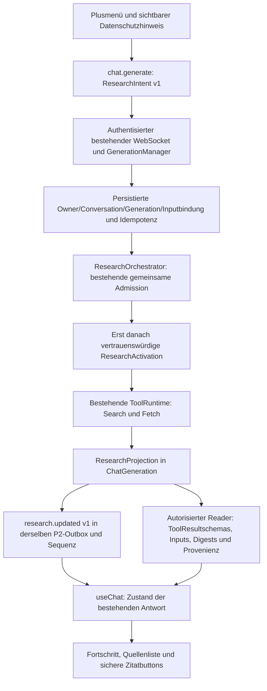

# P7c – Model-Agnostic Web Search UI and Citations

Basis: `main` / `331116f`, einschließlich P1b, P2, P6, P7a und P7b.
P7c integriert deren bestehenden Ablauf in die Benutzeroberfläche. Kein Merge,
Deployment, produktiver Grant oder produktive Migration gehört zu diesem PR.

## Benutzerablauf und Composer

Im bestehenden Plusmenü aktiviert **Websuche** einen entfernbaren Chip. Der
Datenschutzhinweis erscheint vor dem Versand: Suchbegriffe aus der aktuellen
Nachricht werden über unseren Suchdienst an externe Suchanbieter übertragen.
Der Hinweis bleibt sichtbar; es gibt keine versteckte Aktivierung oder Dialogkette.
Die aktuelle, bearbeitbare Nachricht ist die überprüfbare Sucheingabe. Anhänge,
Systeminstruktionen und Chatgeschichte werden nicht in die Suchquery übernommen.

Die Auswahl gehört zum vorhandenen Gesprächsentwurf. Sie bleibt beim Modellwechsel
und beim erstmaligen Vorbereiten eines Chats durch Upload oder Einstellungen
erhalten. Ein Chatwechsel verwendet die Auswahl des betreffenden Entwurfs. Der
Chip bleibt nach dem Versand aktiv, bis er ausdrücklich entfernt wird. Neue Chats
übernehmen keinen alten `__new__`-Modus. Die konkrete Nachricht erhält ihre
serverseitige ResearchProjection unabhängig vom Browserstate.

Beim erstmaligen Upload entstehen Chat und Entwurfscope über die vorhandene
Persistenz. Ein verspäteter History-/Draftread überschreibt keine lokalen
Änderungen von vor oder während dieses Reads, auch wenn deren Speicherung
inzwischen bestätigt wurde. Unveränderte Entwürfe werden weiterhin vom Server
geladen; Modellwahl und Fokuswechsel löschen keinen Text.

Vor dem Versand werden Katalog und Researchverfügbarkeit aufgefrischt. Modell,
Conversation, Entwurf, Rechercheauswahl und Anhänge dürfen während dieser
asynchronen Prüfung nicht unbemerkt wechseln. Andernfalls wird nichts versendet
oder gelöscht. Während einer gestarteten Recherche kann ein Modell für den nächsten
Versand gewählt werden; die laufende Generation behält ihr ursprüngliches Modell.
Ungeeignete Modelle erhalten einen lokalisierten Hinweis; Auswahl,
Text und Anhänge bleiben erhalten. Es erfolgt kein Ersatzmodellwechsel.

Uploads, Plusmenü, Lernen, Reasoning, Enter/Shift+Enter, bestehendes Autosizing und
Scroll-to-Bottom verwenden weiterhin ihre bisherigen Komponenten und Zustände.
Der Chip nutzt die vorhandene Composerheader-Geometrie.

## Modellunabhängigkeit und Kontext

`LLMModel.research_eligible` enthält die gemeinsame serverseitige Entscheidung:
verfügbar, chatfreigegeben, Streaming, nicht ausdrücklich unbereit und kompatible
Textein-/ausgabe. `CatalogLLMModel` veröffentlicht diese ausschließlich abgeleitete
Eigenschaft als Bedienhilfe. Operatorpolicy und Providerfacts durchlaufen weiterhin
`ModelCatalogService.require`; Browsermetadata kann keine Eignung oder Permission
erteilen. Das Read-only-Catalogschema bleibt von Operatorpolicyinput getrennt.

Es gibt keine Research-Allowlist nach Modell- oder Providernamen. Tool Calling,
Function Calling, JSON Mode, strukturierte Ausgaben, Reasoning und Vision sind
keine Voraussetzungen. Alle vom aktuellen Katalog zugelassenen geeigneten Modelle
kommen automatisch infrage, einschließlich neu durch den Betreiber zugelassener
Modelle. Unbekannte/unfreigegebene Modelle umgehen die bestehende Chatpolicy nicht.

`LLMGateway.research_capacity` zählt bestehende History, Benutzerfrage,
System-/Lerninstruktionen, Anhänge, Bildreserve, Output und Reasoningreserve mit
dem vorhandenen TokenCounter. Der Quellenkontext erhält höchstens 12.000 zusätzliche
Tokens und nur die tatsächlich verfügbare Kapazität. Bei kleineren Fenstern werden
weniger Quellen ausgewählt und Auszüge durch den vorhandenen Builder verkürzt.
Unter 1200 Tokens Restkapazität beginnt keine externe Suche. Benutzer- und
Sicherheitsnachrichten werden nicht gekürzt; `CONTEXT_LIMIT` erklärt die Abhilfe.
Die bestehende Byte-, Kontext-, Budget- und finalen Dispatchprüfung bleibt bindend.

## Versionierte Aktivierung und Datenfluss



Der additive WebSocketrequest enthält optional
`research: {version: 1, mode: "web", language: "de" | "en"}` sowie
`researchEventVersion: 1`. Freie Toolnamen, URLs, Scopeberechtigungen und
Researchparameter sind verboten. Public Intent erteilt keine Autorität.

Authentisierung, Origin/Host/Ticket und Owner kommen aus dem bestehenden Chatpfad.
`begin_generation` prüft Conversationversion, Archiv/Löschung, Input, Modell,
Generation, Operation und Request-ID. Die Intent wird in der bestehenden JSONprojektion
persistiert; ein Replay mit geänderter Intent wird abgelehnt. Der Orchestrator prüft
Featureflag, gespeicherte Scope-/Inputbindung, Cancellation, Deadline, Modell und
Kontext, beide Toolpermissions und Budgets. Erst nach bestandener Admission wird
die Benutzerintent in eine `ResearchActivation` überführt. Die Runtime wiederholt
Policy-, Budget- und Cancelprüfungen vor jedem externen Call und Commit.

Eine ausdrückliche Webauswahl recherchiert auch Fragen ohne Aktualitätswort.
Die bisherige P7b-Wortheuristik bleibt für interne Aktivierungen bestehen.
Datenschutzvalidierung und begrenzte deterministische Queryplanung gelten für beide.
Es gibt keine LLM-Planung, freie Execute-API oder Modellausführung von Toolcalls.

## Fortschritt, REST und Replay

Die echten Zustände `planning`, `searching`, `selecting`, `fetching`, `grounding`,
`generating`, `completed`, `failed`, `cancelled`, `interrupted`, `skipped` werden
lokalisiert angezeigt. Grounding bedeutet **Kontext wird vorbereitet**, nicht
„Modell hat Quellen gelesen“. Es gibt weder Prozentwerte noch simulierte Phasen.

Public Zustandswechsel committen mit `research.updated` / `eventVersion: 1`
in der vorhandenen `chat_stream_event`-Outbox. Sie verwenden ausschließlich
`ChatGeneration.last_sequence`. Events enthalten Zustand und Scope, keine
Suchqueries oder Quellenkopien. `ToolEventVersion: 1` bleibt unverändert.
Nicht optierende Clients erhalten kompatible Chatsnapshots statt Sequenzlücken.
Snapshots und Terminalevents enthalten additiv den tatsächlich gespeicherten
`researchState`. Kein Researchfortschritt wird aus allgemeinem Chatstatus abgeleitet.

`GET /api/v1/chat/research/capability` liefert Feature-/Permissionverfügbarkeit als
Bedienhilfe, keine Startberechtigung. `GET /api/v1/chat/conversations/{conversation_id}/`
`generations/{generation_id}/research` ist ein authentisierter Scope-Reader.
History-/Active-Path-Nachrichten enthalten dieselbe autorisierte ResearchView.
Alle Reads verwenden vorhandene Daten, niemals neue Such-/Fetchrequests.

Der bestehende Socket liefert Replay und Resumes nach Reload während Suche,
Fetch oder Textstream. Reconnect versendet Resume oder denselben idempotenten
Request. Verwaiste Generationen werden durch die vorhandene Startup-Recovery
unterbrochen; externe Arbeit wird nicht neu gestartet. Archivierte Chats bleiben
lesbar, können keine neue Recherche beginnen. Soft Delete sperrt Reads und Starts.
Ein optionaler Quellenladefehler lässt den Chatstream weiterlaufen, verlinkt keine
ungeprüften Quellen und zeigt eine lokalisierte Reloadaktion.

Ein automatischer Titelcommit kann zwischen Request und Generationsaufnahme die
Conversationversion erhöhen. Der vorhandene Ressourcenclient behält dafür eine
begrenzte Kopie autorisierter Metadatenrevisionen. Nur bei genau einem
`fallback`→`generated`-Übergang auf Version `v+1`, unverändertem Branch, Scope,
Lifecycle, Archiv-/Pinstatus und Einstellungen darf er vor dem ersten angenommenen
Generationsevent einmal denselben Request mit aktueller CASversion senden.
Request-/Message-IDs, Inhalt, Attachments, Modell und Researchintent bleiben identisch.
Cancel, Löschung, Dispose, eine neuere bekannte Revision und jeder weitere Konflikt
sperren die Wiederholung. Die serverseitige Versionsprüfung bleibt unverändert.

## Quellen und Zitate

Der Reader autorisiert Owner, Conversation, Generation und den Assistantknoten.
Jede vorbereitete Quelle wird gegen SearchRun, FetchRun, SearchResult und
SourceDocument aufgelöst. Er validiert Registryversion, Input-/Resultatdigest,
Source-ID, Suchlaufbindung, Original-/Final-URL, Titel, Fetchzeit, Dokumentdigest
und Codepointauszug. Fehlerhafte Scope-, Schema- oder Provenienzdaten werden
geschlossen abgelehnt. Historische Reads funktionieren auch nach Flag-/Policy-
Änderung oder Abbruch; sie erlauben keine neue Ausführung.

Die Liste zeigt nur vorbereitete Dokumente und gespeicherte fehlgeschlagene
Fetchversuche mit korrektem Status. Erfolgreiche Dokumente, die wegen Doppelinhalt,
zu kurzer Texte oder Kontextgrenzen ausgelassen wurden, werden nicht als
Antwortquellen ausgegeben. Der Reader übernimmt keine Modell-URLs oder globalen
Source-UUIDs. Das Modal zeigt Titel, Domain, Original-/Final-URL, Abrufzeit,
vorbereiteten Textauszug und optional technische Provenienz.

Der bestehende öffentliche Abruftransport prüft sämtliche DNSantworten, bevor er
eine Adresse auswählt. Bei öffentlichen IPv4- und IPv6-Adressen bevorzugt er IPv4,
damit Dual-Stack-Seiten auch aus IPv4-only-Containern erreichbar sind. IPv6-only
bleibt unterstützt; Host-/TLS-SNI-Bindung, Zertifikatsprüfung und genau ein
Verbindungsversuch je Request bleiben erhalten. Private Antworten einer beliebigen Familie
sperren weiterhin den gesamten Abruf. Der bestehende Transport handelt HTTP/2 über
ALPN mit HTTP/1.1-Fallback aus. Auf HTTP 403 folgt höchstens ein Abruf derselben URL
mit einem festen anonymen Browserprofil (User-Agent, Accept, Sprache und
Navigationsheader). Dieser Versuch verbraucht einen der bestehenden vier HTTP-Hops;
Deadline, Größenlimit, DNS-/TLS-Prüfung und Cancellation gelten unverändert. Cookies,
Browserheader, Zugangsdaten, Referrer und Responseheader werden nicht weitergereicht.
HTTP/2- und HPACK-Debuglogs sind wie die vorhandenen HTTP/1.1-Logs im Fetchscope
unterdrückt. Andere HTTPclients behalten ihre normalen Logs.

Der bestehende deterministische Extraktor führt keine Scripts aus und gibt keine
Hiddenbereiche frei. Wenn kein regulärer Dokumenttext verfügbar ist, kann er die
vom Seitenbetreiber veröffentlichte HTML-Metabeschreibung als kurzen Auszug verwenden.
Zugelassen sind nur direkte Head-Metatags für `description`, `og:description` und
`twitter:description`, höchstens 4096 Zeichen, optional mit dem Seitentitel
(höchstens 256 Zeichen). Regulärer Seitentext hat Vorrang. Scripts, Templates,
mehrdeutige Attribute, andere Metadaten und Hiddenbody-Inhalte bleiben ausgeschlossen.
Das ist ein öffentlich deklarierter Metadatenauszug, keine Auswertung der dynamischen
Browseransicht. Er durchläuft dieselben Provenienz-, Ausgabelimit-, Kontext- und
Groundingprüfungen wie andere untrusted HTML-Auszüge.

HTTP 403 oder browsergebundene Schutzseiten
können einen Serverabruf trotzdem ablehnen. „Vom Server nicht abrufbar“ beschreibt
diesen konkreten Abruf und behauptet nicht, die Webseite sei allgemein offline.
CAPTCHAs, Anubis-Proof-of-Work, Benutzer-Cookies und allgemeines Browserrendering
werden nicht produktiv unterstützt. Ohne die neu deklarierte `httpx[http2]`-
Abhängigkeit hält ein alter Devcontainer seinen HTTP/1.1-Fallback; für HTTP/2 ist
ein ausdrücklicher Backend-Image-Neubau erforderlich, keine Datenbankmigration.

Nur gespeicherte, serverseitig bekannte `[[R1]]`–`[[R3]]` an gültigen
Codepointpositionen werden verlinkt. JavaScript rechnet die Offsets in UTF-16 um.
Ein zufälliger Renderprefix verhindert Spoofing durch entitykodierte Platzhalter.
Markdown rendert weiterhin escaped Vue-VNodes, kein HTML. Code und Linklabels
behalten Marker als Text; unbekannte Marker und Modell-URLs bleiben gewöhnlicher
unbestätigter Antworttext. Remote Markdownbilder bleiben deaktiviert.

Quellenlinks sind keine semantische Faktenprüfung. Der UItext trennt „abgerufen /
Kontext vorbereitet“ von „Modelltextantwort beobachtet“. `claimSupport` bleibt
`unverified`. Weder „verifiziert“ noch „faktengeprüft“ werden behauptet. Externe
Links erlauben ausschließlich HTTP(S) ohne URLcredentials, öffnen mit
`noopener noreferrer` und ohne Referrer.

## Fortsetzungen und Varianten

Automatische Outputlimit-Fortsetzungen bleiben in derselben Generation mit
vorbereitetem Groundingkontext und ursprünglicher Deadline. Sie starten keine Tools.

Explizites Weiterschreiben erzeugt weiterhin eine neue Generation mit gespeicherter
`source_message_id`-Ancestry. Der Reader folgt nur der Owner-/Conversationgebundenen
Kette, höchstens 20 Vorgängern, ohne Zyklen und nur bei unverändertem kopiertem
Antwortprefix. Er übernimmt ausschließlich Zitate im ursprünglich bewerteten Text.
Neu erzeugter Fortsetzungstext bekommt keine geerbte Zitierautorität. Die UI erklärt,
dass die Fortsetzung ohne neue Recherche erstellt wurde. Regenerate, Bearbeitung
und Varianten starten den bisherigen Normalpfad; neue Recherche erfordert einen
ausdrücklichen Composer-Webversand. Public Researchintent bei `continue` wird
abgelehnt. Unklare Provenienz bleibt fail closed.

## Fehler, Datenschutz und Barrierefreiheit

Deutsch und Englisch decken Schalter, Hinweis, Zustände, Quellenmodal, Fehler und
Researchbenachrichtigungen ab. Verfügbarkeit/Betreiberfreigabe, ungeeignetes Modell,
Kontextlimit, Budget, Suchdienstfehler, fehlende Quellen, Fetchfehler, Cancel,
Timeout und LLM-Ausfall erhalten feste öffentliche Meldungen. Keine Credentials,
Providerantworten oder Stacktraces werden angezeigt. Normales Chatten bleibt nach
Entfernen des Chips verfügbar.

Die P7b-Prüfung auf bezeichnete Credentials/private Daten bleibt bindend. Sie
ist kein vollständiger semantischer Geheimnisdetektor; Nutzer müssen ihre aktuelle
Sucheingabe prüfen. Keine Chatgeschichte, anderen Conversations, Systemprompts,
API-Schlüssel oder Auditdaten werden als Query übertragen. Quelleninhalte bleiben
untrusted, P7a-SSRF/DNS/TLS/Redirect-/Extraktionsgrenzen bleiben unverändert.

Stop verwendet denselben Generation-/Runtimecancel und akzeptierten Cancel-Fence.
Nach Stop dürfen keine weiteren Tools oder LLMproviderstarts folgen; Status und
bereits gespeicherte Provenienz bleiben erhalten. Fortschritt verwendet eine
polite Live-Region ausschließlich für die tatsächlichen Phasen, keine internen
Toolupdates. Quellen- und Zitatbuttons sind tastaturbedienbar; das vorhandene Modal
übernimmt Fokustrap/Escape, P7c stellt Fokus explizit auf den auslösenden Button
zurück. Touchflächen, URLumbruch und interne Auszugscrolls unterstützen 320, 390,
768, 1024, 1440 und 1700 px, Desktop/Mobile sowie Light/Dark.

## Migrationen, Tests und Rollout

Keine neue Migration: die P7b-Spalte `chat_generation.research` reicht für Intent,
Zustand und Provenienz aus. Quellen bleiben in ToolResult; Events persistieren nur
Zustand, keine zweite Quellenkopie.

Der Sourcepaketbau verwendet eine ausdrückliche Dateiauswahl. Lokale Uploads,
Betreiberkonfiguration und Browser-/Audittraces gehören weder in Wheel noch
Sourcepaket. `make build` prüft die tatsächlichen Archive ohne Extraktion;
Regressionen sichern den Ausschluss lokaler Daten und vorhandene Migrationen ab.

Neue Tests: `test_web_search_ui.py` (Unit/Integration), `research.spec.ts`,
WebSockettransportregressionen und `web-search-ui.spec.ts`. Die dynamische Matrix
läuft über den aktuellen Modellkatalog und einen neu zugelassenen synthetischen
Operatornamen, einschließlich kleinem Kontext, ohne Tool Calling, Reasoning,
Vision und reinem Text. Alle Provider-/Suchantworten sind kontrollierte Fixtures.
PGtests prüfen Sourcescopes, Digests, manipulierte Provenienz, Unicodezitate,
Fortsetzungspräfix, deaktivierte Aktivierung, Idempotenz und alte Clients.
Browsertests prüfen Modellwechsel, Hinweis, Uploadvorbereitung, Quelleninteraktion,
Fokus, Reload während Recherche, Stop, Sprachfehler und alle sechs Breiten.

Die bestehenden Gates für Ruff/Format, striktes Pyright, Unit/HTTP/PG/Migrationen,
ESLint/Nuxt/Vue/API/i18n, OpenAPI-/WSdrift, UI/HTTP-LLM/WS-Browser, Wheel/Sourcepaket,
Frontendproduktion und Actions `checks` / `compose-smoke` bleiben unverändert.
Konkrete endgültige Laufergebnisse stehen im PR.

Ein separat beauftragter Reviewer hat Commit `00fbf67` unabhängig auf Aktivierung,
Modell-/Kontextprüfung, Permissions/Budget, Cancel/Replay/Idempotenz, Quellenbindung,
Fortsetzungsancestry, XSS/SSRF, Datenschutz und Zugänglichkeit geprüft. Bestätigte
Befunde wurden vor Abschluss korrigiert und mit Regressionen versehen:

| Befund | Korrektur / Regression |
| --- | --- |
| Abgeleitete Capability störte interne Modellpolicy-Roundtrips. | Read-only-Catalogprojektion; dynamischer Katalog-/Groundingtest einschließlich neuem Modell und `tool_calling=false`. |
| Optionaler REST-Readerfehler beendete den Chatstream oder ließ Resume-/Fortsetzungszustände hängen. | Getrennter Quellenladefehler, erhaltene autorisierte Views und persistierter Snapshotzustand; WS-503-/Resume-/Continue-Terminaltests. |
| Entitykodierter Platzhalter konnte ein zusätzliches Quellenzitat erzeugen. | Zufälliger Renderprefix, exakte Unicodepositionen; Entity-/Code-/Link-/Unknownmarkerregression. |
| Async Admission konnte alten Draft in einen inzwischen ausgewählten Chat senden. | Scope-/Modell-/Draft-/Attachmentguard; verzögerte Capability mit Chatwechsel im Browser. |
| Erstmaliges Vorbereiten des Chats verlor den aktiven Webmodus. | Synchroner Modustransfer mit bestehender Draftscope-Erstellung; Settingsunit und Uploadbrowserregression. |
| Verspäteter leerer Draftread überschreibt einen inzwischen bestätigten lokalen Save beim ersten Upload. | Zustand beim Readstart sowie unveränderter Draftref/Text prüfen; Regressionen für Edits vor/während Read, A→B→A und unveränderten Serverdraft nach Cacheeviction. Bestehende Upload-/Fokus-/Modellbrowserassertionen bleiben erhalten. |
| Programmatisches Modal stellte den Fokus nicht auf den externen Trigger zurück. | Explizite Fokuswiederherstellung; getrennte Source-/Zitat-/Escape-Browserassertions. |
| Englische Researchfehler erschienen im bestehenden Toast auf Deutsch. | Lokalisierung am vorhandenen Notificationsport; English-Panel-/Toastregression. |
| Zusätzliche defensive Readerbindungen fehlten. | Assistantrole/Generationbackref sowie Inputdigest neben Resultat-/Dokumentdigest. |
| Der bestehende Sourcepaketbau übernahm lokale Uploads und Testtraces. | Ausdrückliche Sdistdateiauswahl; tatsächliche Wheel-/Sdistprüfung im vorhandenen Buildgate. |
| Nachgebaute Pflichtdateisuffixe konnten das neue Paketgate täuschen. | Exakte relative Quellen-/Configpfade und echte Datei-/Migrations-/Test-/Scriptprüfung; 20 Paketregressionen. |

Der Reviewer meldete keine offenen bestätigten Codebefunde und reproduzierte
49 Backend- sowie 40 Frontendtests erfolgreich. Browser-/CI-Gesamtgates und
abgeschlossene Animations-Screenshots werden getrennt nachgewiesen; unabhängiges
Code-Review ersetzt diese Gates nicht.

`NORIS_RESEARCH_ENABLED`, `NORIS_SEARXNG_ENABLED` und
`NORIS_SOURCE_FETCH_ENABLED` bleiben standardmäßig false. Die bestehenden
Toolpermissions bleiben ohne Produktivgrants. `NORIS_TOOL_PERMISSIONS_JSON` ist
standardmäßig leer. Nur explizite serverseitige Betreiberkonfiguration kann feste
Search-/Fetchpermissions mit Entscheidung, Configversion und begrenzten Budgets
an die bestehende ToolPolicy übergeben. Unbekannte Felder, freie Toolnamen und
ungültige Budgets werden geschlossen abgelehnt; normale Chats bleiben verfügbar.
Ein Betreiber muss Dienste,
Datenschutzentscheidung, begrenzte Budgets und beide Permissions ausdrücklich
freigeben. P7c nimmt keine Aktivierung oder Produktionsänderung vor.
Rollback: zuerst neue Starts über Featureflag/Permissions sperren, laufende Arbeit
geordnet stoppen, vorhandene Chat- und ToolResultdaten behalten. Coderollback
benötigt keine Schemamigration; alte Clients verwenden kompatible Snapshots.

Bekannte Grenzen: keine interaktive Research-Approvalfortsetzung, erneute Recherche
bei expliziten Fortsetzungen, semantische Claimprüfung oder vollständige
Geheimniserkennung. Präfixauszüge und kleine Kontextfenster können relevante
Informationen auslassen. Die vorhandenen Single-Worker- und Tokenzählungsgrenzen
bleiben bestehen. Reale Internetqualität, Modellantwortqualität und Betreiberrollout
werden durch synthetische CI nicht bewiesen.


## Manuelle Betreiberkonfiguration für die bestehende UI

Die Funktion benötigt drei unabhängige Voraussetzungen: Researchflag, gebundene
Search-/Fetchprovider und explizite Toolpermissions. Kein einzelnes Flag ersetzt
die anderen Prüfungen. P7c verändert keine laufende `.env` oder Dienste.

Bei der bestehenden Docker-SearXNG-Verbindung verwendet das Overlay
`compose.searxng-backend.yaml` den Host `searxng:8080` im Netzwerk `noris-searxng`.
Die IPfreigabe muss exakt zur laufenden Instanz passen; keine Subnetzfreigabe.
In der lokalen `.env` werden folgende Werte ausdrücklich gesetzt:

```dotenv
NORIS_RESEARCH_ENABLED=true
NORIS_SEARXNG_ENABLED=true
NORIS_SOURCE_FETCH_ENABLED=true
NORIS_SEARXNG_CONFIG_VERSION=p7c-local-v1
NORIS_SEARXNG_ALLOWED_ADDRESSES=["<exakte-IP-der-SearXNG-Instanz>"]
```

Dazu kommt `NORIS_TOOL_PERMISSIONS_JSON` als einzeiliges JSON. Das folgende
Beispiel autorisiert nur die zwei bereits implementierten Tools. Call- und
Bytebudgets sind konservative Reservations; Toolbucket-Gesamtgrenzen und die
jeweils strengeren Permissions gelten weiterhin gemeinsam. USDkosten müssen
den vom Betreiber bestätigten Kosten entsprechen; für selbst betriebenes
SearXNG/Public-Fetch zeigt das Beispiel eine ausdrücklich gewählte Obergrenze 0.

```json
{
  "version": 1,
  "web_search": {
    "decision": "allow",
    "config_version": "p7c-local-v1",
    "per_call": {"calls": 1, "bytes": 65536, "cost": "0"},
    "daily_limit": {"calls": 100, "bytes": 26214400, "cost": "0"},
    "generation_limit": {"calls": 6, "bytes": 2097152, "cost": "0"}
  },
  "web_fetch": {
    "decision": "allow",
    "config_version": "p7a-v1",
    "per_call": {"calls": 1, "bytes": 262144, "cost": "0"},
    "daily_limit": {"calls": 100, "bytes": 26214400, "cost": "0"},
    "generation_limit": {"calls": 6, "bytes": 2097152, "cost": "0"}
  }
}
```

`web_search.config_version` muss der ausdrücklich gesetzten SearXNGversion
entsprechen. Fetch verwendet standardmäßig `p7a-v1` / Public-HTTPS. Die vorhandene
HTTPvariante erfordert getrennt `NORIS_SOURCE_FETCH_ALLOW_HTTP=true` und
`p7a-v1-http` in der Permission. Fehlende Einträge erteilen keine Rechte;
`approval_required` erzeugt keinen automatischen Grant.

Für den bestehenden lokalen Devstack wendet der Betreiber anschließend selbst
nur die Backendkonfiguration an (kein Migratedienst, keine DBmigration):

```sh
docker compose -f compose.yaml -f compose.dev.yaml -f compose.searxng-backend.yaml \
  up -d --build --no-deps backend
```

Ohne Devstack wird `compose.dev.yaml` weggelassen. Der vorhandene Searchstack
muss bereits verfügbar sein. Die bestehende Browserseite danach neu laden;
Produktionsfrontends benötigen außerdem den P7c-Frontendbuild. Danach zeigt
`GET /api/v1/chat/research/capability` bei erfolgreicher Konfiguration
`available: true`; jeder Chatrequest wird trotzdem erneut autorisiert. Bei
nativen Starts werden die SearXNGprovideroptionen ausdrücklich in der
Prozessumgebung gesetzt, da der Provider keine implizite `.env` liest.

Damit die Verbindung beim nächsten Neubau erhalten bleibt, die verwendeten
Overlays dauerhaft in der lokalen `.env` hinterlegen:

```dotenv
COMPOSE_FILE=compose.yaml:compose.dev.yaml:compose.searxng-backend.yaml
```

Weitere lokale Neubauten anschließend mit `make up` ausführen. Dieses Ziel
verwendet die konfigurierte Dateiliste. Ohne Devstack auch hier
`compose.dev.yaml` weglassen. `make dev-up` setzt dagegen ausdrücklich nur
`compose.yaml` und `compose.dev.yaml`; explizite `-f`-Optionen überschreiben
`COMPOSE_FILE` und entfernen damit die Suchanbindung aus dem Backend.

Wenn nach einem Neubau `RESEARCH_UNAVAILABLE` erscheint, zuerst die tatsächlich
geladenen Compose-Dateien und die SearXNG-Einstellungen im Backend prüfen.
`NORIS_SEARXNG_ENABLED=true` in `.env` allein reicht nicht: Erst das Overlay
übergibt die Providerkonfiguration und verbindet das Backend mit dem Suchnetz.

`available: true` bestätigt Konfiguration und Permissions; es ist kein aktiver
Netzwerktest. Ein Timeout schon nach etwa drei Sekunden in `searching` kann vom
SearXNG-Verbindungszeitlimit stammen, obwohl die gesamte Researchdeadline noch
nicht erreicht ist. Ein höheres `NORIS_RESEARCH_TIMEOUT_SECONDS` behebt eine
blockierte TCPverbindung nicht. Den Suchdienst zuerst aus dem Backend auf
`searxng:8080` prüfen; `/healthz` im Suchcontainer allein beweist diesen Weg nicht.

Bei einer eigenen Host-Forward-Chain mit `policy drop` benötigt die Verbindung
zwischen Backend und SearXNG eine ausdrücklich vom Betreiber geprüfte Freigabe
auf der Suchbridge: exakt Backend-IP → SearXNG-IP, TCP 8080, einschließlich
zugehörigem Antwortverkehr. Die vorhandene `noris-chat0`-Regel gilt für dieses
separate Netz nicht. Die in [SearXNG Provider](SEARXNG-PROVIDER.md) beschriebene
DNS-/HTTPS-Korrektur betrifft dagegen den Suchdienst → Internet. Aktive Regeln
mit `sudo nft -a list chain inet filter forward` prüfen; P7c verändert keine
Hostfirewall. Bridge/IPs müssen nach einer Netzwerkerneuerung erneut geprüft werden.
