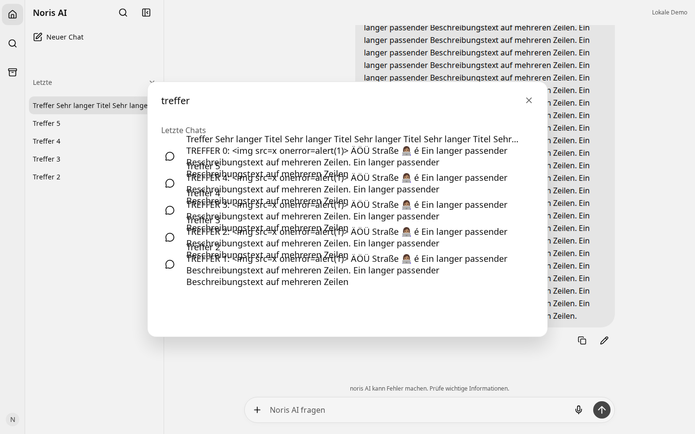
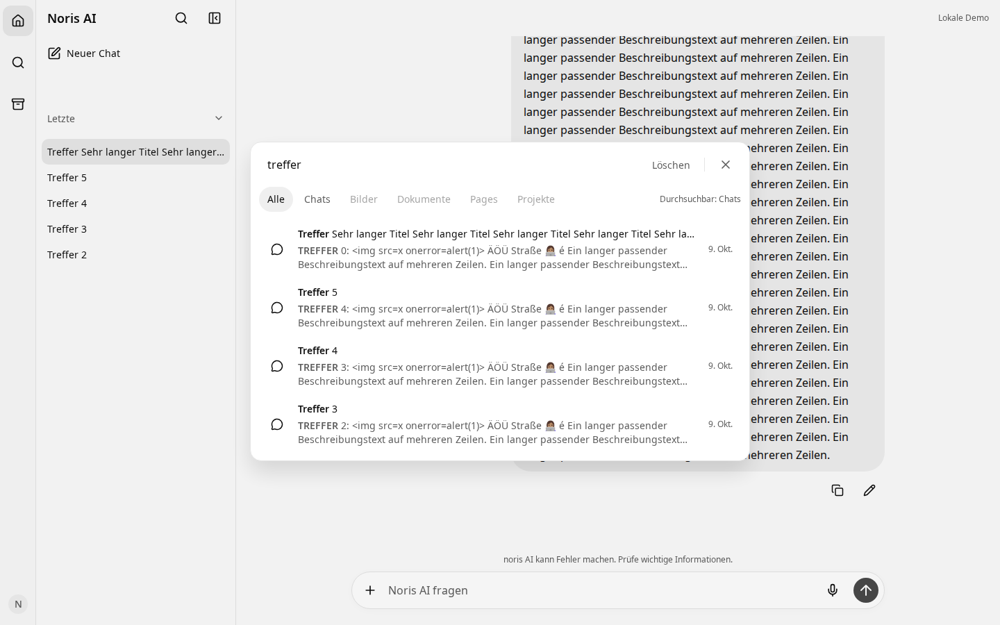
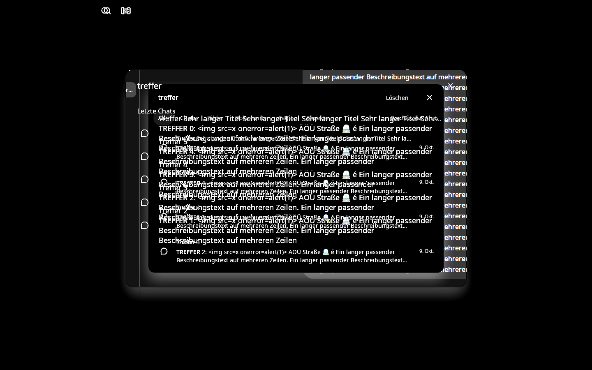

# Reparatur und Referenzabgleich der Chat-Suche

## Bestätigte Ursache

Nuxt UI **4.11.3** rendert `itemLabel` und `itemDescription` als Geschwister
innerhalb von `span[data-slot="itemWrapper"]`. Die bisherige Anwendung ersetzte
die Nuxt-Klassen durch eigene Slot-Klassen, ohne den Beschreibungstext zu
begrenzen. Eine feste Zeilenhöhe von **56 px** traf auf **24 px Titel + 72 px
Beschreibung**. Der 96 px hohe Textblock wurde vertikal in 56 px zentriert und
ragte oben und unten jeweils 20 px aus der Zeile: Texte benachbarter Treffer
überlagerten sich. Das ist anhand der Vorher-DOMRects reproduziert.

Zusätzlich nutzt Nuxt UI für `descriptionHtml` einen eigenen `v-html`-Zweig, der
`#item-description` umgeht. Die reparierte Darstellung verwendet deshalb den
vollständigen `#item`-Slot mit eigener Textstruktur und Vue-Interpolation.
Reka/Nuxt UI behalten Listbox, Auswahl, Maus- und Pfeiltastensteuerung.

## Layout und Interaktion

- Ein Treffer besteht aus einer 28 px breiten Iconspalte mit zentriertem 18 px
  Lucide-Icon, einer flexiblen vertikalen Texteinheit und dem rechts stehenden
  Datum. Das Datum stammt aus `Conversation.updatedAt` und hat ein natives
  `time[datetime]`-Element.
- Zeilen sind mindestens 64 px hoch und wachsen mit dem Inhalt. Titel bleiben
  einzeilig mit Ellipse. Auszüge haben 14 px Schrift, 20 px Zeilenhöhe und höchstens
  zwei Zeilen; auch lange Wörter bleiben innerhalb der Textspalte.
- Der Dialog verwendet die reproduzierbaren Tokens 720 × 460 px, 64 px Suchzeile,
  44 px Kategorienzeile auf Desktop und 16 px Radius. Seine Breite ist auf den
  Viewport minus 32 px begrenzt; die Höhe berücksichtigt den bestehenden Visual
  Viewport einschließlich Bildschirmtastatur. Mobil passen die sechs Kategorien
  bei 390 px in eine Zeile, der Hinweis zur Verfügbarkeit steht darunter.
- Die Suchzeile ist ein Flex-Layout. Eingabe und tatsächliche Breite ihrer Aktionen
  teilen sich den Platz, ohne ein geschätztes Padding für „Löschen“ zu reservieren.
  „Löschen“ leert ausschließlich die Anfrage, lässt den Dialog und die gewählte
  Kategorie bestehen und fokussiert die Eingabe. Schließen/Escape beendet den Dialog.
- Nur `.chat-search-viewport` scrollt. Eingabe, Kategorien, Fehler und Pagination
  stehen in festen Grid-Zeilen. Nuxt UI bietet an dieser Stelle nur Input-,
  Content- und Footer-Slots: Der Footer verwendet `display: contents`, damit seine
  Kategorie- und Aktionsbereiche an den passenden Grid-Positionen stehen.
- Chromium macht überlaufende Container implizit fokussierbar. `syncListbox()`
  setzt deshalb `tabindex=-1` auf den tatsächlichen Treffer-Viewport, auch nach
  Wechseln zwischen leerem Zustand und Treffern. Ergebnisse bleiben über die
  Combobox/Pfeiltasten erreichbar. Tab läuft über Eingabe, Aktionen und die beiden
  verfügbaren Filter; Reka hält den Fokus im Dialog.
- Der bestehende Nachrichten-Fokus erhält einen sichtbaren Rahmen, auch nach
  einem Mausklick. Laden, Scrollen und Fokussieren des Nachrichtenziels bleiben
  in den bestehenden Workspace-/Pagination-Funktionen.

## Daten und sichere Hervorhebung

`useConversationSearch.ts` und Backend sind unverändert. Debouncing (200 ms),
AbortController, Revisionsschutz gegen späte Antworten, Eigentümerprüfung,
Cursor-Pagination und erneute Suche nach WebSocket-Metadaten verwenden weiter
denselben Pfad. `ConversationSearchMatch` enthält `conversationId`, `messageId`
und `excerpt`; diese Zuordnung wird ohne zweite Suche weitergereicht.

„Alle“ umfasst die vorhandene Chat- und Nachrichtensuche. „Chats“ zeigt dieselbe
unterstützte Datenquelle. Bilder, Dokumente, Pages und Projekte besitzen keine
entsprechende Noris-Suchquelle und bleiben nativ deaktiviert. Der sichtbare
Hinweis „Durchsuchbar: Chats“, Tooltips und eine zugängliche Beschreibung erklären
die Einschränkung. Es gibt keine erfundenen Dateitreffer oder Such-Einstellungen.

`SearchHighlight.vue` rendert ausschließlich Textknoten und `mark`-Elemente.
`searchHighlight.ts` normalisiert für den Vergleich nach NFC und Kleinschreibung
und bildet Fundstellen über Graphem-Grenzen auf den Originaltext zurück.
Unicode-Literalmatching berücksichtigt auch Sigma-Endformen und langes S.
Kombinationszeichen, längenverändernde Kleinschreibung und Emoji-Sequenzen werden
nicht zerschnitten. HTML und Regex-Sonderzeichen bleiben gewöhnlicher Text.
Die Hervorhebung verändert keine vorhandenen Such- oder Datenbankregeln.

## Referenz und visuelle Iterationen

Die beiden bereitgestellten Downloads wurden angesehen. Ihre Originalinhalte
bleiben privat. [reference-measurements.json](reference-measurements.json) enthält
Hashes und Rastermessungen: beide Bilder 1920 × 975 px, Referenzdialog ungefähr
939 × 600 px gegenüber ungefähr 1082 × 692 px bei Noris, jeweils ±2 px.
Original-CSS-Viewport, Browserzoom und DPR sind in den PNGs nicht nachweisbar.

Die sichtbare Rail von etwa 68 Rasterpixeln gegenüber der bestehenden 52 px
CSS-Rail liefert einen geschätzten Faktor um 1,3. Daraus ergeben sich die Tokens
720 × 460 px. Eine ausdrücklich als Rekonstruktion bezeichnete Aufnahme bei
1477 × 750 CSS-Pixeln und DPR 1,3 erzeugt ein 1920 × 975 px großes Raster. Ihr Dialog
liegt bei x=492,05, y=167,7 und misst 936 × 598 Rasterpixel. Die kleine Abweichung
zur PNG-Referenz wird nicht als bekannter CSS-Fehler oder Pixelgleichheit ausgegeben.

1. Vorher: 18 Aufnahmen mit 1, 5 und 50 Treffern in drei Viewports und beiden Themes;
   tatsächliche Überläufe innerhalb der 56 px hohen Zeilen bestätigt.
2. Erste Reparatur: variable Zeilen, begrenzte Auszüge, Datum und Kategorien.
   [Mobile Zwischenaufnahme](evidence/iteration-1/390-light-5.png) zeigt die erste
   Fassung mit umgebrochenen Kategorien und einem Hinweis im Footer.
3. Nach Sichtprüfung: mobile Kategorieabstände verkleinert, Verfügbarkeitshinweis
   bei den Kategorien platziert und Eingabeaktionen auf Flex umgestellt. So bleibt
   mehr Höhe für Treffer. Der zusätzliche native Tab-Stopp wurde im Browser
   diagnostiziert und entfernt.
4. Rastervergleich der tatsächlichen Sprechblasenform: zunächst 24 px sichtbare
   Breite gegenüber 21 px in der Referenz. Die letzte Iteration verwendet eine
   eigene Iconspalte mit 18 px SVG: sichtbare Breite **21 px** wie in der Referenz,
   identische horizontale Begrenzung bei x=533…554 im rekonstruierten Bild. Die
   vertikale Begrenzungsmitte liegt 1,5 Rasterpixel höher. Noris behält sein
   vorhandenes Lucide-Icon; es gibt keine individuellen Transform-Korrekturen.

Die Schriftfamilie und nominalen CSS-Schriftmaße der Referenz sind nicht aus dem
Raster belegbar. Noris verwendet seine vorhandenen lokalen Fonts und die
angeforderten 14/20-px-Auszugmaße. Referenz-Dateithumbnails und Einstellungen
werden mangels funktionsfähiger Datenquelle nicht nachgebildet. Für Dark Mode
und Mobile liegt keine entsprechende ChatGPT-Referenz vor; diese Varianten
wurden auf Lesbarkeit, Geometrie und Bedienbarkeit geprüft.

| Vorher, 1440 Light | Nachher, 1440 Light | Pixel-Differenz |
| --- | --- | --- |
|  |  |  |

[Normierte Vergleichsansicht](evidence/after/reference-scale.png),
[alle Vorher-Aufnahmen](evidence/before/), [alle Nachher-Aufnahmen](evidence/after/),
[Diffs](evidence/diff/) und [Pixelstatistik](pixel-comparison.json).
Die veröffentlichten Bilder enthalten ausschließlich synthetische Daten.

## Validierung

Die JSON-Dateien pro Szene messen Dialog, Suchzeile, Kategorien, Viewport,
Treffer, Titel, Auszug, Datum und Icon. Die 18 regulären Layoutfälle prüfen
**336 Zeilen** und **318 benachbarte Zeilenpaare**. Titel/Auszüge bleiben in ihren
Zeilen, benachbarte DOMRects überlappen nicht, Beschreibungen bleiben höchstens
40 px hoch und Icons stehen vertikal in der Zeilenmitte. Zusätzlich werden
leere Ergebnisse, Kategorien, Zurücksetzen, unsichere Inhalte, Scrollverhalten,
kurze Viewports und Light/Dark geprüft.

- 594 Frontend-Unit-Tests grün, einschließlich zehn Unicode-/Sicherheitstests
  und bestehendem Debounce-/Abort-/Race-/WebSocket-Revisionsschutz.
- Zwei vorhandene PostgreSQL-Integrationstests grün: Such-Cursor, Eigentümerbereich,
  literale Suchzeichen und direkte Nachrichtenzuordnungen.
- Vier echte WebSocket-Browserfälle grün, Desktop und Mobile: ältere Nachricht laden,
  Treffer fokussieren, Entwurf erhalten sowie Ladezustand, 503-Fehler, Wiederholung,
  Cursor-Pagination von 50 auf 55 Treffer und Reset.
- Bestehende Such-, Tastatur-, Streaming-, Sidebar- und Persistenzfälle sowie
  visuelle Baselines wurden geprüft. Details und Laufgrenzen stehen in
  [test-results.json](test-results.json).
- ESLint, TypeScript und Produktionsbuild werden im Ergebnisprotokoll erfasst.

Lokaler Browser: Playwright 1.64.0 mit installiertem Chromium Revision 1243.
Der erste Browserdownload 1248 scheiterte am temporären Speicherlimit. Nach
Verlagerung von Browser und Temporärdateien ins ignorierte Testverzeichnis wurde
zusätzlich die exakt gepinnte Revision 1248 (Chromium 156.0.8078.4) geprüft: alle
25 neuen Geometriefälle sowie die betroffenen Navigations-Baselines sind grün.
Ein weiterer Lauf mit dieser Revision besteht ohne Baseline-Änderung (31 Fälle).
Die kontrollierten Vorher/Nachher-Aufnahmen behalten Revision 1243; zusätzliche
Nachher-Belege aus Revision 1248 stehen unter `evidence/ci-after`. DPR/Viewport/Skala
stehen in jedem Messprotokoll. Tests und Bildtoleranzen wurden nicht aufgeweicht.

```sh
pnpm --dir frontend exec playwright test chat-search-layout.spec.ts chat-search.spec.ts chat-search-streaming.spec.ts navigation-icon-alignment.spec.ts sidebar-actions.spec.ts final-parity.spec.ts --workers=1
pnpm --dir frontend exec playwright test --config playwright.websocket.config.ts message-search.spec.ts search-layout.spec.ts --workers=1
python3 scripts/compare-navigation-search.py chat-search
```

Die WebSocket-Konfiguration erfordert wie bisher eine migrierte, ausdrücklich
disposable Datenbank mit Suffix `_test` in `NORIS_DATABASE_URL`. Vorher-Aufnahmen
müssen mit dem ursprünglichen Build und `NORIS_UI_CAPTURE_PHASE=before` erzeugt
werden; ein aktueller Build kann den alten Überlauf nicht dokumentieren.

Der Such-PR baut auf [Icon-PR #92](https://github.com/p3t3r67x0/noris-ai-chat/pull/92)
auf. `ChatWorkspace.vue`, Suche-Composable, API-Vertrag und Backend bleiben
unverändert. Es wird nicht automatisch gemergt.

Die bestehenden Shell-, PostgreSQL-Paginations- und Live-Aktualisierungstests
prüfen den vollständigen Chattitel jetzt innerhalb der Ergebniszeile. Der
zugängliche Gesamtname enthält zusätzlich Auszug und Datum; ein exakter
Vergleich mit ausschließlich dem alten Titel würde gültige Treffer übersehen.
Die bestehende Höhenassertion prüft die neue Dialoghöhe von 460px. Die Prüfungen
für Tastaturauswahl, gespeicherte Entwürfe, Pagination, Fehlerbehandlung und
überholte Antworten bleiben erhalten.

Erneut mit dem gepinnten CI-Browser geprüft: **8 Shell-Fälle**, **14 Such- und
PostgreSQL-Paginationsfälle** sowie **6 Live-Such-/Upload-Sichtbarkeitsfälle**
bestehen auf Desktop und Mobile. Keine Assertion oder Bildtoleranz wurde
abgeschwächt.
