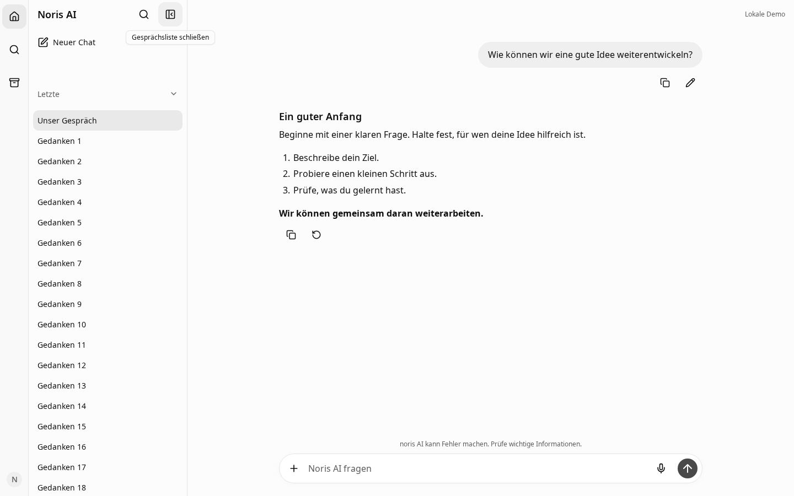

# Zentrierte Navigationsbuttons

## Bestätigte Ursache

Nuxt UI 4.11.3 rendert das Icon eines `UButton` direkt als
`span[data-slot="leadingIcon"].iconify`. Die sichtbare SVG-Form liegt in einer
CSS-Maske. Die bisherigen Sidebar- und Headerbuttons hatten durch
`touch-control` zwar mindestens 44 × 44 px, behielten aber das Nuxt-Padding
und die links beginnende Flex-Anordnung. Die Iconmitte lag dadurch **6 px links**
von der Buttonmitte. Eine bereits vorhandene Rail-Regel korrigierte nur die Rail.

Playwright hat diese Werte vor der Änderung im echten Browser gemessen:

| Button | Button | Icon | ΔX vorher | ΔY vorher | ΔX / ΔY nachher |
| --- | --- | --- | --- | --- | --- |
| Sidebar-Suche | 44 × 44 | 20 × 20 | −6 px | 0 px | 0 / 0 px |
| Sidebar schließen | 44 × 44 | 20 × 20 | −6 px | 0 px | 0 / 0 px |
| Neuer Chat im geschlossenen Hauptbereich | 44 × 44 | 20 × 20 | −6 px | 0 px | 0 / 0 px |
| Rail-Suche / Sidebar öffnen | 44 × 44 | 20 × 20 | 0 px | 0 px | 0 / 0 px |

## Änderung

`main.css` definiert die gemeinsamen Tokens für 44 px Zielgröße, 20 px Icon und
12 px Radius. `.noris-nav-icon-button` setzt Flex-Zentrierung, Padding und Gap
auf null und entfernt Abstände am tatsächlichen Icon-Slot. Hover, gedrückter
Zustand, aktuelle Seite und Tastaturfokus ändern ausschließlich die Darstellung.
Die spätere Profil-Radiusregel nimmt diese Klasse ausdrücklich aus.

Die Klasse wird in `ChatRail.vue`, `ChatSidebar.vue`, `ChatHeader.vue` und am
kompakten `ProfileMenu.vue` verwendet. Andere UButtons behalten ihre Geometrie.
`ChatWorkspace.vue` wurde geprüft und bleibt unverändert: Bei geschlossener
Desktop-Sidebar bleibt die Rail sichtbar, ihr oberer Button öffnet die Sidebar,
und genau ein Neuer-Chat-Button steht links im Hauptbereich. Der Desktop-Header
enthält keinen sichtbaren zusätzlichen Toggle. Mobil bleibt der bestehende
Header mit Drawer erhalten; eine mobile ChatGPT-Referenz liegt nicht vor.

## Browserprüfung

`frontend/tests/e2e/navigation-icon-alignment.spec.ts` prüft 1701 × 863,
1440 × 900 und 390 × 844, jeweils Light und Dark, DPR 1 und Visual-Viewport-Skala 1.
Die sechs Fälle prüfen offene und geschlossene Sidebar sowie Default, Hover,
Mouse-down/Active, tatsächlichen Focus-visible und native Disabled-Zustände.

**170 Einzelmessungen:** maximale DOM-Mittenabweichung **0 px**. Die Button- und
Icon-DOMRects bleiben in allen fünf Zuständen identisch. Zusätzlich rasterisiert
der Test die tatsächlich verwendete SVG-Maske mit achtfacher Auflösung und misst
deren bemalte Kontur inklusive Strichstärke. Die größte Abweichung ihrer
Begrenzungsmitte beträgt **0,4375 px** beim Square-Pen-Icon; die sichtbaren Formen
wurden auch in den Screenshots geprüft. Es gibt keine individuellen Transforms.

Die sechs Browserfälle bestehen. Sie prüfen außerdem Sidebar-Persistenz nach
Reload, Öffnen/Schließen, genau einen sichtbaren Neuer-Chat-Button, Fokus im
neuen Composer und Suche mit Escape/Fokus-Rückgabe. Die übrigen bestehenden
Sidebar-/Suchtests werden im Such-PR zusätzlich ausgeführt.

Lokale Ausführung: Playwright 1.64.0 mit vorhandenem Chromium Revision 1243
statt des nicht installierten gepinnten Browsers 1248. Browser-User-Agent,
Viewport, DPR und Skala stehen pro Fall in den JSON-Dateien. Der Browserdownload
scheiterte am temporären Speicherlimit; Browser-Temporärdateien wurden deshalb
ins ignorierte Testverzeichnis verlegt. Es wurde keine Testtoleranz vergrößert.

```sh
pnpm --dir frontend exec playwright test navigation-icon-alignment.spec.ts --project=desktop --workers=1
python3 scripts/compare-navigation-search.py navigation-icons
```

Für eine erneute Vorher-Aufnahme muss zuerst der ursprüngliche Quellstand gebaut
werden; `NORIS_UI_CAPTURE_PHASE=before` aktiviert ausschließlich den Messlauf.

## Visuelle Belege

Alle veröffentlichten Aufnahmen enthalten synthetische Testdaten. Die privaten
Downloads wurden angesehen und nicht ins Repository kopiert.

| Vorher, 1440 Light | Nachher, 1440 Light | Pixel-Differenz |
| --- | --- | --- |
|  |  |  |

Alle Viewports und Themes: [Vorher](evidence/before/), [Nachher](evidence/after/),
[Diffs](evidence/diff/). Die JSON-Dateien enthalten alle DOMRects und SVG-Messungen;
[pixel-comparison.json](pixel-comparison.json) erfasst die geänderten Pixel bei
identischen Aufnahmebedingungen. Die Referenz-PNGs allein beweisen keine
ursprünglichen CSS-Viewports oder DPR-Werte; daraus wird keine Pixelgleichheit
mit dem privaten ChatGPT-Browser behauptet.
