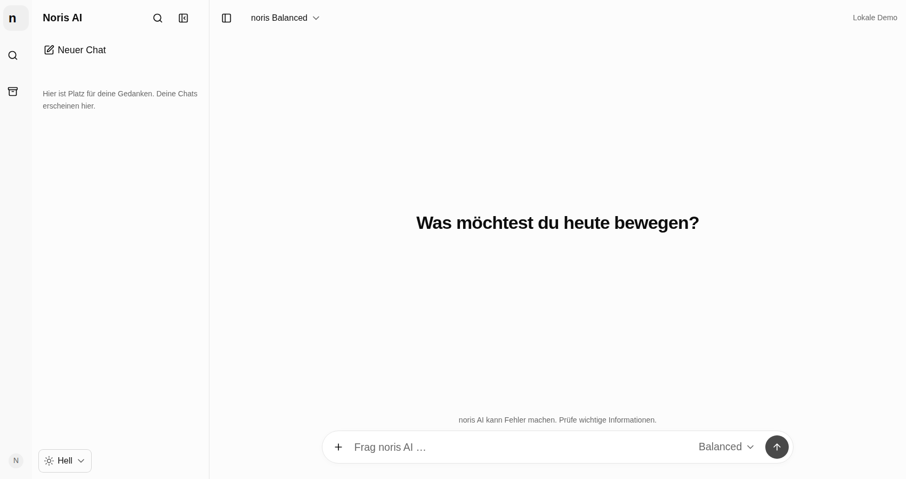
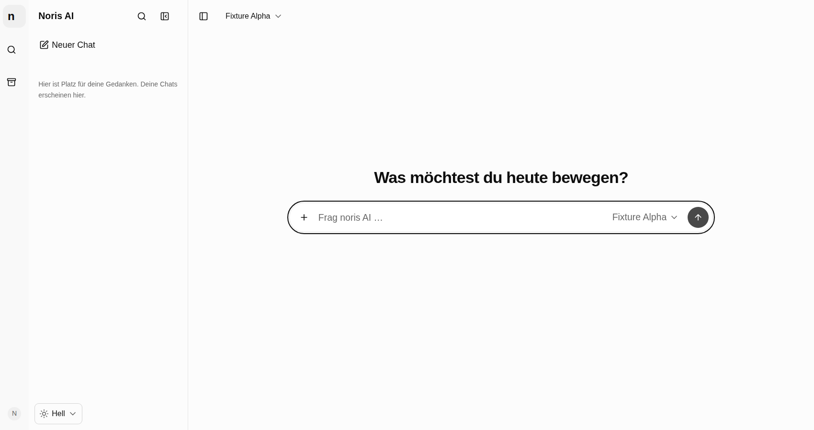
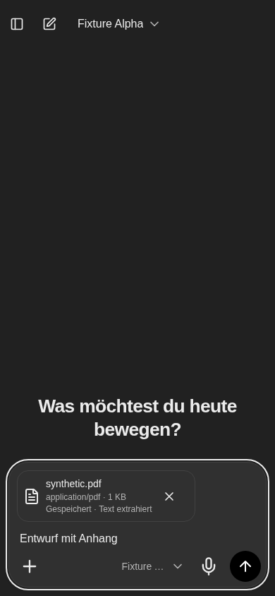

# Neuer Chat: visuelle Abnahme

Die Screenshots enthalten ausschließlich synthetische Inhalte. Die lokale private
ChatGPT-Referenz wurde betrachtet und bleibt außerhalb des Repositorys.

`before/`: Hauptbranch vor Änderungen, leer und mit Textentwurf (16 Screenshots).
`after/`: Produktionsbuild mit lokalem FastAPI-/PostgreSQL-/WebSocket-Backend,
neun Zustände × vier Auflösungen × zwei Farbschemata (72 Screenshots).
Die Chatzustände werden von `frontend/tests/websocket/new-chat.spec.ts` erzeugt.
Senden und Streaming werden für reproduzierbare Aufnahmen kurz gehalten.

## Vorher / Nachher

| Auflösung | Modus | Vorher leer | Nachher leer | Vorher Entwurf | Nachher Entwurf |
|---|---|---|---|---|---|
| 1700 × 900 | light | [Bild](before/1700-light-empty.png) | [Bild](after/1700-light-empty.png) | [Bild](before/1700-light-draft.png) | [Bild](after/1700-light-draft.png) |
| 1700 × 900 | dark | [Bild](before/1700-dark-empty.png) | [Bild](after/1700-dark-empty.png) | [Bild](before/1700-dark-draft.png) | [Bild](after/1700-dark-draft.png) |
| 1440 × 900 | light | [Bild](before/1440-light-empty.png) | [Bild](after/1440-light-empty.png) | [Bild](before/1440-light-draft.png) | [Bild](after/1440-light-draft.png) |
| 1440 × 900 | dark | [Bild](before/1440-dark-empty.png) | [Bild](after/1440-dark-empty.png) | [Bild](before/1440-dark-draft.png) | [Bild](after/1440-dark-draft.png) |
| 768 × 1024 | light | [Bild](before/768-light-empty.png) | [Bild](after/768-light-empty.png) | [Bild](before/768-light-draft.png) | [Bild](after/768-light-draft.png) |
| 768 × 1024 | dark | [Bild](before/768-dark-empty.png) | [Bild](after/768-dark-empty.png) | [Bild](before/768-dark-draft.png) | [Bild](after/768-dark-draft.png) |
| 390 × 844 | light | [Bild](before/390-light-empty.png) | [Bild](after/390-light-empty.png) | [Bild](before/390-light-draft.png) | [Bild](after/390-light-draft.png) |
| 390 × 844 | dark | [Bild](before/390-dark-empty.png) | [Bild](after/390-dark-empty.png) | [Bild](before/390-dark-draft.png) | [Bild](after/390-dark-draft.png) |

## Alle Zustände

| Auflösung / Modus | Leer | Textentwurf | Senden | Antwort läuft | Antwort fertig | Sidebar-Titel | Aktiver Chat | Bild | PDF |
|---|---|---|---|---|---|---|---|---|---|
| 1700 × 900 / light | [Bild](after/1700-light-empty.png) | [Bild](after/1700-light-draft.png) | [Bild](after/1700-light-sending.png) | [Bild](after/1700-light-streaming.png) | [Bild](after/1700-light-completed.png) | [Bild](after/1700-light-sidebar-title.png) | [Bild](after/1700-light-active.png) | [Bild](after/1700-light-image.png) | [Bild](after/1700-light-pdf.png) |
| 1700 × 900 / dark | [Bild](after/1700-dark-empty.png) | [Bild](after/1700-dark-draft.png) | [Bild](after/1700-dark-sending.png) | [Bild](after/1700-dark-streaming.png) | [Bild](after/1700-dark-completed.png) | [Bild](after/1700-dark-sidebar-title.png) | [Bild](after/1700-dark-active.png) | [Bild](after/1700-dark-image.png) | [Bild](after/1700-dark-pdf.png) |
| 1440 × 900 / light | [Bild](after/1440-light-empty.png) | [Bild](after/1440-light-draft.png) | [Bild](after/1440-light-sending.png) | [Bild](after/1440-light-streaming.png) | [Bild](after/1440-light-completed.png) | [Bild](after/1440-light-sidebar-title.png) | [Bild](after/1440-light-active.png) | [Bild](after/1440-light-image.png) | [Bild](after/1440-light-pdf.png) |
| 1440 × 900 / dark | [Bild](after/1440-dark-empty.png) | [Bild](after/1440-dark-draft.png) | [Bild](after/1440-dark-sending.png) | [Bild](after/1440-dark-streaming.png) | [Bild](after/1440-dark-completed.png) | [Bild](after/1440-dark-sidebar-title.png) | [Bild](after/1440-dark-active.png) | [Bild](after/1440-dark-image.png) | [Bild](after/1440-dark-pdf.png) |
| 768 × 1024 / light | [Bild](after/768-light-empty.png) | [Bild](after/768-light-draft.png) | [Bild](after/768-light-sending.png) | [Bild](after/768-light-streaming.png) | [Bild](after/768-light-completed.png) | [Bild](after/768-light-sidebar-title.png) | [Bild](after/768-light-active.png) | [Bild](after/768-light-image.png) | [Bild](after/768-light-pdf.png) |
| 768 × 1024 / dark | [Bild](after/768-dark-empty.png) | [Bild](after/768-dark-draft.png) | [Bild](after/768-dark-sending.png) | [Bild](after/768-dark-streaming.png) | [Bild](after/768-dark-completed.png) | [Bild](after/768-dark-sidebar-title.png) | [Bild](after/768-dark-active.png) | [Bild](after/768-dark-image.png) | [Bild](after/768-dark-pdf.png) |
| 390 × 844 / light | [Bild](after/390-light-empty.png) | [Bild](after/390-light-draft.png) | [Bild](after/390-light-sending.png) | [Bild](after/390-light-streaming.png) | [Bild](after/390-light-completed.png) | [Bild](after/390-light-sidebar-title.png) | [Bild](after/390-light-active.png) | [Bild](after/390-light-image.png) | [Bild](after/390-light-pdf.png) |
| 390 × 844 / dark | [Bild](after/390-dark-empty.png) | [Bild](after/390-dark-draft.png) | [Bild](after/390-dark-sending.png) | [Bild](after/390-dark-streaming.png) | [Bild](after/390-dark-completed.png) | [Bild](after/390-dark-sidebar-title.png) | [Bild](after/390-dark-active.png) | [Bild](after/390-dark-image.png) | [Bild](after/390-dark-pdf.png) |

## Desktopvergleich

Vorher:

Nachher:

## Mobil mit Anhang

Eine reale Softwaretastatur lässt sich in Desktop-Playwright nicht vollständig
abbilden. Die betroffenen Tests emulieren Touch und die vorhandenen
`visualViewport`-Resize-/Offset-Ereignisse einschließlich Landscape.
