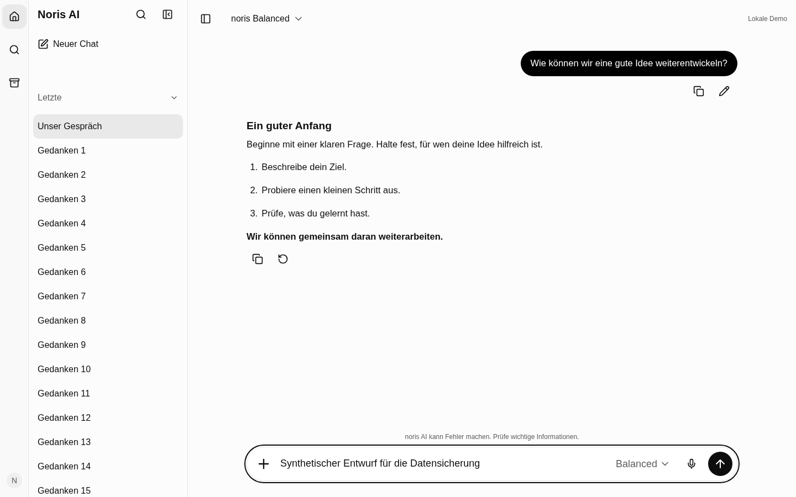
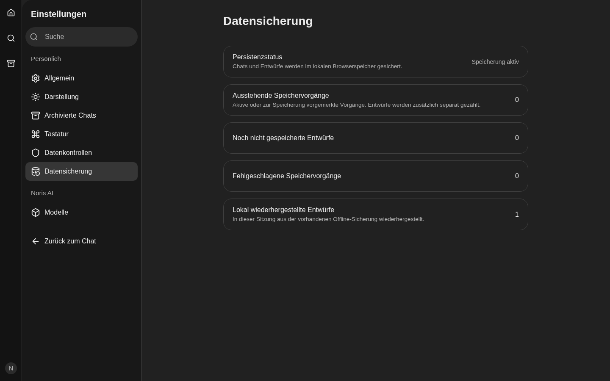

# Darstellung und Datensicherung ausschließlich in den Einstellungen

Ursprünglicher Ausgangspunkt: `main` / `b48ce9331ff9a1e89f40f5e5a936e25471fc42a2`.
Nach dem Benutzer-Merge von PR #88 wurde `main` /
`8d6b06f6f552238898109f0bb1d634340c142f9d` integriert. Die dort korrigierte
Shell-Geometrie und die gleich breite Hoverfläche von „Letzte“ bleiben erhalten.
Der Konflikt im Sidebar-Layout wurde mit dem gemergten Header-Padding und dem
ausgeblendeten Desktop-Footer dieser Änderung aufgelöst.
Isolierter Branch `fix/settings-only-controls-clean-chat`; keine Übernahme der
unfertigen Modell-/Suchänderungen aus der separaten Fidelity-Runde 2.

## Bestandsaufnahme

- `frontend/app/components/chat/ChatSidebar.vue`: Der Footer enthält eine eigene
  `UColorModeSelect`-Instanz. Die Settingsroute `appearance.vue` verwendet bereits
  dasselbe Nuxt-Color-Mode-System und dessen bestehende Persistenz.
- `frontend/app/components/chat/ChatWorkspace.vue:242`: Das globale `details`
  unter dem Composer zeigt `chat.storageWarning` und `retryPersistence`.
- `useChat.ts:314`: Lokale Snapshotfehler, ungültige Backups und Änderungen durch
  andere Tabs erzeugen diesen Status und bereits zentrale Warn-/Fehlertoasts.
  Ungültige bzw. extern geänderte Sicherungen werden bewusst nicht überschrieben.
- `useChatBackend.ts:30`: Derselbe Anzeigestatus bündelt echte Speicherfehler,
  Importergebnisse und die informative Wiederherstellung eines Offlineentwurfs.
  Fehlgeschlagene Operationen und ihre Retry-Funktionen existieren bereits in
  `failedPersistence`; ausstehende Entwürfe in `pendingDrafts`.
- `useChatBackend.ts:467`: Ein wiederhergestellter Offlineentwurf erzeugt bisher
  zusätzlich einen Info-Toast. Diese rein informative Sicherungsmeldung wird
  künftig nur auf der Datensicherungsseite angezeigt. Kritische Fehlertoasts
  und ihre Aktionen bleiben erhalten.

## Umsetzung

Die Sidebar enthält keine `UColorModeSelect`-Instanz mehr. Ihr gesamter Footer
ist auf Desktop verborgen, einschließlich des bisherigen Paddings. Die mobilen
Archiv-, Settings- und Profilaktionen bleiben im Drawer erhalten; das vorhandene
Profilmenü in der Rail bleibt unverändert.

Die bisherige Darstellungseinstellung ist als `SettingsAppearance.vue`
ausgelagert und wird unter **Profil → Einstellungen → Allgemein → Darstellung**
angezeigt. Die vorhandene direkte Route `/settings/appearance` bleibt nutzbar.
Beide Ansichten verwenden dieselbe Komponente, `useColorMode` und den bestehenden
Schlüssel `noris-ai-theme`. Es gibt keinen zusätzlichen Präferenzspeicher.

Das globale Sicherungs-`details` unter dem Composer entfällt vollständig. Der
vorhandene Hinweis „noris AI kann Fehler machen. Prüfe wichtige Informationen.“
und das Composer-Docking bleiben erhalten. Die Sicherungsansicht wird über die
bestehende Settingsregistrierung, Settingssuche und responsive Navigation als
**Datensicherung** eingebunden. Sie verwendet `SettingsRow`, `UButton`,
`useAppLocale` und den bestehenden `useWorkspace`-Chatzustand.

## Datensicherheit und Statusquelle

`PersistenceStatus` ist eine berechnete Ansicht vorhandener Zustände. Die
bestehende Fehlermenge und die Liste ausstehender Serverentwürfe sind für diese
Anzeige reaktiv; aktive Speicherversuche werden innerhalb des bisherigen
`persist`-Wrappers gezählt. Lokal wird der bereits bestehende debouncte
Snapshot-Schreibvorgang angezeigt. Es gibt keine zweite Warteschlange,
keinen neuen Speicherort und keine Änderung des Snapshotformats.

Die Seite zeigt Speicherart, Bereitschaft/Blockierung, ausstehende Vorgänge und
Entwürfe, fehlgeschlagene Vorgänge, wiederhergestellte Entwürfe, den aktuellen
Hinweis und den letzten bekannten Speicherfehler. Wiederherstellungen und der
letzte Fehler werden für die aktuelle Workspace-Sitzung festgehalten. Es wird
keine zusätzliche Fehlerhistorie persistiert und kein Entwurfsinhalt auf der
Statusseite ausgegeben.

Die Informationsmeldung über einen wiederhergestellten Offlineentwurf erscheint
nur noch in den Einstellungen. Echte Schreibfehler, ungültige lokale Sicherungen
und externe Tabänderungen erzeugen weiterhin die vorhandenen zentralen
Fehler-/Warntoasts. Ihre Recovery-Aktionen bleiben erhalten. Auf der
Datensicherungsseite führt „Erneut speichern“ direkt dieselbe vorhandene
`retryPersistence`-Funktion aus. Geschützte Sicherungen werden weiterhin nicht
überschrieben. Die bisherige Neuladen-Aktion bei Tabkonflikten bleibt
auch nach Ablauf des Warn-Toasts dauerhaft auf der Datensicherungsseite
erreichbar. Ein eigener Statuswert unterscheidet diese Aktion von einem
unlesbaren lokalen Backup; letzteres erhält keine neue Neuladen-Empfehlung.
Erfolgreiche Wiederholung löscht den aktiven Fehlerstatus; der
letzte bekannte Fehler bleibt bis zum Ende der Sitzung nachvollziehbar.

## Geänderte Dateien

- Chatdarstellung: `ChatSidebar.vue`, `ChatWorkspace.vue`.
- Bestehende Statusquellen: `useChat.ts`, `useChatBackend.ts`,
  `lib/chat/persistence.ts`.
- Settings: `SettingsAppearance.vue`, `pages/settings/general.vue`,
  `pages/settings/appearance.vue`, `pages/settings/backup.vue`,
  `lib/settings/registry.ts`, `lib/settings/messages.ts`.
- `nuxt.config.ts`: ausschließlich das vorhandene Lucide-Icon `database-backup`
  in die lokale Iconliste aufgenommen.
- Tests: `chat-shell.spec.ts`, `settings-only.spec.ts`,
  `websocket/settings-backup.spec.ts`, `notifications/fixtures.ts`,
  `chat-persistence.spec.ts`, `notification-recovery.spec.ts`,
  `settings-registry.spec.ts` und zugehörige synthetische Baselines.

Backend, APIs, Abhängigkeiten, Modellwahl, Reasoning, Uploads, Streaming und
Conversation-Verwaltung werden durch diese Änderung nicht angepasst. Die
separat angefragte Hoverkorrektur für „Letzte“ ist bereits über Fidelity-PR #88
in `main` enthalten. Die fachlichen Änderungen dieses PRs bleiben auf
Darstellungseinstellung, Datensicherungsanzeige und deren Recovery beschränkt.

## Visuelle Nachweise

Im [Bildordner](settings-only/) liegen 16 synthetische Noris-Aufnahmen: offener
und geschlossener Chat, Darstellung unter Allgemein und Datensicherung; jeweils
Hell/Dunkel bei 1440×900 und 390×844 CSS-Pixeln. Der mobile Pixel-7-Test verwendet
seinen vorhandenen DPR 2,625 (1024×2216 Bildpixel bei 390×844 CSS-Pixeln);
Desktop DPR 1. Die Playwright-Baselines selbst verwenden CSS-Pixel.
Keine privaten Vorlagen wurden
übernommen. Die Aufnahmen entstehen nach der Integration von `main` gegen den
kombinierten Produktionsbuild; die erste Version bleibt im Commit
`5c540738f3e179aee9167d3d3300cf6be1677392` nachvollziehbar.

| Desktop Hell | Desktop Dunkel |
| --- | --- |
|  |  |

[Vorher](settings-only/comparison/before.png),
[Nachher](settings-only/comparison/after.png) und
[Differenz](settings-only/comparison/diff.png) vergleichen die synthetische
Noris-Ansicht `workspace-dark` bei 1280×720. Sie zeigen den entfernten Footer
und die dadurch zusätzlich sichtbaren Chatzeilen. Dies ist kein Pixelvergleich
mit der privaten ChatGPT-Referenz. Testtoleranzen bleiben unverändert.

## Prüfungen vor der Integration von PR #88

| Prüfung | Ergebnis |
| --- | --- |
| ESLint | erfolgreich |
| Vue-/Nuxt-App-, Test- und Tool-Typecheck | erfolgreich |
| Produktionsbuild | erfolgreich |
| API-Drift-Prüfung | erfolgreich; API unverändert |
| Vollständige Frontend-Units | 575 bestanden, 43 Dateien |
| Neue Settings-Browserfälle | 6 bestanden; vier Szenenfälle in Hell/Dunkel plus zwei Tabkonflikt-/Toastablauf-/Tastatur-Recovery-Fälle |
| Neue serverseitige Recovery-Browserfälle | 4 bestanden; Desktop/Mobile |

Die Browserfälle prüfen den Weg über das Profilmenü, fehlende Chatcontrols und
fehlenden Desktop-Footer, alle drei Darstellungsmodi samt Reload und System-
Farbwechsel, erhaltene lokale Entwürfe und Wiederherstellung, kritische
Speicherfehler, ausstehende/fehlgeschlagene Entwürfe und erfolgreiche Recovery
des neuesten Entwurfs. Die Unit-Tests prüfen zusätzlich lokalen Quotenfehler,
Wiederholung und Schutz bei Tabänderungen. Die vollständige Mock-Suite vor der zusätzlichen Tab-Recovery bestand
mit 332 erfolgreichen und 45 projektspezifisch ausgelassenen Fällen. Der
vollständige WebSocket-Lauf bestand mit 206 erfolgreichen und 30 ausgelassenen
Fällen. Ein unabhängiger Bildvergleich mit 24 Fällen war ohne Snapshot-Updates
erfolgreich. Nach Ergänzung der Tab-Recovery bestand der erneute Vergleich gegen den
finalen Build mit **26 Fällen ohne Snapshot-Updates**. Alle 16 aktualisierten
bestehenden Baselines und die 16 neuen Settings-Baselines werden dabei geprüft.
Die Bereiche mit Pixeldifferenzen sind in
[updated-goldens.json](settings-only/comparison/updated-goldens.json) dokumentiert.
Der finale Produktionsbuild, ESLint, App-/Test-Typecheck und die vollständigen
575 Unit-Tests sind ebenfalls erfolgreich. Die vier serverseitigen Recovery-Fälle bestanden auch gegen den finalen
Build erneut, ohne Snapshot-Updates.

Der erste SSE-Gesamtlauf ergab 80 erfolgreiche, drei fehlgeschlagene und
13 ausgelassene Fälle. Die vollständige betroffene Titeldatei bestand in der
isolierten Wiederholung mit 16 Fällen. Der erste Gesamtlauf wird deshalb
nicht nachträglich als erfolgreich ausgewiesen. Die vollständige CI führt
alle SSE-Fälle ohne Snapshot-Updates erneut aus.

## Validierung nach Integration des gemergten main

Erneut gegen `main` / `8d6b06f6f552238898109f0bb1d634340c142f9d`
plus dieser Settings-Änderung ausgeführt:

| Prüfung | Tatsächliches Ergebnis |
| --- | --- |
| ESLint, App-/Test-/Tool-Typechecks | erfolgreich |
| Produktionsbuild und API-Drift | erfolgreich |
| Vollständige Frontend-Units | 577 bestanden, 43 Dateien |
| Vollständige Mock-Browsersuite mit Bildaufnahme | 358 bestanden, 61 projektspezifisch ausgelassen |
| Unabhängiger Bild-/Recovery-Vergleich ohne Updates | 42 bestanden, 16 projektspezifisch ausgelassen |
| WebSocket-Upload, Stop und Settings-Recovery ohne Updates | 10 bestanden, sechs projektspezifisch ausgelassen |
| Tatsächliche Vorher-Aufnahme des main im separaten Worktree | ein Fall bestanden, keine Snapshot-Updates |

Die unabhängige Vergleichsauswahl deckt alle 16 neuen und alle 16 geänderten
bestehenden Baselines ab. Zusätzlich prüft sie Composer-Wachstum und Schrumpfen,
Sidebar-Collapse, die bestehende Keyboard-Auswahl und beide Themes. Die
Hovermessung für „Letzte“ bleibt bei **X = 60 px und Breite = 271 px** für
Abschnittsschaltfläche und Chatzeile; die Breitenabweichung beträgt **0 px**.
Die WebSocket-Auswahl enthält die sechs gemergten Upload-/Stop-Szenen und die
vier neuen serverseitigen Recovery-Fälle. Kein Testlimit wurde angehoben.

Die 16 Dokumentationsbilder wurden mit dem kombinierten Build neu aufgenommen.
`comparison/before.png` stammt aus einer tatsächlichen Browseraufnahme des
main-äquivalenten Builds im separaten Worktree, `after.png` aus demselben
synthetischen Test gegen den kombinierten Build. Die absolute RGB-Differenz
liegt im Rechteck `[64, 662, 186, 718]` (links, oben, rechts, unten): entfernter
Darstellungsfooter und zusätzlich sichtbare Chatzeilen. Composer und Hauptinhalt
ändern sich in diesem Vergleich nicht. Die historischen Evidenzdateien anderer
Features bleiben unverändert; neue Noris-Baselines ersetzen keine privaten
ChatGPT-Referenzbilder.

Die [PR-Ansicht](https://github.com/p3t3r67x0/noris-ai-chat/pull/89) enthält die
vollständigen aktuellen CI-Läufe. Die lokalen Läufe vor der main-Integration
stehen oben und in `TEST-RESULTS.json` ausdrücklich getrennt vom kombinierten Stand.

## Umgebung und Grenzen

Ein erster paralleler lokaler Gesamtlauf wurde unter hoher Ressourcenlast
abgebrochen; protokolliert wurden PostgreSQL-Lock-Timeouts, Build-Exit 137
und Mock-Exit 143. Der genaue Auslöser der Prozessbeendigungen ist nicht
vollständig belegt. Die neuen gezielten Fälle waren bereits vorher
erfolgreich. Die Wiederholung verwendet getrennte Testdatenbanken, weniger
gleichzeitige Browser und keinen parallelen Build. Diese abgebrochenen bzw.
fehlgeschlagenen Läufe zählen nicht als bestanden. Ein temporäres `/tmp`-
Quota-Problem wurde durch einen eigenen temporären Ordner unter `test-results`
umgangen. Fixture-Startversuche mit einem belegten Testport und mit einem
nicht als Testdatenbank erkennbaren Namen wurden vor Testbeginn beendet;
getrennte Ports und passende Namen beheben beide Startprobleme.
Vorhandene optionale Volar-Plugin- und Buildhinweise sind unverändert.

Die vollständige CI validiert zusätzlich Backend-, Datenbank-, Compose- und
Transportregressionen. Reale mobile Tastaturen und Screenreader wurden nicht
manuell auf physischen Geräten geprüft.
